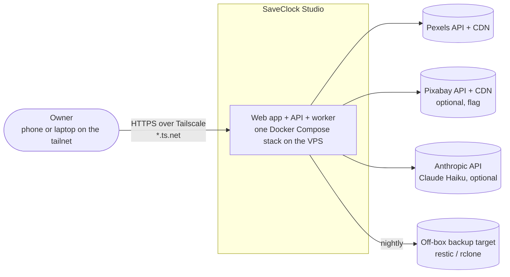
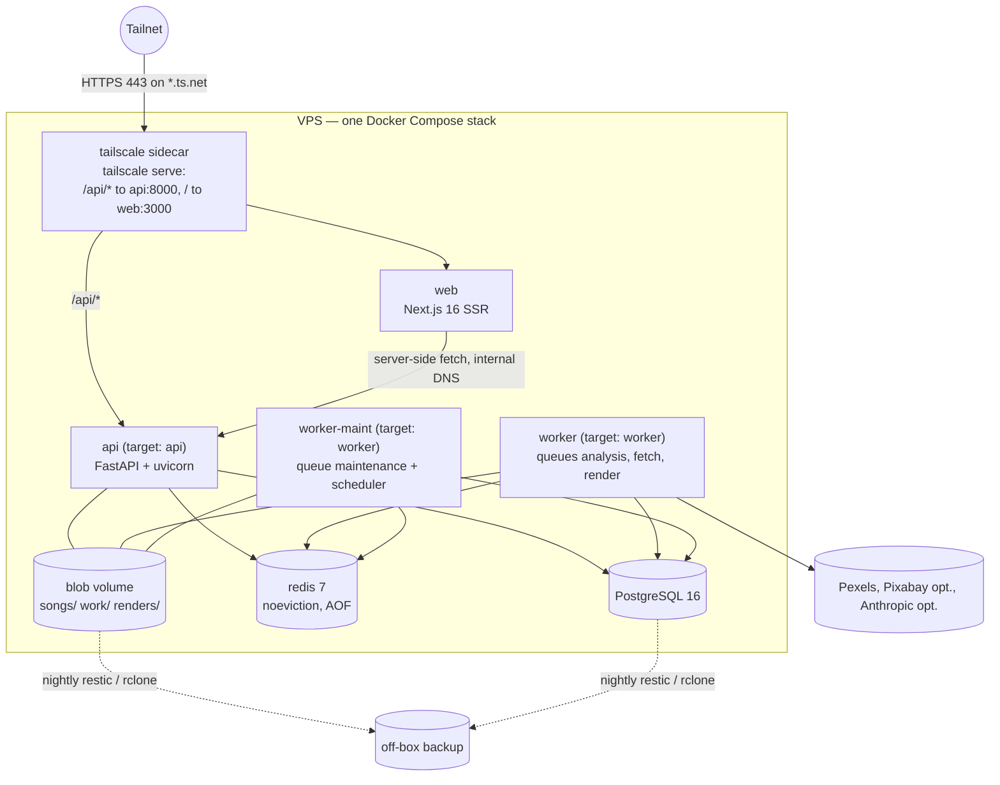
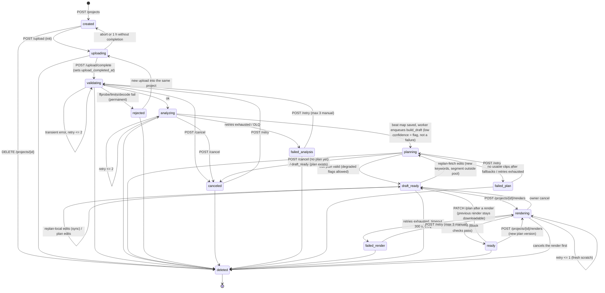
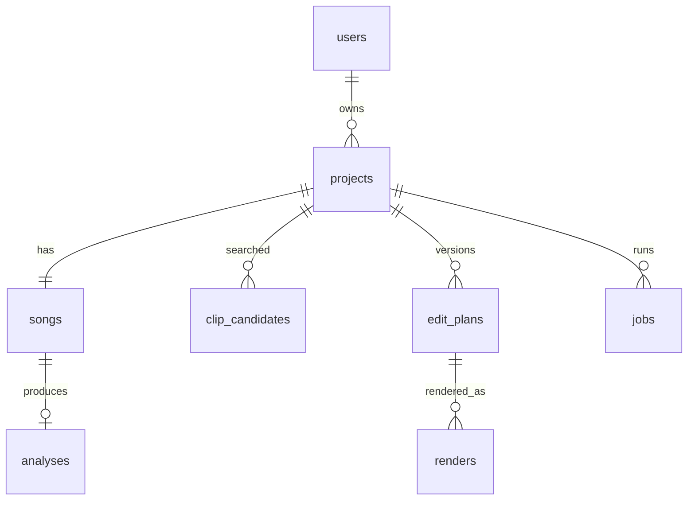
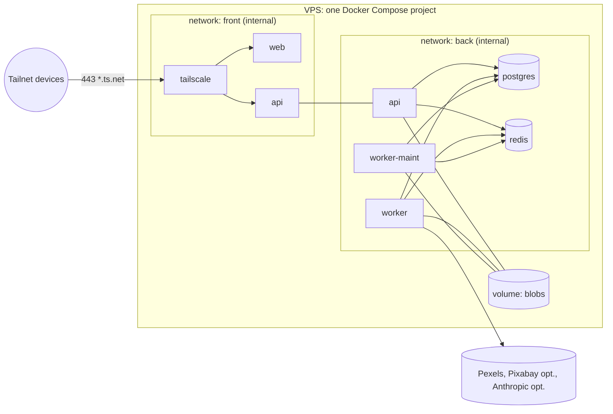

# SaveClock Studio — Architecture

Status: DRAFT · **Rev 3 — Personal edition (public-ready)** · Date: 2026-11-08 · Source of truth for decisions: `DECISIONS.md` Rev 3 (this doc must agree; deviations are in §17 Open questions only).
Siblings (by filename): `PRD.md`, `ROADMAP.md`, `CHECKLIST.md`, `SECURITY.md`, `QUALITY.md`, `DESIGN.md`, `UX-SPEC.md`, `STANDARDS.md`, `adr/0001..0013`.
The full public-edition design (Rev 2.2: accounts, billing, DMCA, worker VM, R2) is archived unchanged in `archive/public-edition-rev2.2/ARCHITECTURE.md` and is the starting point for **Phase P**.

## Rev 3 changelog (2026-11-08)

- **Rev 3.3 (2026-11-08, DECISIONS §8d):** single-user simplifications. Endpoints 33 -> **27**, tables 9 -> **8**. One streamed `POST /projects/{id}/song` replaces the five chunked-upload endpoints; signed file tokens and `GET /files/{token}` removed (the API serves files directly, path containment kept; `FILES_SIGNING_KEY`, `FILE_TOKEN_TTL_S`, `UPLOAD_PART_MB` gone); `op_id` and every `Idempotency-Key` removed (plan `version` + `base_version` stay; renders dedupe by `job_hash`); `exports` folded into `renders` (`mode_a_key`, `mode_a_state`); `GET /plans/{version}` folded into `GET /plan?version=`; disk-usage, key-status and stock endpoints collapse into `GET/PUT /settings` (+ `POST /housekeeping/run`); preview media gets `GET /projects/{id}/preview/{name}`. Old numbers #1-#33 are retired; the table below is the only numbering.
- **Rev 3.2 (2026-11-08, DECISIONS §8c):** `worker-maint` is a canonical service (OQ-22 resolved); the owner row is seeded by the baseline Alembic data migration (fixed UUID `00000000-0000-4000-8000-000000000001`, `OWNER_DISPLAY_NAME`; no manual step; OQ-24 resolved); Settings endpoints (superseded by Rev 3.3: now `GET/PUT /settings` + `POST /housekeeping/run`); Tailscale-serve verification test + Caddy fallback (§14, OQ-19).

Rescoped to **one user (the owner) on a private Tailscale network**, keeping the seams needed to go public later. Section numbers are unchanged from Rev 2.2 so existing citations still resolve; §24/§25 are repurposed (see below).

- **Topology (§2, §14):** one Docker Compose stack on the existing VPS — `web`, `api`, `worker` (+ `worker-maint`, same image), `postgres`, **one** `redis` (`noeviction`), `tailscale` sidecar publishing the app with `tailscale serve` on `https://<host>.<tailnet>.ts.net`. **No public Traefik route, no public port**, single origin (`/api/*` → FastAPI, rest → Next.js). Removed: worker VM, egress proxy, WireGuard tunnel, `redis-cache`, Traefik, Dokploy-specific wiring (Dokploy or plain `docker compose` both work). ADR-0012.
- **Storage (§9):** `BlobStore` adapter; `FilesystemBlobStore` on a local volume (`songs/`, `work/<project>/{raw,mezz,proxy}/`, `renders/`); `S3BlobStore` (R2) is a stub listed for Phase P. Upload is one streamed `POST` through the API; files are served by the API directly (Rev 3.3: no signed tokens; path containment kept). R2, presigned URLs, bucket CORS, lifecycle rules removed. ADR-0013.
- **Retention (§4, §9):** the 72 h clock, `expired` state, re-attach-by-hash and R2 lifecycle backstop are gone. Songs, plans and renders (incl. the Mode A file) stay until the owner deletes the project; the `maintenance` housekeeping job removes **intermediates** (raw, mezz, proxy, canonical audio) 7 days after the project's last use and everything for deleted projects. Disk usage is part of `GET /settings`.
- **Removed:** auth/sessions/CSRF/OAuth/Turnstile, email + outbox + Mailpit, Stripe/billing/tiers/quotas/usage counters, watermark, fingerprinting, DMCA tables/endpoints/CLI/admin tooling, age gate/consents, rate-limit table, idempotency store in Redis, feedback endpoint, data-export/delete-account endpoints. Edit plan loses `overlays.watermark_version` and `output.tier/scale_to` (never implemented; Phase P re-adds them as additive optional fields).
- **Kept (unchanged rules):** frame rule and all FFmpeg templates (§11), edit-plan schema + PATCH ops incl. `move_clip`/`nudge_cut` (§5), `verify_render`, Mode A/B export, SSE progress, timing budgets (targets/hard limits), FFmpeg hardening, `user_id` on owned tables + scoped repositories + a single seeded owner (`users` table).
- **State machine (§4):** 14 states (`expired` removed; `rejected` kept because it is the permanent file-validation failure, not only a policy state). **Endpoints (§7): 27** (was 56; 33 in Rev 3.2). **Data model (§6):** 8 tables kept (`exports` folded into `renders`), 15 moved to "Deferred to Phase P" (§24).
- **Stock/LLM (§0, §16):** Pexels is the default provider; Pixabay sits behind `PIXABAY_ENABLED` (off unless Pexels fails the G0 stock test). LLM is optional: without `ANTHROPIC_API_KEY` or with `LLM_ENABLED=false` the fallback keyword table is used.
- **Ops (§18–§23):** env-var inventory rewritten; local dev = compose without MinIO/Mailpit/Traefik; CI optional (`make check` is the gate); migrations reduced to 3 revisions before Phase P; backup = restic/rclone of a Postgres dump + the blob volume; capacity model for one user.

<details><summary>Earlier changelogs (Rev 2.2 / 2.1 / 2): see the archive copy</summary>

Rev 2.2: "Frantic" density stop removed (`set_density` −2..+1), minimum clip 0.5 s (15 frames), cuts on beat/downbeat only, `lead_frames` sign stated, budgets are targets with G0 hard limits 40/180/90/10 s. Rev 2.1: `move_clip`/`nudge_cut` ops restored, Mode A audio source = validated original. Rev 2: frame rule `floor(x+0.5)`, one automatic pipeline to `draft_ready`, per-project mezzanines, export flow (silent master + Mode A remux / Mode B), SSE, error catalogue, env inventory.
</details>

Legend: facts with a URL were checked on 2026-11-08; "(inference)" = engineering estimate, must be benchmarked in the spike; "(unverified)" = could not be confirmed from a primary source, re-check at scaffold time; **[spike]** = value fixed by Phase 0 measurements; **[Phase P]** = deferred public-edition item.

---

## 0. Version baseline (verified 2026-11-08, re-pin at scaffold time via lockfiles)

| Component | Decision (DECISIONS §3) | Found today | Note |
|---|---|---|---|
| Next.js | 16.x (App Router) | npm `next` latest **16.4.5** (fact-check F-39); Turbopack default, Node >= 20.9 | Pin exact `next` in `pnpm-lock.yaml`. Node: current LTS at scaffold (pin via `.nvmrc`). |
| FastAPI | current (0.16x) | PyPI **0.162.2** (F-40) | Pre-1.0: pin exact, upgrade deliberately. |
| Pydantic / SQLAlchemy / Alembic | v2 / 2.x / — | Pydantic **2.14.3**; SQLAlchemy **2.1.8** latest (needs Python >= 3.11), 2.0.x still the conservative line (F-41/F-42); Alembic version not verified | Choose 2.0.x vs 2.1.x at scaffold after reading the 2.1 migration notes. |
| Dramatiq | 2.x on Redis | PyPI **2.2.1** (F-43), Python >= 3.10 | **Defaults quoted from 1.x docs are unverified for 2.x.** Every limit/retry is set explicitly per actor (§8). Re-read the 2.x changelog before ADR-0003 is accepted. |
| FFmpeg | **>= 8.1; exact build pinned by the Phase 0 spike** | ffmpeg.org (F-12): **9.0.2** 2026-09-18, **8.1.3** 2026-09-21, 8.0.3, 7.1.5 | Spike runs golden + hardening tests on 8.1.x and 9.0.x, pins one build with checksum. Templates here are version-agnostic. |
| PySceneDetect | 0.7.x | PyPI **0.7.2** (F-44) | `scenedetect` Python API; check 0.6 → 0.7 changes at scaffold. BSD-3. |
| TransNetV2 | adopt when weights terms checked (T-0.6) | repo LICENSE = **MIT** (code) (F-37) | Weights terms check remains. |
| Beat This! | MIT, CPU | PyTorch >= 2.0 (+ `torchaudio`, F-06); `File2Beats(checkpoint_path="final0", device="cpu", dbn=False)`; `final0` ~78 MB (F-05); install from GitHub ([repo](https://github.com/CPJKU/beat_this)) | `dbn=True` needs **madmom** (NC weights) — **never enable** (F-07). Pin git commit SHA. Torch pinned well above 2.6 (CVE-2025-32434). |
| SigLIP 2 | Apache-2.0 | HF `google/siglip2-base-patch16-224` (MVP default); `transformers` >= 4.49 (F-35) | CPU speed not published; benchmark (§13). |
| Pexels API | **default provider** | `GET https://api.pexels.com/videos/search`, `Authorization: <key>`, `orientation=portrait`; `videos[].video_files[]`; 200 req/h, 20k/month default (F-18); params/fields **unverified** (F-20) | Verify with one live call in T-0.5. fps read from ffprobe. |
| Pixabay API | **optional, behind `PIXABAY_ENABLED`** (default off) | `GET https://pixabay.com/api/videos/?key=…&q=…`; 100 req/60 s; responses cached 24 h; no hotlinking (F-21/F-22) | Enabled only if Pexels fails the G0 stock test. No orientation filter assumed (F-23) → filter by `width/height`. |
| Claude Haiku | `claude-haiku-5-5`, **optional** | model exists (F-46); ~$0.10 / $0.50 per MTok in/out (F-47) | Cost per video ~$0.001–0.01; absent key = fallback keyword table (§16). |
| Tailscale | free Personal plan (non-commercial) | `tailscale serve` publishes a local service over HTTPS on `*.ts.net` (requires MagicDNS + HTTPS certificates enabled for the tailnet) | **(unverified today)** exact `tailscale serve` flags / `TS_SERVE_CONFIG` JSON shape, and whether `serve` identity headers (`Tailscale-User-Login`) are forwarded to path handlers; confirm at scaffold (T-1.x). Personal plan is non-commercial: going public (Phase P) ends the Tailscale-only access model anyway. |
| restic / rclone | backups (§23) | current stable at scaffold | Either; restic gives encryption + dedup out of the box. |

---

## 1. System context (C4 level 1)



Nobody but the owner reaches the app: there is no public DNS name, no public port. External services are called only by the worker (stock, LLM) and the backup job.

---

## 2. Containers (C4 level 2)

One host (the existing VPS), one Compose project. Only the `tailscale` container is attached to the tailnet; `web` and `api` publish **no host ports**.



### Component responsibilities

| Component | Owns | Must not |
|---|---|---|
| `tailscale` | tailnet identity of the node, HTTPS termination on `*.ts.net`, path routing `/api/*` → api, `/` → web | Expose any other port; run app code |
| `web` (Next.js) | UI, SSR shells, generated API client, SSE consumption, client-side preview player | Hold secrets other than public config; touch DB/Redis/volume directly |
| `api` (FastAPI, build target `api`) | Owner resolution (`current_user()` = seeded owner, after the Tailscale-origin check), validation, ownership-scoped repositories, streamed upload ingest, direct file serving (path-contained), enqueue, SSE stream, settings + housekeeping endpoints | Run FFmpeg/ML, parse media, call stock/LLM APIs (workers do), block > 1 s. Contains **no torch, no ffmpeg** |
| `worker` | validate/canonicalize (ffprobe + decode), Beat This, energy segmenter, waveform peaks, then **enqueues the draft job**; keywords (LLM or fallback), stock search/download, low-res sampling, PySceneDetect, SigLIP rank, top-K normalize, planner, preview proxies, lazy normalize; final render (silent master + cut list), verify, Mode A remux | Be reachable from outside; run with write access outside the blob volume and scratch |
| `worker-maint` | housekeeping sweeper, orphan-upload reaper (stale `incoming.bin.part`), stuck-job reaper, project purge (`delete`), disk-usage rollup | Parse media; business flows. Same image as `worker`, separate process so housekeeping never waits behind a render |
| PostgreSQL | System of record | Store audio/video blobs |
| redis | Dramatiq broker (ids only), SSE pub/sub, stock-search cache and provider token buckets (every non-broker key carries a TTL). `noeviction`, AOF `everysec` | Be the only copy of anything |
| blob volume | All media (§9), reached only through `BlobStore` | Be served directly by any web server |

Code layout: one Python package `services/api/src/saveclock` contains `api/` (routers), `services/`, `repositories/`, `adapters/` (pexels, pixabay, blobstore, llm, ffmpeg, scenedetect, siglip, beat_this), `domain/` (pure: beat grid, planner, edit-plan models), `workers/` (Dramatiq actors = thin wrappers around services). Two Docker build targets from the one codebase: `api` and `worker` (ADR-0011, the two-build-target part remains in force). Details in `STANDARDS.md`.

---

## 3. End-to-end pipeline

**Rule:** from upload-complete to `draft_ready` there is **one automatic pipeline driven by the worker chain**. The user (and the web client) never triggers planning; `analyze_song` enqueues `build_draft` itself with the project's defaults (30 s, auto-selected segment, default style, density 0, tempo octave as detected). The owner then edits (`PATCH /plan`), renders, and exports.

```mermaid
sequenceDiagram
  autonumber
  actor U as Owner
  participant W as web
  participant A as api
  participant Q as Redis (broker)
  participant WK as worker
  participant B as BlobStore (local volume)
  participant X as Pexels / LLM
  U->>W: choose song
  W->>A: POST /projects {title?, options?}
  A-->>W: 201 project (created)
  W->>A: POST /projects/{id}/song (one streamed body, Content-Length <= 100 MB, X-Filename)
  A->>B: stream to songs/{pid}/incoming.bin.part, running byte cap, rename to incoming.bin
  A->>A: status=validating; upload_completed_at=now
  A->>Q: enqueue analysis.validate
  Note over A,Q: from here on NO user action until draft_ready
  Q->>WK: validate: magic-byte sniff, ffprobe limits (forced -f), decode, SHA-256, canonical FLAC 48k
  WK->>B: songs/{pid}/source.<ext> (gated original), work/{pid}/canonical.flac; delete incoming file
  WK->>WK: analysis (budget 20 s): Beat This final0 + octave clamp + energy segmenter + waveform peaks
  WK->>A: analyses row saved, status=planning
  WK->>Q: enqueue fetch.build_draft(defaults)
  WK->>X: keywords (LLM JSON schema, or fallback table); search Pexels (portrait)
  WK->>X: download candidates (host allowlist, size caps) to work/{pid}/raw/
  WK->>WK: ffprobe + PySceneDetect + low-res frame sample; SigLIP 2 rank; no repeats
  WK->>WK: planner picks cuts; top-K (~1.3 x cuts) normalized to work/{pid}/mezz/ + proxies
  WK->>A: edit_plans v1 saved, status=draft_ready (SSE draft_ready)
  U->>W: preview (proxy clips vs audio proxy) and edit
  W->>A: PATCH /projects/{id}/plan {base_version, ops:[...]}
  A-->>W: 200 new plan (replan-local) or 202 (replan-fetch)
  U->>W: Render
  W->>A: POST /projects/{id}/renders {plan_version}
  A->>Q: enqueue render.render_master
  Q->>WK: one filter_complex pass -> silent master + cutlist.json/csv; verify
  WK->>B: renders/{rid}/master.mp4, cutlist.json, cutlist.csv
  WK->>A: status=ready (SSE render_ready)
  U->>W: Export screen: choose mode
  alt Mode A with song
    W->>A: POST /renders/{rid}/mode-a
    A->>Q: enqueue render.remux_with_song
    Q->>WK: stream-copy video + trimmed audio from source (copy if AAC-LC, else AAC-LC 48 kHz); verify A/V
    WK->>B: renders/{rid}/with_song.mp4 (renders.mode_a_key, mode_a_state=ready)
    A-->>W: SSE mode_a_ready
  else Mode B silent + beat map
    Note over W,A: Mode B needs no call: the silent master and cut lists are already on disk
  end
  W->>A: GET /renders/{rid}/download?kind=...
  A->>B: stream the file directly (Range supported, Content-Disposition: attachment)
  A-->>W: 200 file bytes
```

### Timing budgets (DECISIONS §6; all p95 on a 4-vCPU worker running 4 threads, **[spike]** until profiled)

The budgets below are the **targets**. The G0 **hard NO-GO limits** are analysis ≤ 40 s, draft ≤ 180 s, render ≤ 90 s, remux ≤ 10 s (QUALITY G0-13…G0-16). All numbers assume exclusive use of the 4 vCPU; contended-load p95 per stage and the worker-concurrency recommendation come from ROADMAP T-0.11 / QUALITY G0-27. On the one-box stack the API, Postgres and Redis share those CPUs, so the contended measurement is the number that counts.

Four separate metrics, each with its own span. Stage budgets are allocated so that they **sum to the target**; a stage exceeding its allocation is a logged warning, the span total is the target.

**(1) Analysis — upload-complete → `analyzing` done (4-min song): ≤ 20 s.**

| Stage | Queue | Budget |
|---|---|---|
| sniff + ffprobe + decode to canonical FLAC + SHA-256 | analysis | 4 s |
| Beat This (4 torch threads) + octave clamp + energy segmenter + waveform peaks | analysis | 14 s |
| persist + enqueue draft | analysis | 2 s |
| **Total** | | **20 s** |

**(2) Draft — upload-complete → `draft_ready` (analysis + fetch + rank + normalize): ≤ 120 s.**

| Stage | Queue | Budget |
|---|---|---|
| analysis (above) | analysis | 20 s |
| keywords (LLM, timeout 8 s then fallback table; instant when LLM is off) | fetch | 6 s |
| search + download (parallel 6, cached search) | fetch | 20 s |
| ffprobe + PySceneDetect (360 px) + low-res frame sample | fetch | 12 s |
| SigLIP 2 rank on sampled low-res frames | fetch | 12 s |
| top-K (~1.3 x cuts) normalize to mezzanine (semaphore 2 FFmpeg) | fetch | 35 s |
| planner + schema validate + preview proxies + persist | fetch | 10 s |
| queue hand-off slack | | 5 s |
| **Total** | | **120 s** |

**(3) Render — `POST /projects/{id}/renders` → silent master `ready` (30 s, 1080p): ≤ 60 s.**

| Stage | Budget |
|---|---|
| stage mezzanines to scratch (local copy; rehydrate any missing mezzanine first, see §4 Rules) | 3 s |
| single-pass `filter_complex` render (veryfast, `-threads 4`) | 40 s |
| verify (frame count, duration, cut positions) | 10 s |
| publish master + cut list to `renders/` | 2 s |
| slack | 5 s |
| **Total** | **60 s** |

A render that has to rehydrate evicted mezzanines (project idle > 7 days) is outside this span; it shows "Restoring clips…" and reuses the draft-stage fetch/normalize code.

**(4) Mode A remux — `POST /renders/{id}/mode-a` → `mode_a_state=ready`: ≤ 5 s.** read master 1 s, video stream copy + audio trimmed once from `source` (stream copy if AAC-LC, else one AAC-LC 48 kHz encode) 2 s, A/V offset check 1 s, publish 1 s. No video re-encode.

Swapping to a candidate whose mezzanine does not exist yet (ranked on low-res only) triggers a **lazy normalize** (~3–5 s, `clip_ready` event) — not part of the budgets above. p50 is recorded in `jobs.timings` and reported by the spike.

---

## 4. Project / job state machine

`projects.status` (lowercase text + CHECK; the wire format is the same) holds the coarse state; every long step is a `jobs` row (stage, attempt, error) linked to it. **Fourteen states:** `created, uploading, validating, analyzing, planning, draft_ready, rendering, ready, failed_analysis, failed_plan, failed_render, rejected, canceled, deleted`. Transitions are performed only by services (`ProjectStateService.transition(project, from, to, reason)`) using `UPDATE … WHERE status = :from` (optimistic; 0 rows = lost race).

**Removed vs Rev 2.2:** `expired` (there is no forced expiry; the 72 h clock, re-attach and `DELETE /media` are gone). **`rejected` is kept:** it is the permanent *file-validation* failure (ffprobe limits, decode failure, unsupported codec), not a policy/fingerprint state; the owner starts a new upload (`rejected → uploading`). Fingerprinting no longer exists.



`deleted` is terminal. `DELETE /projects/{id}` sets it, cancels active jobs and enqueues `maintenance.purge_project`, which removes every blob of the project (songs, work, renders) and then hard-deletes the project's rows (cascade). A project stuck in `deleted` with blobs left is retried by the housekeeping sweeper.

### Rules

- **Owner-controlled retention (replaces the 72 h clock).** Songs (`songs/{pid}/source.*`), plans, analyses and renders (incl. `with_song.mp4`) are kept **until the owner deletes the project**. **Intermediates** — `work/{pid}/raw/`, `mezz/`, `proxy/`, `canonical.flac`, `audio_proxy.m4a` — are removed by `maintenance.sweep_intermediates` **7 days after the project's last use** (`projects.last_activity_at`, bumped by any project read in the editor, `PATCH /plan`, render, Mode A, or download; `INTERMEDIATE_TTL_DAYS=7`), skipping projects with an active job. The sweep sets `projects.intermediates_purged_at`. Everything for `deleted` projects is purged immediately by `purge_project`. Abandoned partial uploads (`songs/{pid}/incoming.bin.part`) are reaped after 24 h. The sweeper runs every `SWEEP_INTERVAL_MIN` (default 60) and on `POST /housekeeping/run`.
- **Rehydration after housekeeping.** Opening an idle project in the editor still works from `analyses` + `edit_plans` + `source` audio (preview proxies are regenerated on demand). A render or swap that needs a missing mezzanine/raw/proxy triggers `fetch.rehydrate_plan`: re-download the clips named in the plan by `(provider, provider_id)` (provider video-by-id endpoint, host-allowlisted), re-normalize them, **no re-rank**, plan pinned. `canonical.flac` is regenerated from `source` if needed. If a stock clip has since disappeared at the provider, that cut is flagged `clip_unavailable` and the owner swaps it (the plan is not silently changed).
- **Original upload is short-lived.** `validate_audio` probes the uploaded file under the SEC-010/011/015 gate, records `songs.sha256`, writes `work/{pid}/canonical.flac` (FLAC 48 kHz, tags stripped) and moves the **byte-identical validated original** to `songs/{pid}/source.<ext>`, deleting the incoming file. Beat This and the browser audio proxy read only the canonical file; the **Mode A remux reads `source`** (DECISIONS §8a) in an FFmpeg child with `-protocol_whitelist file` and a forced `-f`, never the raw incoming file (SEC-018).
- **Replan modes (C-15).** *replan-local*: tempo octave, BPM override, density, segment within the fetched pool, lock/swap(ready candidate)/remove/toggle cut/move/nudge — domain planner only, synchronous in the API request (target ≤ 2 s p95, no fetch), status stays `draft_ready`. *replan-fetch*: new keywords/vibe chips or a segment whose sections need clips not in the pool — `draft_ready → planning` via `fetch.replan` (202 + SSE), locked cuts are kept.
- **Concurrency.** At most one active job per project among stages `draft`, `replan`, `render`, `remux`, `rehydrate` (unique partial index, §6). A second request returns 409 `conflict` or, for an identical render (same `job_hash`), the existing resource. `PATCH /plan` while a render is running is allowed (it edits the working version, not the version being rendered).
- **Failures.** `jobs.error_code` (catalogue §7), `jobs.attempt`, `jobs.retryable`. Automatic retries where marked; manual retries bounded by `projects.manual_retries` (3).
- **Cancel.** `POST /projects/{id}/cancel` / `POST /renders/{id}/cancel` sets `cancel_requested` (DB + Redis); the worker checks between sub-steps and FFmpeg progress ticks, kills the process group, and transitions as drawn.
- **Planning is never user-triggered after upload.** `POST /plan` does not exist; the only user-visible entry into `planning` after the first draft is a replan-fetch `PATCH`.

### UI status mapping (UX-SPEC S9 pills)

| `projects.status` | UI pill |
|---|---|
| `created`, `uploading` | Uploading |
| `validating`, `analyzing`, `planning` | Analysing / Building draft |
| `draft_ready` | Draft |
| `rendering` | Rendering |
| `ready` | Ready |
| `failed_*`, `rejected` | Failed (reason from `jobs.error_code`) |
| `canceled` | Canceled |
| `deleted` | hidden |

A project whose `intermediates_purged_at` is set shows a quiet "clips will be re-fetched when you render" hint, not a status. Render rows have their own sub-state (`queued, running, verifying, ready, failed, canceled`); the project status is derived from the latest render and the working plan.

---

## 5. Edit-plan contract (schema version `1.0`)

The edit plan is the **only** contract between planner (writes), preview (reads), renderer (reads), and the cut-list export. A plan **version is mutable only while it is the unfrozen working version**; `POST /renders` freezes it (`frozen_at`), and the next edit after a freeze creates version N+1 (this is how editor autosave stays cheap: many `PATCH` ops coalesce into one working version; undo/redo is client-side and replays ops). A frozen version is immutable and is what a render references. JSON Schema lives at `packages/contracts/schemas/edit-plan.v1.schema.json`; Pydantic models generate it; TS types derive from it.

The plan is **silent**: it carries no audio mode. Audio is an export concern (Mode A remux uses `audio.trim` below on `songs/{pid}/source.<ext>`; Mode B ignores it).

```json
{
  "schema_version": "1.0",
  "plan_id": "01JD…ULID",
  "project_id": "01JD…",
  "version": 3,
  "created_by": "planner",
  "fps": 30,
  "lead_frames": 0,
  "resolution": {"width": 1080, "height": 1920},
  "song": {
    "sha256": "hex64",
    "duration_s": 214.12,
    "sample_rate": 48000
  },
  "segment": {"start_s": 62.4, "end_s": 92.4, "start_snapped_to": "downbeat"},
  "beat_grid": {
    "source": "beat_this:final0",
    "tempo_bpm": 128.0,
    "tempo_octave_adjust": 0,
    "confidence": 0.93,
    "beats_s": [62.4, 62.86875, 63.3375],
    "downbeats_s": [62.4, 64.275],
    "fallback": null
  },
  "options": {"density": 0, "style": "default", "keywords_override": null},
  "cuts": [
    {
      "index": 0,
      "out_start_frame": 0,
      "out_end_frame": 56,
      "beat_ref": {"beat_index": 0, "kind": "downbeat", "t_s": 62.4},
      "section": {"id": "s2", "label": "e3"},
      "clip": {
        "provider": "pexels",
        "provider_id": "3571264",
        "mezzanine_key": "work/{pid}/mezz/pexels_3571264.mp4",
        "mezzanine_frames": 270,
        "in_frame": 41,
        "keywords": ["neon city night"],
        "score": 0.31,
        "locked": false,
        "attribution": {"author": "Jane Doe", "author_url": "https://www.pexels.com/@jane", "page_url": "https://www.pexels.com/video/3571264/"}
      },
      "effects": []
    }
  ],
  "total_frames": 900,
  "audio": {"trim": {"start_s": 62.4, "duration_frames": 900}},
  "overlays": {"credits_text": null},
  "output": {"crf": 20, "preset": "veryfast"},
  "provenance": {"llm_model": "claude-haiku-5-5", "keyword_source": "llm", "planner_version": "0.1.0", "seed": 12345},
  "content_hash": "sha256 over canonical JSON excluding plan_id, created_by, provenance.seed"
}
```

**Rev 3 note:** `overlays.watermark_version` and `output.tier` / `output.scale_to` were removed (watermark and tiers are Phase P; the schema was never implemented, so no version bump). Phase P re-adds them as additive optional fields (minor bump). `mezzanine_key` is a `BlobStore` key (§9). Everything else in this section is unchanged from Rev 2.2.

Differences from the Rev 1 schema: `lead_frames` added; `cuts[].clip.locked` added; `song.storage_key` and `audio.mode/encode/copy_allowed` removed (the plan stays silent; the Mode A copy-vs-transcode choice is made by the remux actor from the probed codec of `source`); `beat_ref.kind ∈ {downbeat, beat}` only (**no `manual` kind: every cut is on the grid; a free "nudge ±n frames" is not an op, but `nudge_cut` (±1 beat / ±1 bar, grid-snapped) and `move_clip` (reorder) ARE MVP ops, Rev 2.1**); `mezzanine_key` now lives under the project prefix; `options` mirrors the replan inputs; `sections[].label ∈ {e1,e2,e3,e4}` (energy levels, QUALITY §10 table is the versioned data file); `options.density` is an integer −2..+1 applied to that table.

Invariants (enforced by a validator run in planner, API on PATCH, and renderer before FFmpeg):
1. `cuts[0].out_start_frame == 0`; `cuts[i].out_end_frame == cuts[i+1].out_start_frame`; `cuts[-1].out_end_frame == total_frames`; all lengths >= 1 (planner minimum per QUALITY §10.3 table; validator only requires >= 1).
2. For `i > 0`, `out_start_frame_i == floor((beat_ref.t_s − segment.start_s) * fps + 0.5) − lead_frames` (**positive `lead_frames` = the cut happens EARLIER than the beat**; planner-computed; validator recomputes exactly, ±0 frames; use `math.floor(x + 0.5)`, never `round()`). `lead_frames` defaults to 0 and is non-zero only after an A/B test (DECISIONS §4).
3. `clip.in_frame + (out_end_frame − out_start_frame) <= clip.mezzanine_frames`.
4. No `provider+provider_id` repeats unless `pool_exhausted=true` (planner flag).
5. `audio.trim.duration_frames == total_frames`.
6. `fps == 30` and resolution 1080x1920 in v1.0 (fields kept for future).
7. Locked cuts (`clip.locked=true`) are never changed by a replan; a replan that cannot honour a lock fails with 409 `lock_conflict`.
8. Unknown fields rejected on write (`additionalProperties: false`); consumers ignore unknown fields only within the same major.
9. Versioning: `schema_version` is `MAJOR.MINOR`. Minor = additive optional fields (adding `lead_frames`/`locked` before any plan exists was free; later additions follow this rule); Major = breaking, requires a `plan_migrations/` function v(N−1)→vN and a renderer that supports both for one release.

### PATCH ops (the whole editor surface, `PATCH /projects/{id}/plan`)

Body `{base_version, ops:[…]}`; stale `base_version` → 409 `plan_version_conflict` (the client refetches; there are no per-op idempotency keys, Rev 3.3).

| Op | Args | Replan mode | Result |
|---|---|---|---|
| `set_tempo_octave` | `octave: -1\|0\|1` (half / as detected / double) | local | grid recomputed from retained beat map (no re-inference), cuts re-planned |
| `set_bpm` | `bpm` (tap / typed) or `use_even_grid: true` | local | fallback grid, banner |
| `use_detected_beats` | `on: bool` | local | toggles the low-confidence fallback |
| `set_density` | `level: -2..1` (four UX stops: Calm −2, Relaxed −1, Steady 0, Busy +1) | local | cut-rate table offset |
| `set_segment` | `start_s`, `duration_s \| auto: true` | local if the fetched pool covers the sections, else fetch | segment snapped to downbeats |
| `set_keywords` | `section_id?`, `keywords[]` or `vibe_chips[]` | **fetch** | `draft_ready → planning` |
| `lock_clip` | `cut_index`, `locked` | local | flag only |
| `swap_clip` | `cut_index`, `candidate_id` | local if candidate has a mezzanine, else lazy normalize (202, `clip_ready`) | |
| `remove_cut` | `cut_index` | local | merged into the previous cut |
| `toggle_cut` | `beat_index`, `on` | local | add/remove a cut on a grid beat (respecting minimum length) |
| `move_clip` | `cut_index`, `direction: "earlier"\|"later"` | local | **reorder (WCAG 2.5.7 non-drag alternative).** Swaps the whole `clip` object (provider, id, mezzanine, `in_frame`, `locked`, attribution) between slot `cut_index` and its neighbour `cut_index∓1`/`+1`; cut times (`out_*_frame`, `beat_ref`) are untouched |
| `nudge_cut` | `cut_index` (≥ 1), `by: "beat"\|"bar"`, `steps: -1\|+1` | local | **cut nudge (WCAG 2.5.7 non-drag alternative).** Moves the start boundary of cut `cut_index` (= the end of the previous cut) to the grid beat 1 beat / 1 bar (= beats-per-bar beats, taken from `downbeats_s` spacing) earlier or later; frames recomputed with the frame rule |

**Validation of the Rev 2.1 ops** (failures are 422 `validation_error` with `details.reason`, or 409 `lock_conflict`; the plan is never partially applied):
- `move_clip`: `cut_index ± 1` must exist (`details.reason = no_neighbour`); if **either** clip is `locked`, 409 `lock_conflict` (a locked clip never moves); after the swap invariant 3 must hold for both slots, the planner first re-clamps `in_frame` into `[0, mezzanine_frames − length]` and only if the clip is still too short for the slot rejects with `details.reason = clip_too_short`; invariant 4 (no repeats) is unaffected.
- `nudge_cut`: `cut_index` in `1..len(cuts)−1` (cut 0 starts at the segment start; move that with `set_segment`); the target must be an existing grid beat strictly inside the segment (`target_out_of_range`); both adjacent cuts keep at least the planner minimum clip length from QUALITY §10.3 (`min_clip_length`); the target may not equal another cut's boundary; the new `beat_ref` (`kind` recomputed as `downbeat`/`beat`) and `out_start_frame` obey invariant 2 exactly; the left cut's `in_frame + length` and right cut's fit are re-checked (invariant 3, `in_frame` re-clamped first). A locked clip may have its boundary nudged (only clip identity is locked, not timing).
- Both ops are replan-local (synchronous, ≤ 2 s p95, no fetch).
- **Density and minimum clip length (Rev 2.2, V-01):** there is no "Frantic"/half-beat stop in the MVP. Cut points are beats or downbeats only (`beat_ref.kind ∈ {downbeat, beat}`), and the planner enforces the single **0.5 s (15 frames)** minimum clip length (QUALITY §10.3); when a density level would produce shorter shots (beat interval < 15 frames, BPM > 120) the planner coarsens that span to the next sparser grid step instead of failing.

Mode B cut-list export (`cutlist.json` and `cutlist.csv`) is derived from the plan at render time: `index, start_frame, end_frame, start_s, end_s, beat_index, kind, provider, provider_id, attribution`. No audio, no song hash.


---

## 6. Data model

Eight tables ship in the personal edition. Everything else from Rev 2.2 is listed in §24 ("Deferred to Phase P"). `users` exists with **one seeded owner** and `user_id` stays on every owned table, with `user_id` a required argument of every repository method — this is the Phase P seam (§25).



All ids are ULID/UUIDv7 stored as `uuid`. All timestamps `timestamptz` UTC. Every table has `created_at`; mutable ones `updated_at`. snake_case plural tables. **Enums are lowercase `text` + CHECK** (STANDARDS §5); the wire uses the same values. The column **Ph** is the ROADMAP phase in which the table ships (§21).

| Ph | Table | Columns (type, notes) | Indexes / constraints |
|---|---|---|---|
| 1 | `users` | id uuid PK; email text NOT NULL (the owner's address; informational, never used for login); display_name text; settings jsonb NOT NULL DEFAULT '{}' (`stock.pixabay_enabled`; Settings screen, `PUT /settings`); created_at | UNIQUE(email). **Exactly one row, seeded by the baseline Alembic data migration `0001_baseline` (fixed UUID `00000000-0000-4000-8000-000000000001`, `display_name` from `OWNER_DISPLAY_NAME`, `email` from `OWNER_EMAIL` or the placeholder `owner@saveclock.local`); no manual step, `make seed` never creates users (DECISIONS §8c).** No password, role, tier, locale, ban or deletion columns |
| 1 | `projects` | id; user_id FK NOT NULL; title; status (§4) NOT NULL; status_reason text; flags jsonb (`low_confidence`, `degraded_keywords`, `pool_exhausted`); options jsonb (duration 15/30/60, style, density −2..1, tempo_octave −1/0/1; defaults for the automatic draft); upload_completed_at; **last_activity_at** (drives intermediate housekeeping); **intermediates_purged_at**; manual_retries smallint; deleted_at | idx(user_id, created_at DESC); idx(status) WHERE status <> 'deleted'; idx(last_activity_at) WHERE intermediates_purged_at IS NULL |
| 1 | `songs` | id; project_id FK UNIQUE; original_filename; size_bytes; content_type; duration_s numeric(8,3); codec; sample_rate; channels; **sha256 bytea**; source_ext text (file at `songs/{pid}/source.<ext>`) | UNIQUE(project_id); idx(sha256) |
| 2 | `analyses` | id; song_id FK UNIQUE; model (`beat_this:final0`); model_version; tempo_bpm numeric(6,2); tempo_octave_adjust smallint; beat_confidence real; fallback text NULL (`energy_grid`/ladder step); beat_map jsonb (`beats_s[]`, `downbeats_s[]`); sections jsonb (`[{id,start_s,end_s,label,energy}]`); energy_curve jsonb (10 Hz); **waveform_peaks jsonb (<= 2000 points)**; **low_confidence_ranges jsonb** (`[{start_s,end_s}]`); timing jsonb | UNIQUE(song_id). Kept for the life of the project (no audio) |
| 2 | `clip_candidates` | id; project_id FK; provider (`pexels`,`pixabay`); provider_id; query; **page_url; author; author_url; license text; fetched_at** (attribution metadata); width/height; duration_s; fps real (ffprobe); download_url (ephemeral, nulled after use); status (`found`,`downloaded`,`rejected_cut`,`rejected_quality`,`ranked`,`normalized`,`selected`); reject_reason; score; frame_scores jsonb. Raw/mezz/proxy file locations are **derived from the layout in §9** (`work/{pid}/{raw,mezz,proxy}/{provider}_{id}.mp4`), not stored | UNIQUE(project_id, provider, provider_id); idx(project_id, status) |
| 2 | `edit_plans` | id; project_id FK; version int; schema_version; plan jsonb NOT NULL; content_hash bytea; created_by (`planner`,`user`); **frozen_at** (set by `POST /renders`) | UNIQUE(project_id, version); idx(content_hash) |
| 2 | `renders` | id; project_id FK; edit_plan_id FK; user_id FK (denormalized ownership); job_hash bytea (`sha256(plan.content_hash ‖ song.sha256)` — no audio mode, no tier; the only dedupe key); state (`queued`,`running`,`verifying`,`ready`,`failed`,`canceled`); attempt; error_code; size_bytes; duration_frames; verify jsonb (QUALITY §7 Block/Warn results: `max_cut_error_frames`, `duration_delta_frames`, `attribution_present`, Mode A `av_offset_frames`, …); render_ms; started_at; finished_at; **`mode_a_key` text NULL** (`renders/{id}/with_song.mp4` once Mode A has run); **`mode_a_state` text NULL** (CHECK in `queued`,`running`,`ready`,`failed`; NULL = Mode A never requested). Files at `renders/{id}/{master.mp4,cutlist.json,cutlist.csv[,with_song.mp4]}`. Mode B has no state: its artefacts are the master + cut lists | UNIQUE(job_hash) WHERE state IN ('queued','running','verifying','ready'); idx(project_id) |
| 1 | `jobs` | id; project_id FK NULL (NULL for housekeeping sweeps); render_id uuid NULL (plain column in `0001`; FK to `renders` added in `0002`); stage (`validate`,`analyze`,`draft`,`replan`,`rehydrate`,`swap_normalize`,`render`,`remux`,`sweep`,`purge`); queue; attempt; state (`queued`,`running`,`ok`,`error`,`dead`); error_code; error_detail (sanitized); started_at; finished_at; timings jsonb; cancel_requested bool | idx(project_id, stage); idx(state) WHERE state IN ('queued','running') |

Extra constraints: `CREATE UNIQUE INDEX uq_jobs_active ON jobs(project_id) WHERE state IN ('queued','running') AND stage IN ('draft','replan','rehydrate','render','remux');`. All owner-owned queries are scoped by `user_id` (directly or via join) — repository methods take `user_id` as a required argument; cross-user access returns 404 (trivially unreachable today, tested anyway so the seam does not rot). Workers re-check ownership (`project.user_id` vs the message's `user_id`) before touching blobs (SEC-020, kept: it costs one query).

Retention of rows: everything lives until the owner deletes the project (`purge_project` cascades). `clip_candidates.download_url` is nulled after use. `jobs` rows older than 90 days are pruned by the sweeper.

DB roles (reduced): `app_rw` (api, worker, worker-maint: CRUD, no DDL) and `migrator` (DDL; only the one-shot migrate job). The `worker_rw` / `retention` / `readonly` split returns in Phase P (§25).

---

## 7. REST API contract (v1) — the ONE canonical endpoint table

Base: `https://<host>.<tailnet>.ts.net/api/v1` (single origin, ADR-0012); all paths below are relative to `/api/v1`. JSON; UTC ISO-8601; ids ULID/UUID strings. OpenAPI generated by FastAPI is the contract (`packages/contracts/openapi.json` committed, TS client generated; `make check` fails on drift).

**Access (replaces cookie auth/CSRF/CORS):** there is no login. The API trusts exactly one network path: requests must come from the `tailscale` sidecar's address on the internal compose network (`TRUSTED_PROXY_CIDRS`) and, when `OWNER_TAILSCALE_LOGIN` is set, carry a `Tailscale-User-Login` header equal to it (headers added by `tailscale serve`; **(unverified)**, confirm at scaffold); anything else gets 403 `forbidden`. `current_user()` then returns the seeded owner row. `web` and `api` publish no host ports, so this check is defence in depth, not the boundary. State-changing requests additionally require `Content-Type: application/json` (or the raw upload part type) — which a cross-site form cannot send — and there are **no cookies**, so no CSRF token exists. No CORS (same origin). The check lives behind one dependency (`api/deps.py::current_user`) so Phase P swaps in session auth without touching routers.

**Error envelope** (all non-2xx):

```json
{"error": {"code": "insufficient_storage", "message": "Disk is almost full.", "details": {"free_bytes": 2147483648}, "request_id": "01JD…", "doc_url": null}}
```

Validation errors: `code:"validation_error"`, `details.fields = [{"loc":[…],"msg":"…","type":"…"}]`. Never stack traces.

### Error-code catalogue (exported as an OpenAPI enum; UX S12 maps `code` → copy key)

| Code | HTTP | Retryable | When |
|---|---|---|---|
| `validation_error` | 422 | no | schema failure |
| `bad_request` | 400 | no | malformed body / header |
| `forbidden` | 403 | no | request did not come through the Tailscale proxy / wrong tailnet login |
| `not_found` | 404 | no | missing **or not owned** |
| `conflict` | 409 | later | wrong state, active job exists |
| `plan_version_conflict` | 409 | refetch | stale `base_version` |
| `lock_conflict` | 409 | no | replan cannot honour a locked clip |

| `payload_too_large` | 413 | no | > 100 MB |
| `unsupported_media` | 415 | no | not in the format allowlist |
| `file_rejected` | 422 | no | `details.reason ∈ file_too_long, file_too_short, unsupported_codec, too_many_streams, decode_failed, corrupt` |

| `insufficient_storage` | 507 | after housekeeping | free disk below `DISK_LOW_WATERMARK_GB` (upload / new draft refused) |
| `pixabay_not_configured` | 409 | no | `PUT /settings` enabled Pixabay while no Pixabay key is set |
| `stock_unavailable` | — (job `error_code`) | yes | Pexels (and Pixabay if enabled) down and cache empty |
| `clip_unavailable` | — (job/cut flag) | no | a stock clip named in the plan vanished at the provider during rehydration |
| `verification_failed` | — (job `error_code`) | yes (1 auto) | render Block checks failed twice |
| `upstream_unavailable` | 503 | yes | Redis/PG down |
| `internal_error` | 500 | yes | unexpected (logged with `request_id`) |

### Limits

No per-user rate-limit table: one trusted user. Remaining guards are structural: SSE max 5 concurrent streams; one active job per project (`uq_jobs_active`); upload ≤ 100 MB, one upload at a time per project; downloads are cheap. The Phase P rate-limit/quota design (Rev 2.2 §7) is in the archive.

No idempotency keys (Rev 3.3). Renders are de-duplicated by `job_hash` (an identical active/ready render is returned instead of re-run); `PATCH /plan` is protected by `base_version` alone (stale → 409, the client refetches); Mode A is idempotent by state (`mode_a_state` already `queued`/`ready` → returns the existing result).

### Endpoints (27)

Legend: "owner" = request passed the access check and the project is owned by the seeded owner (else 404). All state-changing calls are JSON unless noted. Files are streamed by the API directly (no tokens, no redirects); every path is resolved through `blob_keys.py` and contained under `BLOB_ROOT` (SEC-160).

| # | Method & path | Request → Response | Errors |
|---|---|---|---|
| **Projects & upload** |
| 1 | `POST /projects` | `{title?, options?:{duration:15\|30\|60, style?, density?}}` → 201 project | 422 |
| 2 | `GET /projects` | cursor pagination `?limit&cursor&status` → `{items,next_cursor}` (each item: UI status, disk bytes, `last_activity_at`) | |
| 3 | `GET /projects/{id}` | project + song meta + analysis summary + working-plan summary + latest render (incl. `mode_a_state`) + flags + UI status; bumps `last_activity_at` | 404 |
| 4 | `PATCH /projects/{id}` | `{title?, options?}` (options only before the song is uploaded; afterwards use plan ops) | 409 |
| 5 | `DELETE /projects/{id}` | delete now → 202 (cancels jobs, purges all blobs, hard-deletes rows) | 404 |
| 6 | `POST /projects/{id}/song` | **single streamed upload**: raw body (`Content-Type: application/octet-stream` or `audio/*`), required `Content-Length` ≤ 104857600, header `X-Filename`; streamed to `songs/{pid}/incoming.bin.part` with a running byte cap, then renamed → 202; sets `upload_completed_at`, enqueues validate. Also allowed from `rejected`/`canceled`. No resume: a failed upload is simply re-sent | 409, 413, 415, 507 |
| 7 | `GET /projects/{id}/events` | SSE (§12) | 404 |
| 8 | `POST /projects/{id}/cancel` | cancel in-flight validate/analyze/plan → 202 | 409 |
| 9 | `POST /projects/{id}/retry` | from `failed_*`/`canceled` → 202 (max 3 manual) | 409 |
| **Analysis & editing** |
| 10 | `GET /projects/{id}/analysis` | beat map, tempo (+octave), sections, energy, `waveform_peaks`, `low_confidence_ranges`, confidence, fallback, flags | 409 not ready |
| 11 | `GET /projects/{id}/plan` | current working plan (edit-plan 1.0) + `version`, `frozen`; `?version=N` returns a specific frozen/working version (undo/history) | 404, 409 |
| 12 | `PATCH /projects/{id}/plan` | `{base_version, ops:[…]}` (§5 op table, incl. `move_clip` / `nudge_cut`). Replan-local → **200** new plan; replan-fetch / lazy normalize / rehydrate → **202** `{job_id}` | 409 `plan_version_conflict`/`lock_conflict`, 422 invariants |
| 13 | `GET /projects/{id}/candidates` | `?cut_index` → ranked alternatives with `ready` flag + preview-proxy paths | |
| 14 | `GET /projects/{id}/preview-manifest` | `{audio_proxy_url, clips:[{key,url,frames}], plan}` where each url is `/api/v1/projects/{id}/preview/{name}` | 409 |
| 15 | `GET /projects/{id}/preview/{name}` | streams a preview proxy or the audio proxy directly (`name` = `audio_proxy.m4a` or `{provider}_{id}.mp4`; allowlisted pattern, resolved only under `work/{pid}/{proxy/,audio_proxy.m4a}`); `Range` supported; `nosniff` | 404 |
| 16 | `GET /projects/{id}/credits` | attribution list for the plan (author + page URLs) and a ready-to-copy credits string | 409 |
| **Render & export** |
| 17 | `POST /projects/{id}/renders` | `{plan_version?}` (default working) → 202 `{render_id}`; freezes the plan; produces the **silent master + cutlist.json + cutlist.csv**. An identical active/ready render (same `job_hash`) is returned instead | 409, 507 |
| 18 | `GET /renders/{id}` | state, `verify` summary, files available, `mode_a_state`, queue position | 404 |
| 19 | `POST /renders/{id}/cancel` | → 202 | 409 |
| 20 | `POST /renders/{id}/mode-a` | start Mode A (remux, ≤ 5 s, no re-render) → 202; sets `mode_a_state=queued`; repeat calls return the existing state. Mode B needs no call | 409 render not ready |
| 21 | `GET /renders/{id}/download` | `?kind=silent_video\|cutlist_json\|cutlist_csv\|with_song` → streams the file directly (`Content-Disposition: attachment`, `Range`, `nosniff`); `with_song` only when `mode_a_state=ready`; repeatable | 404, 409 |
| 22 | `DELETE /renders/{id}` | delete one render and its Mode A file (free disk) → 204; refused while running | 404, 409 |
| **Settings & housekeeping** |
| 23 | `POST /housekeeping/run` | `{scope:"intermediates"\|"abandoned_uploads"\|"all", project_id?}` → 202; `project_id` + `intermediates` = "free this project's intermediates now" | 409 if already running |
| 24 | `GET /settings` | `{keys:{pexels:{configured}, pixabay:{configured}, anthropic:{configured, llm_enabled, fallback_active}}, stock:{pixabay_enabled}, disk:{volume:{total,free}, by_area:{songs,work,renders}, projects:[{id,title,bytes,intermediate_bytes,last_activity_at}]}}` (disk part cached 60 s). Never returns a key or any part of one: `api` receives only the derived flags `PEXELS_KEY_CONFIGURED`, `PIXABAY_KEY_CONFIGURED`, `ANTHROPIC_KEY_CONFIGURED` (e.g. `${PEXELS_API_KEY:+true}`), so the real keys stay in `worker`. Keys change by editing the server environment and redeploying (UX-SPEC S11) | |
| 25 | `PUT /settings` | `{pixabay_enabled: bool}` → 200 the same shape as `GET /settings` (US-038). Stored in `users.settings` (jsonb); `PIXABAY_ENABLED` is only the initial default; the `fetch` worker reads the effective value from Postgres at job time. Enabling without `PIXABAY_KEY_CONFIGURED` → 409 `pixabay_not_configured` | 409, 422 |
| **Health** |
| 26 | `GET /health/live` | 200 (no access check, for the container healthcheck) | |
| 27 | `GET /health/ready` | 200/503 (PG, Redis, blob volume writable + free space) | |

Pagination: cursor (opaque base64 of `(created_at,id)`), `limit` default 20, max 100. No offset pagination.

**Removed vs Rev 2.2 (27 endpoints remain):** 11 auth, 7 account (`/me*`, sessions, data export), 4 billing/webhooks, `POST /dmca/notices`, `POST /feedback`, 5 admin/DMCA, `DELETE /projects/{id}/media`, upload part-URL endpoint. **Removed in Rev 3.3 (vs the 33 of Rev 3.2):** the four extra chunked-upload endpoints (init/part/resume/complete/abort collapse into #6), `GET /files/{token}`, `GET /plans/{version}` (now `?version=` on #11), `GET /housekeeping/disk-usage` + `GET /settings/key-status` + `PUT /settings/stock` (now #24/#25), `POST /renders/{id}/exports` (now #20). **Added vs Rev 2.2:** `DELETE /renders/{id}`, `POST /renders/{id}/mode-a`, `GET /projects/{id}/preview/{name}`, `POST /housekeeping/run`, `GET/PUT /settings`.

### UX screen action → endpoint

| UX screen / action | Endpoint(s) |
|---|---|
| S2 sign up / log in | **none** — no auth screens in the personal edition (UX-SPEC S2/S10/S11 are Phase P) |
| S3 choose file, upload, retry | 1, 6 (single streamed upload; cancel aborts the request, retry re-sends) |
| S4 fingerprint notice | **removed** |
| S5 progress stepper, cancel, retry | 7 (steps §12), 8, 9 |
| S6 editor: waveform, preview, tempo ½/×2, tap tempo, density, segment, vibe chips, lock, swap, remove/toggle cut, undo/redo | 10, 11, 12, 13, 14, 15 |
| S6 clip strip "Move earlier" / "Move later" (`Shift+[` / `Shift+]`) | 12 → op `move_clip` |
| S6 selected cut "Nudge −1 beat / +1 beat / −1 bar / +1 bar" | 12 → op `nudge_cut` |
| S6 segment start/end ±1 beat / ±1 bar nudge buttons | 12 → op `set_segment` (client computes `start_s`/`duration_s` from the beat grid) |
| S7 render progress, cancel | 17, 18, 7, 19 |
| S8 export: choose A/B, download MP4/JSON/CSV, copy credits | 20 (Mode A only), 21, 16 |
| S9 projects list, rename, delete | 2, 4, 5 |
| Settings (S11): API-key status (read-only), Pixabay switch, disk usage, free intermediates / run housekeeping, delete a project/render | 24, 25, 23, 5, 22 |
| S12 errors | error catalogue above |

---

## 8. Queue design (Dramatiq 2.x + Redis)

Four queues (DECISIONS §3). Every time limit, retry count and backoff below is **set explicitly per actor**; no Dramatiq default is relied on (§0). Dramatiq 2.x middleware names/semantics (`Retries`, `TimeLimit`, `Results`, per-message `priority`, the `.DQ` dead-letter queue and its TTL) are **(unverified)** and re-checked at scaffold. All queues run on the one VPS.

| Queue | Process | Actors | Worker process config | Time limit | Retries | Notes |
|---|---|---|---|---|---|---|
| `analysis` | `worker` | `validate_audio`, `analyze_song` | 1 proc x 2 threads; `OMP_NUM_THREADS=4` for the Beat This step (torch threads = 4 is the budgeted configuration, §3) | 120 s | `max_retries=2`, backoff 5 s → 30 s; `ValidationFailed` is non-retryable | Model loaded once per process (lazy singleton). On success `analyze_song` **enqueues `fetch.build_draft`** |
| `fetch` | `worker` | `build_draft` (parent), `search_stock`, `download_clip`, `sample_rank`, `normalize_topk`, `replan`, `swap_normalize`, `rehydrate_plan` | 1 proc x 4 threads (I/O heavy); normalize via semaphore of 2 concurrent FFmpeg | 180 s per actor | `max_retries=3`, backoff 2 s → 60 s (HTTP 429/5xx only) | Fan-out via `group`/pipeline; each sub-actor idempotent by `(project_id, provider, provider_id)` |
| `render` | `worker` | `render_master`, `verify_render`, `remux_with_song` | 1 proc x 1 thread (FFmpeg `-threads 4`) | `render_master` **300 s** (FFmpeg subprocess 270 s); `remux_with_song` 30 s | `max_retries=1` | `prefetch=1`; remux messages get `priority=0` so they never wait behind a render |
| `maintenance` | `worker-maint` | `sweep_intermediates`, `reap_orphans` (incomplete uploads, stuck jobs), `purge_project`, `prune_jobs`, `disk_usage_rollup` | 1 proc x 2 threads | 60 s (`purge_project` 600 s) | `max_retries=5` | Housekeeping cannot starve behind renders. Deletes by key/prefix and runs DB queries only; never parses media |

Rules:
- **One heavy job at a time.** On the single box, CPU-heavy stages (Beat This, normalize, render) take a Redis lock `heavy` (TTL = the actor time limit) so a render never contends with an analysis and the budgets in §3 hold. `WORKER_HEAVY_CONCURRENCY=1` (raise only from the Phase 0 contended-load result, QUALITY G0-27). I/O-bound work (search/download) is not locked. Queue wait is the cost; with a single user it is rarely visible.
- **Time limits** raise inside the Python thread and cannot kill a child process. Every FFmpeg/ffprobe call goes through `adapters/ffmpeg.py::run()` using `subprocess.Popen(..., start_new_session=True)` with a wall-clock timeout, `os.killpg` on timeout/`TimeLimitExceeded`/cancel, and `prlimit` (`RLIMIT_AS`, `RLIMIT_CPU`). Stderr tail (last 4 KB) logged on failure.
- **Idempotency**: `render_master` receives `render_id`; on start `UPDATE renders SET state='running', attempt=attempt+1 WHERE id=:id AND state IN ('queued','running')`; output keys are deterministic (`renders/{rid}/master.mp4`), written to a temp name then renamed (atomic on one filesystem), so a retry overwrites safely. Cross-request dedupe: `job_hash = sha256(plan.content_hash ‖ song.sha256)`; the unique partial index returns the existing active/ready render. Mode A: idempotent by `renders.mode_a_state` — repeat calls return the same result.
- **At-least-once**: actors can run twice; all are written idempotent (check state, act under row lock, deterministic keys, upsert).
- **Dead letter**: after retries are exhausted the message goes to the queue's dead-letter queue; a failure hook marks `jobs.state='dead'`, project `failed_*`, emits SSE `failed`, and (if configured) sends a Sentry event with `job_id`. Operator CLI `saveclock jobs requeue-dead <id>`.
- **Stuck-job reaper** (`reap_orphans`, every 5 min): re-drives or fails jobs whose Redis message was lost (the broker holds ids only; Postgres `jobs` is the record).
- **Results**: Postgres is the state of record. The Results backend (if enabled) holds ids only, TTL 1 h.
- **Redis**: one instance, `noeviction`, AOF `everysec`, `maxmemory` 256 MB. Queue payloads are ids only. Non-broker keys (stock-search cache, provider token buckets, SSE pub/sub channels, the `heavy` lock) are tiny and **every one carries a TTL** (pub/sub has no keys). Cache writes that fail with OOM are swallowed (cache miss); enqueue never competes with a large cache because nothing large lives here. Losing Redis loses latency, not work (the reaper re-drives from Postgres).
- **Graceful shutdown**: `SIGTERM` → stop consuming, wait up to `stop_timeout` (render: 60 s), unfinished messages are requeued; compose `stop_grace_period: 90s` on `worker`; test: SIGTERM during a render (S-7).
- **Backpressure**: `POST /projects/{id}/renders` and upload init return 507 `insufficient_storage` when free disk < `DISK_LOW_WATERMARK_GB`; no queue-depth limit (one user).

---

## 9. Storage layout & lifecycle (local filesystem behind `BlobStore`)

All media lives on one Docker volume mounted at `BLOB_ROOT` (default `/data/blobs`) in `api`, `worker` and `worker-maint`. Code never touches paths directly: everything goes through the `BlobStore` port (`adapters/blobstore/`), and key construction is centralized in `blob_keys.py` (ADR-0013).

```
BLOB_ROOT/
├── songs/{project_id}/
│   ├── incoming.bin(.part)          # streamed upload in flight; deleted by validate; stale .part reaped after 24 h
│   └── source.<ext>                 # byte-identical validated original (SHA-256 = songs.sha256); Mode A input. KEPT until project delete
├── work/{project_id}/               # INTERMEDIATES — housekept 7 d after last use
│   ├── canonical.flac               # FLAC 48 kHz, tags stripped; Beat This + audio proxy input
│   ├── audio_proxy.m4a              # 128 kbps AAC trimmed to the segment for the browser player
│   ├── raw/{provider}_{id}.mp4      # raw stock download (kept for lazy normalize on swap)
│   ├── mezz/{provider}_{id}.mp4     # per-project mezzanine (1080x1920, 30 fps CFR, no audio)
│   └── proxy/{provider}_{id}.mp4    # 540x960 preview proxy (DECISIONS §8e; 360x640 fallback)
├── renders/{render_id}/             # KEPT until render/project delete
│   ├── master.mp4                   # silent master
│   ├── cutlist.json
│   ├── cutlist.csv
│   └── with_song.mp4                # Mode A output (renders.mode_a_key); KEPT until render/project delete
```

| Area | Written by | Read by | Lifetime |
|---|---|---|---|
| `songs/` | `api` (incoming stream), `worker` (validate) | `worker` (remux), `api` (never serves it) | until project delete |
| `work/` | `worker` | `worker`, `api` (proxies + audio proxy, #15) | intermediates: 7 days after `last_activity_at`; all: on project delete |
| `renders/` | `worker` | `api` (#21 download), `worker` (remux) | until render/project delete |

**`BlobStore` port** (`Protocol`): `put(key, stream)`, `open(key, range?)`, `stat(key)`, `exists(key)`, `delete(key)`, `delete_prefix(prefix)`, `list(prefix)`, `usage(prefix)`, `local_path(key)` (workers only: FFmpeg needs real paths; the `S3BlobStore` stub implements it as download-to-scratch). Phase P adds `url_for(key)` (presigned GET) where it is needed. Implementations: **`FilesystemBlobStore` (now)** and **`S3BlobStore` (R2) — stub, Phase P**, where uploads move to presigned PUTs and the two-bucket/lifecycle design from the archive applies. Atomicity: writes go to `<name>.part` in the same directory, `fsync`, then `rename`. `delete_prefix` refuses paths outside `BLOB_ROOT` and any key containing `..` (key validation is in `blob_keys.py`).

**Serving.** The API never exposes the volume through a static route. Endpoints #15 and #21 open the blob through `BlobStore.open(key, range?)` and stream it to the client over the tailnet (no tokens, no signed URLs, Rev 3.3: Tailscale is the boundary). Byte-range requests are supported so `<video>`/`<audio>` seek works; responses carry `Cache-Control: private, no-store` and `X-Content-Type-Options: nosniff`. **Path containment (SEC-160) stays:** keys are built only by `blob_keys.py` from validated ids and an allowlisted `name`/`kind`; the resolved path must stay under `BLOB_ROOT`; `..`, absolute paths and symlinks are refused; `songs/` and `work/{pid}/raw|mezz` are never served.

**Housekeeping (`maintenance` queue, §8).** `sweep_intermediates` finds projects with `intermediates_purged_at IS NULL AND last_activity_at < now() - INTERMEDIATE_TTL_DAYS` and no active job, deletes `work/{pid}/`, sets `intermediates_purged_at`, and logs bytes freed. `purge_project` handles deleted projects (all prefixes, then rows). `reap_orphans` removes `songs/*/incoming.bin.part` older than 24 h and blob directories with no project row (found by a weekly reconcile of `list()` against the DB; reported, then removed after a second consecutive sighting). Free-space guard: `DISK_LOW_WATERMARK_GB` (default 5) refuses new uploads/drafts with 507 and surfaces a banner; the owner then deletes renders/projects or runs "free intermediates now" (`POST /housekeeping/run`). No cross-user cache exists to purge.

Upload constraints: one streamed `POST` through the API (no chunks, no resume; a failed upload is re-sent). The size cap is enforced by (a) the required `Content-Length` (> 100 MB rejected 413 before any byte is read), (b) a running byte counter while streaming (abort + delete the `.part` on overflow), (c) the free-disk guard, (d) ffprobe limits in `validate`.

---

## 10. Caching

| What | Where | Key | TTL | Reason |
|---|---|---|---|---|
| Stock search responses | `redis` | `stock:{provider}:{sha256(normalized query+params)}` | **24 h** (Pixabay requires 24 h response caching; Pexels same for symmetry) | API terms, rate limits |
| Provider rate-limit state | `redis` | token buckets: Pexels 200/h, Pixabay 100/60 s (if enabled) | rolling | avoid key revocation; on exhaustion jobs wait up to 20 s then degrade (§16) |
| Mezzanines, raw downloads, proxies | local volume, **per project** | `work/{pid}/…` | housekept 7 days after last use (§9) | "no persistent mirror" (ADR-0004); no cross-project sharing |
| Keyword generation | `redis` | `kw:{sha256(features+style)}` | 24 h | cost; deterministic via `temperature=0` |
| Frame-embedding scores | Postgres `clip_candidates.frame_scores` | per project | life of project | re-rank on tweak without re-running SigLIP |

No session, idempotency or rate-limit caches exist in this edition.

---

## 11. FFmpeg command templates

All commands built by `adapters/ffmpeg.py` as **argument lists** (`subprocess.run([...], shell=False)`), never shell strings. Common prefix `COMMON = ["ffmpeg","-hide_banner","-nostdin","-loglevel","error","-protocol_whitelist","file","-y"]`. **`-protocol_whitelist file` only** (no `pipe`; DECISIONS §4, C-06). Inputs are only local files: blob-volume paths obtained through `BlobStore.local_path()` or a per-job scratch dir (`/scratch/{job_id}`, `tmpfs` or ephemeral volume, 0700, deleted in `finally`). No filter string ever contains user text; dynamic text overlays are not supported in MVP. `-threads` explicit. Progress: `-progress /scratch/{job_id}/progress.txt -nostats` (a file, not `pipe:1`, so it works under `file`-only; the spike confirms), tailed and throttled to 1 SSE event/s.

**Forced input format (F-17).** Semi-trusted input (the owner's songs, stock files) is never auto-detected: a Python magic-byte sniff (first bytes: `ID3`/MPEG sync → `mp3`; `RIFF…WAVE` → `wav`; `fLaC` → `flac`; `OggS` → `ogg`; `ftyp` → `mov,mp4,m4a,3gp,3g2,mj2`) selects the demuxer, which is passed explicitly as `-f <fmt>` before `-i` (ffprobe too). Anything else is `unsupported_media`. `hls`, `concat`, `ffconcat`, `image2`, `sdp`, `rtsp` and playlist-style demuxers are never in the allowlist; stock clips are forced to `-f mov,mp4,m4a,3gp,3g2,mj2`. After the probe, `format_name` must still be in the allowlist. Verified against the pinned FFmpeg build in the spike (hardening tests).

Probe (user audio and stock clips):
```
ffprobe -v error -protocol_whitelist file -f {forced_fmt} -print_format json -show_format -show_streams -show_entries stream=codec_type,codec_name,width,height,r_frame_rate,avg_frame_rate,duration,nb_frames,channels,sample_rate,sample_aspect_ratio,pix_fmt:format=duration,size,format_name <file>
```
Limits enforced after parse: audio duration **15 s – 10 min**, **<= 100 MB**, >= 1 audio stream, <= 4 streams total, no attached picture > 2 MB, unknown `format_name` rejected; stock clips: duration 3–60 s, 1 video stream, size <= 120 MB, width >= 720. Output length is capped at song length (a 60 s output from a 30 s song is not offered).

**Canonicalize** (worker, once): `ffmpeg … -f {fmt} -i original -map 0:a:0 -vn -map_metadata -1 -c:a flac -ar 48000 -ac 2 canonical.flac`, plus a 44.1 kHz mono PCM temp for Beat This. SHA-256 of the **original** bytes is computed while reading the assembled upload and stored in `songs.sha256`. The validated original is moved byte-for-byte to `songs/{pid}/source.<ext>` and the incoming file is deleted; render and remux never read the raw incoming file, and the remux reads `source` only in an FFmpeg child run with `-protocol_whitelist file` and a forced `-f` (SEC-018).

**Low-res sampling for ranking** (raw download, before normalization): `ffmpeg … -f mov,mp4,… -i raw.mp4 -vf "fps=1,scale=224:-2" -frames:v 8 frames_%02d.jpg` (frame count/size tuned by the spike); SigLIP ranks on these frames and PySceneDetect runs on a 360 px stream of the raw file.

**Normalize (mezzanine)** — only for the top-K ranked clips (K ~ 1.3 x number of cuts, spike validates), written to `work/{pid}/mezz/`:
```
ffmpeg … -f mov,mp4,m4a,3gp,3g2,mj2 -i raw.mp4 -map 0:v:0 -an -sn -dn \
  -ss {window_start_s} -t {window_len_s} \
  -vf "fps=30,scale=1080:1920:force_original_aspect_ratio=increase:flags=bicubic,crop=1080:1920,setsar=1,format=yuv420p" \
  -r 30 -fps_mode cfr \
  -c:v libx264 -preset veryfast -crf 14 -profile:v high -g 15 -keyint_min 15 -sc_threshold 0 -bf 2 \
  -video_track_timescale 30000 -movflags +faststart \
  out_mezz.mp4
```
Why: `fps=30` + `-fps_mode cfr` makes timestamps exact multiples of 1/30; `scale…increase,crop` fills 9:16 (a 16:9 source loses ~68 % of width — the planner penalises landscape clips); `setsar=1`; `-g 15 -sc_threshold 0` gives a keyframe every 0.5 s so trim seek cost is bounded and no scene-cut keyframes break the cadence; timescale 30000 = 1000 ticks per frame, a common timescale across all mezzanines so concat has no rounding; `-ss/-t` select the cut-free window chosen by PySceneDetect (<= 15 s), which bounds work. Rotation metadata is applied by FFmpeg autorotate. Expected size ~8–12 MB per 15 s clip at crf 14 (inference).

**Browser preview proxy** (per selected clip): `scale=540:960…,crop=540:960`, `-crf 28 -preset ultrafast -g 15`, `-an`, `-movflags +faststart` (540×960 per DECISIONS §8e; 360×640 fallback if T-3.4b stutters). The audio proxy `audio_proxy.m4a` is a 128 kbps AAC trim of `canonical.flac` to the segment, per project (an intermediate, housekept per §4/§9).

**Final render → silent master** — one pass, trim by frame index, concat, **no audio at all**:
```
ffmpeg … \
  -i m_0.mp4 -i m_1.mp4 … -i m_{N-1}.mp4 \
  -filter_complex "
    [0:v]trim=start_frame=S0:end_frame=E0,setpts=PTS-STARTPTS[v0];
    [1:v]trim=start_frame=S1:end_frame=E1,setpts=PTS-STARTPTS[v1];
    …
    [v0][v1]…[vN-1]concat=n=N:v=1:a=0[vc];
    [vc]null[vout]" \
  -map "[vout]" -an \
  -c:v libx264 -preset veryfast -crf 20 -profile:v high -pix_fmt yuv420p -r 30 -fps_mode cfr \
  -g 60 -video_track_timescale 30000 \
  -frames:v {total_frames} \
  -movflags +faststart -f mp4 master.mp4
```
- `Sk = clip.in_frame`, `Ek = clip.in_frame + (out_end_frame − out_start_frame)` — **frame counts, never seconds**. Each segment emits exactly `Ek−Sk` frames, so the output frame index of cut i is the cumulative sum of exact integers = `f_i`.
- N inputs: ~10–30 cuts per 30 s; cap N at 60 per render (planner minimum shot length per the QUALITY §10 table). Above 60, two-stage segments (not MVP).
- **No watermark, no downscale** in this edition: `[vc]null[vout]`, always 1080x1920 (Phase P re-adds the Free-tier scale + PNG overlay chain from the archive).
- Alongside the master the worker writes `cutlist.json` and `cutlist.csv` (§5). **Every render produces these three files**; Mode B is simply "download them separately".

**Mode A remux** (`remux_with_song`, ≤ 5 s; DECISIONS §8a): the audio source is the **validated original** (`songs/{pid}/source.<ext>`), trimmed once at the segment start, **no gain, loudness, EQ or other processing**. Video is stream-copied. The codec is read from `songs.codec`: **AAC-LC → audio stream copy; anything else → one transcode to AAC-LC 48 kHz**. Input read under `-protocol_whitelist file` with a forced `-f {fmt}` in the no-network child:
```
# source codec is AAC-LC (m4a/aac): stream copy, packet-accurate (±1 AAC frame = 21.3 ms)
ffmpeg … -i master.mp4 -ss {audio_start_s} -t {total_frames/30:.6f} -f {fmt} -i source.m4a \
  -map 0:v:0 -map 1:a:0 -c:v copy -c:a copy \
  -t {total_frames/30:.6f} -movflags +faststart -f mp4 with_song.mp4
# any other codec (mp3/wav/flac/ogg): one transcode, no filters
ffmpeg … -i master.mp4 -ss {audio_start_s} -t {total_frames/30:.6f} -f {fmt} -i source.<ext> \
  -map 0:v:0 -map 1:a:0 -c:v copy -c:a aac -b:a 192k -ar 48000 -ac 2 \
  -t {total_frames/30:.6f} -movflags +faststart -f mp4 with_song.mp4
```
`-ss` before `-i` on the transcode path is sample-accurate in practice; AAC encoder priming (1024 samples = 21.3 ms at 48 kHz) is written to the MP4 edit list by the mov muxer so players compensate; the A/V offset check below verifies it. The song is never loudness-normalized or concatenated per clip; it is trimmed once and either stream-copied (AAC-LC source) or encoded once to AAC-LC 48 kHz (every other source), with no other processing (DECISIONS §8a; the Rev 2 "canonical FLAC re-encode" is superseded). Loudness is measured and a warning shown if far from platform targets (QUALITY QM-073).

### 11.1 The frame-index cut rule (math)

Let `fps = 30`, segment start `t_0` (a downbeat), beat times `t_i` absolute in the song. Output frame boundary
`f_i = ⌊(t_i − t_0)·fps + ½⌋` (round half up; **not** Python `round()`, which is banker's rounding and makes results depend on parity; use `math.floor(x + 0.5)`), with `f_0 = 0`, and `f_i −= lead_frames` for `i > 0` (**positive `lead_frames` = the cut happens EARLIER than the beat**; integer shift applied after rounding; `lead_frames` defaults to 0).

- Each cut shows output frames `[f_i, f_{i+1})`, length `d_i = f_{i+1} − f_i` (an exact integer by construction).
- Error of every boundary `|f_i/fps − (t_i − t_0)| ≤ ½/fps = 16.7 ms`, **independent of i** (no accumulation).
- Wrong way (sum rounded durations): `F_i = Σ round(Δt_k·fps)`. Worked example at 128 BPM: beat = 0.46875 s = 14.0625 frames. Rounded duration 14 frames/beat. After 64 beats (30 s): true boundary 900 frames, summed boundary 896 → 4 frames (133 ms) late and growing 0.0625 frame/beat. With the correct rule: boundaries 14, 28, 42, 56, 70, 84, 98, 113 (112.5→113), … 900; durations are 14 x7 then 15, repeating, total exact.
- The audio is trimmed once at `t_0` and runs untouched, so cuts stay anchored to absolute song time. Video clock and audio clock both start at 0; video is CFR 30, audio 48 kHz; both are exact multiples so no drift: 900 frames = 30.000000 s = 1,440,000 samples.
- Beat times come from Beat This at 50 fps resolution (20 ms) (inference), so model quantisation (±10 ms) adds to cut error vs ground truth; the render requirement (DECISIONS §6) is "±1 frame vs the planned frame index", which this rule satisfies.
- `lead_frames` (D-04): early-cut bias is **off in MVP**; the field exists in the schema so an A/B result needs no major bump. When non-zero, `beat_ref.t_s` stays the beat and the validator applies the integer shift.

### 11.2 Verification (post-render, `verify_render`)

The **authority is QUALITY.md §7** (Block vs Warn checks; results stored in `renders.verify` jsonb — no separate `render_checks` table in MVP, C-18). Block checks include: frame count == `total_frames`; `r_frame_rate == 30/1`; video duration within ±1 frame; each planned `f_i` has a detected cut at ±0 frames (±1 warn) on a 64x112 gray decode (cuts between near-identical clips are unobservable → frame-count test only); attribution present in the cut list. Mode A adds an A/V offset check (cross-correlation of onset envelopes at start and end; offset ≤ 1 frame, audio duration ±1 AAC frame). Failure → one automatic re-render with clean scratch, then `failed_render` (`verification_failed`). Warn checks (loudness, unplanned cuts) never fail a render.

### 11.3 Hardening checklist (FFmpeg)
Kept (cheap): `-protocol_whitelist file` on every call; forced `-f` input format from a closed allowlist (above); inputs referenced by absolute path from `BlobStore.local_path()` (no `concat:` demuxer on user lists, no `-i` URLs, no `subfile:`, no playlist/HLS demuxers); no `-filter_complex_script` from user data; ffprobe validation with limits before any decode; the worker runs as UID 10001 non-root, `ulimit -v 4GiB`, `RLIMIT_CPU` 600 s, `--cap-drop=ALL`, `no-new-privileges`, default seccomp, cgroup CPU/mem limits, read-only root FS with writable scratch + blob volume; FFmpeg **>= 8.1**, exact build pinned (and checksummed) by the Phase 0 spike, with the CVE list in SECURITY re-checked against it. Optional extra layer: run the FFmpeg child in a new network namespace (`unshare -n`/bubblewrap) where available.

Removed (Phase P): dedicated worker VM, egress proxy and nftables allowlist, WireGuard-only data path (ADR-0009 superseded). The owner's songs and stock files are semi-trusted, so a codec exploit is a lower-probability, lower-blast-radius event; the container limits above are the remaining containment, and the worker holds only the Pexels/Anthropic keys, not any account or billing secrets.

### 11.4 Golden tests
Synthetic songs (click tracks at 120/128/133.3 BPM, 30/60 s) → plan → render with solid-colour clips → decode frame colours → assert colour switch at exact frames; assert 900/1800 frames; remux with the click track and measure A/V offset at `t_0 + k` beats. Runs in CI with a small FFmpeg.

---

## 12. Progress reporting (SSE)

`GET /api/v1/projects/{id}/events` — same origin as the web app, through `tailscale serve`. `Content-Type: text/event-stream`, `Cache-Control: no-store`, `X-Accel-Buffering: no`, `retry: 3000`, heartbeat comment `: ping` every 15 s, `Last-Event-ID` supported: the server first sends the current snapshot (`state` event) then live events from the Redis pub/sub channel `proj:{id}`; missed events are not replayed beyond the snapshot, because the snapshot is authoritative. (Whether `tailscale serve` buffers or times out long-lived responses is **unverified**; the 3 s polling fallback below covers it, and the spike should test a 15-minute stream.)

Event types (JSON `data`): `state {status, ui_status, flags}`, `progress {step, pct, message_key, eta_s?, queue_position?}`, `draft_ready {version}`, `render_ready {render_id}`, `mode_a_ready {render_id}`, `clip_ready {cut_index}`, `failed {stage, code, retryable}`. `message_key` is an i18n key, never raw server text.

**One stepper spans the whole automatic pipeline** (UX S5): the step → state table lives in `domain/progress.py` (percentages monotonic, clamped):

| UX step | project status | sub-stage |
|---|---|---|
| Checking your file | `validating` | sniff, probe, canonicalize |
| Finding the beat | `analyzing` | Beat This, energy, waveform |
| Choosing clips | `planning` | keywords, search, download, scene check, rank |
| Building your draft | `planning` | normalize top-K, plan, proxies |
| Draft ready | `draft_ready` | — |

Access check on connect (same as every endpoint); connection closed after a terminal event (`draft_ready` stays open for edits up to 15 min; client reconnects); max 5 concurrent streams; max connection age 15 min. Fallback: `GET /projects/{id}` polling every 3 s with backoff if SSE fails twice.

---

## 13. Capacity & cost model (one user)

Assumptions (inference; replace with spike measurements): the existing VPS gives the stack **4 vCPU / 8 GB RAM** (confirm the real figure; if it is 2 vCPU, every wall-clock number below roughly doubles and the §3 hard limits need the contended-load measurement from T-0.11 before they are accepted). A 30 s video; 4-min analysis song. Budgets in §3 are targets; this table is the CPU-time estimate behind them.

| Step | CPU-seconds of 4 vCPU (wall ≈ CPU / cores used) | Notes |
|---|---|---|
| Validate + canonical convert | 3 | ffmpeg decode of 4-min MP3 |
| Beat This final0 | 10–30 wall at 2 threads | feasibility report: 5.1 s for 4:32 on Apple M4; x86 est. 3–10 s on all cores |
| Energy segmenter | 2 | librosa DSP |
| Clip downloads | I/O, ~20 s wall parallel | 12–16 clips x 8–25 MB |
| PySceneDetect on 14 clips | 14 x 1.0 = 14 | downscaled analysis, `AdaptiveDetector` |
| Normalize **top-K only** (K ~ 1.3 x cuts, cut-free window of each clip; crf14, veryfast) | ~25–35 wall at 4 threads (budget 35 s) | biggest cost; ranking on low-res frames first avoids normalizing the other ~60 % of downloads; K validated in the spike |
| SigLIP2-base, 14 clips x 6 frames = 84 images | 84 / ~15–30 img/s ≈ 3–6 s | CPU speed not published; benchmark |
| Render 30 s 1080p veryfast (silent master) | 20–35 wall (budget 40 s) | feasibility estimate 20–60 s |
| Mode A remux (video copy + audio copy/AAC) | 1–2 | no video re-encode |
| **Total per video** | **~2.0–2.5 min wall typical; p95 budget 120 s draft + 60 s render + 5 s remux** | |

**Sizing.** One user makes a handful of videos a day at most (assume ≤ 10 drafts + ≤ 30 renders/day while actively editing). That is well under one 4-vCPU box running one heavy job at a time (`WORKER_HEAVY_CONCURRENCY=1`, §8): 10 drafts x 2 min + 30 renders x 1 min = 50 busy minutes. No horizontal scaling, no worker VM. Postgres, Redis and the API are idle compared to the worker; give the worker container the bulk of the CPU via compose `cpus`/`mem_limit` and leave ~1 vCPU/1 GB for the rest.

**Memory:** analysis ≤ 2.5 GB (torch + audio), fetch ≤ 3 GB (SigLIP base ≈ 0.4 GB + buffers), render ≤ 2 GB; because heavy stages are serialized, the worker container limit is ~4 GB. Scratch ≤ 1 GB per job on tmpfs/ephemeral volume. Postgres 512 MB, Redis 256 MB, api 512 MB, web 512 MB → ~6 GB total.

**Disk (the real constraint).** Per project (inference): `source` audio 3–15 MB + canonical FLAC 20–40 MB; raw downloads 12–16 clips x 8–25 MB ≈ 150–300 MB; mezzanines K≈15–20 x ~10 MB ≈ 150–200 MB; proxies ≈ 20–40 MB; each render master ≈ 8–15 MB; Mode A export ≈ 10–20 MB. So **~0.4–0.6 GB of intermediates + ~30–100 MB of permanent data per project**. With 7-day housekeeping and ~5 active projects/week the working set is ≈ 2–3 GB of intermediates; permanent data grows ~50–100 MB per finished project, i.e. ≈ 5–10 GB per 100 projects. Alert/refuse at `DISK_LOW_WATERMARK_GB` (5). Provision at least 40 GB free for the blob volume; measure real sizes in the spike and replace these numbers.

**Cost.** Compute is the existing VPS (marginal ≈ €0). LLM ≈ $0.005–0.01 per video when enabled (cap `LLM_COST_CAP_USD_PER_VIDEO`), stock APIs free, no fingerprint vendor, no object storage fees. Backup target storage: the blob volume's permanent areas + DB dump, a few GB.

Spike must measure: Beat This x86 latency at 4 threads (analysis budget 20 s) **with the API/PG/Redis idle and busy**, SigLIP base vs large CPU throughput on low-res frames, top-K size and normalize cost, vertical clip supply per keyword on Pexels alone (G0 stock test: decides whether `PIXABAY_ENABLED` is ever needed), FFmpeg 8.1 vs 9.0, real per-project disk footprint, the VPS's actual CPU/RAM/disk.

---

## 14. Deployment topology (one Compose stack, Tailscale-only)



| Service | Image / target | Networks | Outbound internet | Resources (limits) | Replicas | Healthcheck |
|---|---|---|---|---|---|---|
| tailscale | `tailscale/tailscale` (userspace or `/dev/net/tun`), state volume, `TS_AUTHKEY` first boot only, `TS_SERVE_CONFIG` mounted | front | yes (tailnet control plane, DERP) | 128 MB | 1 | `tailscale status` |
| web | `saveclock-web` (Node LTS slim, standalone, non-root) | front, back (for SSR fetch) | none | 512 MB / 1 CPU | 1 | `GET /healthz` (Next.js liveness, not part of `/api/v1`) |
| api | `saveclock-api` **target `api`** (python:3.12-slim, uvicorn, non-root; **no torch, no ffmpeg, no weights**) | front, back | none | 512 MB / 1 CPU | 1 | `/api/v1/health/ready` |
| worker | `saveclock-worker` **target `worker`** (api + `ml` extra: torch CPU, transformers, beat-this, pinned ffmpeg, weights baked) | back | Pexels API/CDN, Pixabay (if enabled), Anthropic (if enabled), Sentry (if enabled) | ~4 GB / 3–4 CPU | 1 | process + Redis ping |
| worker-maint | same image, command `dramatiq saveclock.workers.maintenance` | back | none | 256 MB | 1 | process + Redis ping |
| postgres | `postgres:16` | back only | none | 512 MB | 1 | `pg_isready` |
| redis | `redis:7`, `noeviction`, AOF `everysec`, `maxmemory 256mb` | back only | none | 256 MB | 1 | `PING` |

Notes:
- **Single origin over Tailscale (ADR-0012).** `tailscale serve` maps `https://<host>.<tailnet>.ts.net/` → `http://web:3000` and `/api` → `http://api:8000/api` (no path stripping; FastAPI mounts routers under `/api/v1`). Equivalent serve config (JSON, mounted as `TS_SERVE_CONFIG`) lives in `infra/tailscale/serve.json`. The Next.js app must not define routes under `/api/*`. **No host ports are published** by any service, no Traefik/Dokploy route exists for this stack, and the VPS firewall needs no inbound rule for it. HTTPS needs "HTTPS certificates" enabled in the tailnet admin console and a one-time auth key (or interactive login) for the sidecar. Funnel is **never** enabled (that would publish it to the internet).
- **Tailscale-serve verification and Caddy fallback (DECISIONS §8c).** Phase 0 task T-0.15 (re-run in T-1.8 on the real stack) proves, from phone and laptop: path routing to `web` and `api`, SSE streaming through the proxy (`/events` delivers events unbuffered), a 100 MB streamed upload, and the identity headers reaching `api`. If any check fails, replace the sidecar's serve config with a **Caddy container bound to the tailnet IP** (compose service `caddy`, TLS from Tailscale certs, same route map); nothing else in the stack changes.
- **Tailnet ACL:** restrict the `saveclock` node to the owner's devices (tag + ACL) so another member of a shared tailnet cannot reach it; `OWNER_TAILSCALE_LOGIN` is the in-app second check (§7).
- **Hardening that survives the rescope:** containers run as non-root UID 10001, `cap_drop: ALL`, `no-new-privileges`, default seccomp, read-only root FS where possible (writable: scratch tmpfs + blob volume), cgroup CPU/mem limits, wall-clock job limits. The worker is the only service with internet egress; its stock downloader validates every URL against per-provider host allowlists (`STOCK_HOST_ALLOWLIST`) and size caps before requesting (SSRF guard, no egress proxy). FFmpeg runs with `-protocol_whitelist file` and a forced demuxer (§11.3).
- Images: multi-stage, `USER 10001`, `.dockerignore` (no `.env`, `.git`), base pinned by digest, tags `sha-<commit>`. Two Python targets from `infra/docker/Dockerfile.api` (`--target api`, `--target worker`) plus `Dockerfile.web` (ADR-0011).
- Migrations: a one-shot `migrate` service (`alembic upgrade head`, `migrator` role) runs before `api` starts (`depends_on: condition: service_completed_successfully`); migrations are still backward compatible (expand/contract) so a rollback of the app image works against the new schema.
- Secrets: `.env` file on the VPS (mode 0600, not in git) or the Dokploy secret store if Dokploy is used; `.env.example` placeholders only; never in images. Keep a copy of the secret inventory in the owner's password manager.
- Deploy: `docker compose pull && docker compose up -d` (or Dokploy compose app). Rollback = redeploy the previous image tag. Single environment (prod); local dev is a separate compose file (§19). Phase P adds staging.
- Backups: see §23.

---

## 15. Observability (lean)

- **Logs**: structured JSON to stdout (`structlog`), fields: `ts, level, service, env, version, request_id, project_id, job_id, render_id, stage, event, duration_ms, error_code`. Request id from `X-Request-Id` (generate if absent), propagated into Dramatiq message options and SSE. No API keys, no song titles. `docker compose logs` + `json-file` log rotation (`max-size 20m`, `max-file 5`) is the log store; no aggregator.
- **Errors**: Sentry is optional (`SENTRY_DSN`); off by default.
- **Per-stage timing** in `jobs.timings` is mandatory (it is how the §3 budgets are checked). The disk part of `GET /settings` and the job table are the only dashboards.
- **Metrics**: optional Prometheus endpoint on an internal port (not routed through `tailscale serve`): `job_duration_seconds{stage}`, `jobs_total{stage,outcome}`, `render_cut_error_frames` (histogram), `stock_requests_total{provider,status}`, `llm_calls_total{outcome}`, `llm_fallback_total`, `beat_low_confidence_total`, `blob_bytes{area}`. Not wired in Phase 1.
- **Targets** (not alerting SLOs; checked in the Phase 0/4 measurements and by `verify_render`): analysis p95 ≤ 20 s, draft ≤ 120 s, render ≤ 60 s, remux ≤ 5 s (DECISIONS §6; hard limits in §3); verification pass rate ≥ 99.5 % (cut ≤ 1 frame, drift ≤ 1 frame); job success rate ≥ 98 % (non-user-error). A failed verification is shown to the owner and logged at ERROR.
- **Disk**: free space below `DISK_LOW_WATERMARK_GB` raises a banner in the app and fails `/health/ready`.
- Phase P adds metrics/SLO/alert tables, traces and the audit log (archive §15).

---

## 16. Failure modes & degradation

| Failure | Detection | Behaviour | Owner impact |
|---|---|---|---|
| Pexels down / 429 / key revoked | HTTP 5xx/429, circuit breaker (5 failures in 30 s → open 60 s) | Use cached results; if `PIXABAY_ENABLED` use Pixabay; if nothing is available → `failed_plan` `stock_unavailable` (retryable) | Warning "limited footage", or retry button |
| Pixabay down (if enabled) | same | Pexels only | none/minor |
| Stock rate-limit exhausted | token bucket empty | stage waits ≤ 20 s then degrades to cache | slower |
| Few portrait results for a keyword | < 6 candidates for a section | broaden query (drop adjectives → single noun → section-agnostic fallback list); landscape clips with centre-crop only if `PIXABAY_ENABLED` or Pexels returns them | possible weaker match |
| LLM disabled / no key / down / timeout (8 s) / invalid JSON (after 1 repair retry) | config, exception or schema validation fail | **fallback keyword table** keyed by `(energy_bucket, tempo_bucket, style)` → curated 10-keyword lists per bucket (committed in repo `domain/keywords_fallback.py`); flag `degraded_keywords` (not set when the LLM is intentionally off) | none visible; slightly generic footage |
| Beat This low confidence | `beat_confidence < 0.5` heuristic (to calibrate in spike) | tempo octave fold into 70–180 BPM; if still low → **energy-onset grid** (`fallback="energy_grid"`); UI banner + "half/double tempo" and "tap tempo / enter BPM" override | cuts less tight, owner can fix |
| Beat This crashes/OOM | worker exit | retry once on a fresh process; then the QUALITY §6.2 fallback ladder (energy grid) | |
| Clip has internal cut or low quality | PySceneDetect, ffprobe, Laplacian-variance blur | reject candidate; if pool exhausted, relax threshold once, else allow repeats flag `pool_exhausted` | |
| FFmpeg timeout/crash | exit code, timeout | kill process group; retry once; then `failed_render` | retry button |
| Verification fails | verify metrics (Block checks) | re-render once (clean scratch); then fail with `verification_failed` | |
| Mode A remux fails / A/V offset > 1 frame | Mode A verify | retry once; then `renders.mode_a_state=failed`; the silent master and Mode B downloads remain available | message + Mode B still works |
| Mezzanine/raw missing at render (housekept, or manual file loss) | `FileNotFoundError` from `BlobStore` | `fetch.rehydrate_plan` (re-download by `(provider, id)` + re-normalize, no re-rank), then render; if a clip is gone at the provider → cut flagged `clip_unavailable`, render blocked until the owner swaps it | slower render, "Restoring clips…" |
| Disk almost full | `DISK_LOW_WATERMARK_GB` check on upload init / draft / render, `/health/ready` | 507 `insufficient_storage`; banner; owner frees intermediates or deletes renders/projects | action required |
| Disk full mid-job | `ENOSPC` | job fails (`internal_error`, retryable); partial `.part` files removed by the reaper | retry after freeing space |
| Tailscale sidecar down / node logged out | tailnet unreachable | app unreachable from outside the VPS; jobs keep running; `docker compose logs tailscale` | outage until re-auth |
| Redis down | ping | API returns 503 for enqueue; reads still work (Postgres is the record); workers reconnect; stuck-job reaper re-drives after recovery; cache misses only | degraded |
| Postgres down | health | API 503; workers retry with backoff | outage |
| Worker killed mid-job | broker redelivery after ack timeout | idempotent actors resume/redo | |
| Housekeeping sweeper down | `last_activity_at` backlog visible in the Settings disk usage | disk fills slowly; owner can run `POST /housekeeping/run`; low-disk guard stops new work first | none until disk low |

---

## 17. Open questions (disagreements / gaps — not silently decided)

Resolved by DECISIONS Rev 3 and removed from this list: worker-VM isolation (OQ-9), fingerprint vendor / Mode-A-on-match (OQ-2, OQ-15), re-attach clock (OQ-11), email provider (OQ-13), audit/DMCA retention (OQ-10), Beat This training-data counsel question (OQ-8, personal use), analytics (OQ-18), CI host (OQ-16, CI is optional). Remaining or new:

1. **OQ-1 FFmpeg build.** 8.1.x vs 9.0.x, static vs distro build, checksum — decided by the Phase 0 spike (golden tests + hardening tests on both). Confirm `-progress <file>` and the forced-`-f` allowlist behave under `-protocol_whitelist file` on the chosen build (F-17 unverified).
2. **OQ-4 Top-K size and sampling.** K ~ 1.3 x cuts, frames per clip (6 vs 8), SigLIP aggregation and prompt template — tuned in the spike, then ADR-0008 updated.
3. **OQ-14 Preview proxy resolution — resolved: 540×960** (DECISIONS §8e). T-3.4b still checks smoothness over Tailscale (direct vs DERP-relayed paths differ a lot for a phone); fall back to 360×640 if it stutters.
4. **OQ-17 SQLAlchemy 2.0.x vs 2.1.x** and the Dramatiq 2.x middleware/default semantics — settled at scaffold (§0).
5. **OQ-19 `tailscale serve` details (new).** Exact serve-config schema for path handlers, whether identity headers reach the upstream, long-lived SSE behaviour, request body limits for a 100 MB streamed POST, and whether the node must run in userspace mode on this VPS (no `/dev/net/tun`). Verified by task T-0.15 (extended, Phase 0) and re-run in T-1.8; if `tailscale serve` path handlers fall short, the fallback is a **Caddy container on the tailnet IP** (same single-origin routing: `/api/*` → api, rest → web; no public port) — see §14. The app's own check (`TRUSTED_PROXY_CIDRS`) works even without the identity header.
6. **OQ-20 Upload transport over Tailscale (new).** A single streamed 100 MB `POST` through the API is assumed (Rev 3.3); T-0.15 verifies it through `tailscale serve` from phone and laptop. If a proxy limit or poor mobile-over-DERP throughput breaks it, reopen chunking then (not before).
7. **OQ-21 VPS capacity (new).** CPU/RAM/disk of the existing VPS are assumed 4 vCPU / 8 GB / ≥ 40 GB free (§13); confirm before accepting the §3 hard limits. Also whether Dokploy or plain compose deploys the stack.
8. **OQ-22 Second Dramatiq process (resolved, Rev 3.2).** `worker-maint` is a canonical compose service from the same image (DECISIONS §8c), so housekeeping never waits behind a render.
9. **OQ-23 Backup target and key custody (new).** Which off-box location (restic repo on object storage / another host via rclone) and where the restic password lives (§23).
10. **OQ-24 First-boot owner bootstrap (resolved, Rev 3.2).** The owner row is created by the baseline Alembic data migration (fixed UUID, `OWNER_DISPLAY_NAME`); prod never depends on dev seeds (DECISIONS §8c).

---

## 18. Environment-variable inventory

`Settings` (pydantic-settings) is the single reader of the environment; `make check` fails if `.env.example` and `Settings` diverge. "Svc" = which service needs it: W=web, A=api, M=worker-maint, K=worker. Secret = never logged.

| Name | Type / default | Req | Secret | Svc | Notes |
|---|---|---|---|---|---|
| `APP_ENV` | `local\|ci\|prod` | y | n | all | |
| `APP_ORIGIN` | url, `https://<host>.<tailnet>.ts.net` | y | n | A,W | single origin; links, SSE |
| `API_INTERNAL_URL` | url, `http://api:8000/api/v1` | y | n | W | SSR → API over the internal network |
| `LOG_LEVEL` | `INFO` | n | n | all | |
| `SENTRY_DSN` / `SENTRY_ENV` | url / `APP_ENV` | n | y | all | off when empty |
| `DATABASE_URL` | postgres+asyncpg url | y | y | A,K,M | role `app_rw` |
| `MIGRATOR_DATABASE_URL` | url | migrate job | y | migrate | role `migrator` |
| `REDIS_URL` | `redis://redis:6379/0` | y | y | A,K,M | the one `noeviction` instance |
| `TAILNET_ENFORCE` | `true` | y in prod | n | A | `false` allowed only when `APP_ENV` is `local`/`ci`; refused otherwise |
| `TRUSTED_PROXY_CIDRS` | list | y | n | A | the `tailscale` container's compose-network address |
| `OWNER_TAILSCALE_LOGIN` | e.g. `me@example.com` | n | n | A | if set, `Tailscale-User-Login` must equal it |
| `OWNER_EMAIL` / `OWNER_DISPLAY_NAME` | `owner@saveclock.local` / required | `OWNER_DISPLAY_NAME` y | n | migrate | read only by the baseline migration's data step that seeds the single `users` row |
| `PEXELS_KEY_CONFIGURED` / `PIXABAY_KEY_CONFIGURED` / `ANTHROPIC_KEY_CONFIGURED` | `true`/`false`, derived by Compose from the real keys | n | n | A | feed `GET /settings` (#24) and the `PUT /settings` validation (#25) only; `api` never holds the keys |
| `TS_AUTHKEY` | tailscale auth key | first boot | y | tailscale | remove after the node is registered |
| `TS_HOSTNAME` | `saveclock` | n | n | tailscale | becomes `saveclock.<tailnet>.ts.net` |
| `BLOB_BACKEND` | `fs` (`s3` = Phase P stub) | n | n | A,K,M | selects `BlobStore` implementation |
| `BLOB_ROOT` | `/data/blobs` | y | n | A,K,M | blob volume mount |


| `MAX_UPLOAD_MB` / `MIN_SONG_S` / `MAX_SONG_S` | `100` / `15` / `600` | n | n | A,K | DECISIONS §1 |

| `INTERMEDIATE_TTL_DAYS` | `7` | n | n | M | DECISIONS §2 |
| `SWEEP_INTERVAL_MIN` | `60` | n | n | M | |
| `DISK_LOW_WATERMARK_GB` | `5` | n | n | A,K,M | 507 / banner below this |
| `WORKER_HEAVY_CONCURRENCY` | `1` | n | n | K | Redis `heavy` lock count; raise only from Phase 0 contended-load data |
| `FFMPEG_BIN` / `FFPROBE_BIN` | paths | y | n | K | pinned build |
| `FFMPEG_THREADS` / `OMP_NUM_THREADS` | `4` / `4` | n | n | K | |
| `BEAT_THIS_CHECKPOINT` | `final0` | n | n | K | `small0` only if the spike requires |
| `SIGLIP_MODEL` | `google/siglip2-base-patch16-224` | n | n | K | baked into image |
| `TOPK_FACTOR` | `1.3` | n | n | K | **[spike]** |
| `PEXELS_API_KEY` | | y | y | K | default provider |
| `PIXABAY_ENABLED` | `false` | n | n | K | initial default for the owner's Pixabay switch (`users.settings`, `PUT /settings`, #25); enable only if Pexels fails the G0 stock test |
| `PIXABAY_API_KEY` | | if enabled | y | K | |
| `PEXELS_RATE_PER_HOUR` / `PIXABAY_RATE_PER_MIN` | `200` / `100` | n | n | K | token buckets |
| `STOCK_HOST_ALLOWLIST` | list | y | n | K | download SSRF guard |
| `LLM_ENABLED` | `true` | n | n | K | `false` or empty key = fallback keyword table |
| `ANTHROPIC_API_KEY` | | n | y | K | optional |
| `LLM_MODEL` / `LLM_TIMEOUT_S` / `LLM_MAX_TOKENS` | `claude-haiku-5-5` / `8` / `300` | n | n | K | one repair retry |
| `LLM_DAILY_CALL_CAP` / `LLM_COST_CAP_USD_PER_VIDEO` | n / n | n | n | K | kill-switch + cost cap |
| `BACKUP_*` (restic repo URL, password file, rclone remote) | | prod | y | host script | read by the backup cron on the host, not by app containers (§23) |
| `NEXT_PUBLIC_APP_ORIGIN` | | y | n | W | only `NEXT_PUBLIC_*` reach the browser |
| `FAKE_STOCK`, `FAKE_ML`, `FAKE_LLM` | `false` | n | n | local/CI only | test doubles (§19, §22); rejected when `APP_ENV=prod` |

**Removed vs Rev 2.2:** `APP_ENV=staging`, `WORKER_DATABASE_URL`, `REDIS_BROKER_URL`/`REDIS_CACHE_URL` (→ `REDIS_URL`), `SESSION_*`, `TURNSTILE_*`, all `R2_*`, `PRESIGN_*`, `USER_STORAGE_CAP_MB`, `RETENTION_HOURS`/`RETENTION_LEGAL_OVERRIDE`, `QUEUE_DEPTH_LIMIT`, `FINGERPRINT_*`, `HTTPS_PROXY`/`NO_PROXY`, `WIREGUARD_*`, `GOOGLE_OAUTH_*`, `EMAIL_*`/`SMTP_URL`, `STRIPE_*`, `BILLING_ENABLED`, `REQUIRE_EMAIL_VERIFIED`, `FREE_*`/`PRO_*`/`MAX_ACTIVE_JOBS_*`, `ADMIN_IP_ALLOWLIST`, `WATERMARK_*`, `MEZZ_*`, `NEXT_PUBLIC_TURNSTILE_SITE_KEY`. They return with Phase P.

---

## 19. Local development topology

`infra/compose/compose.dev.yml` (profiles keep the laptop light):

| Service | Image | Port | Profile |
|---|---|---|---|
| postgres | `postgres:16` | 5432 | default |
| redis | `redis:7` (`noeviction`) | 6379 | default |
| api | build target `api`, `uvicorn --reload`, `TAILNET_ENFORCE=false` | 8000 | default |
| web | `pnpm dev` (host) or container; dev-only Next `rewrites` send `/api/:path*` to `http://localhost:8000` to reproduce the single-origin shape | 3000 | default |
| worker-light | target `api` + `FAKE_ML=1 FAKE_STOCK=1 FAKE_LLM=1`: deterministic stub analysis/plan, tiny generated clips | — | `light` (default for UI work) |
| worker-full | build target `worker` (torch, ffmpeg, weights) | — | `full` |
| tailscale | optional: run the real sidecar to test phone access end to end | — | `tailnet` |

Blob root in dev is `./.data/blobs` (git-ignored). Make targets: `make up`, `make migrate`, `make seed` (§22), `make dev` (up + migrate + seed + web), `make test`, `make check` (all gates), `make contracts` (regenerate OpenAPI + edit-plan schema + TS client), `make down`. Acceptance: **fresh clone → first successful render of the seeded synthetic project in ≤ 15 min** (model-weights download is a one-time `make weights`, skipped in the `light` profile). Dev origin is `http://localhost:3000`; no TLS or cookies are involved, so the `__Host-`/mkcert setup from Rev 2.2 is gone. MinIO, Mailpit and the dev Traefik are no longer needed.

## 20. CI/CD pipeline (optional)

CI is **optional** in the personal edition: **`make check` run locally is the gate** (pre-commit + pre-push). A GitHub Actions workflow (actions pinned by SHA, no real third-party calls — recorded fixtures; `live` marker only on demand) may be added later and simply runs the same targets. Stages of `make check`:

| Stage | Jobs | Blocking |
|---|---|---|
| 0 guard | config-malware guard (`scripts/check-config-malware.sh`) **before any node tool**; gitleaks | yes |
| 1 static | `ruff format --check`, `ruff check`, `mypy --strict`, `lint-imports`; `prettier --check`, `eslint --max-warnings 0`, `tsc --noEmit`, eslint boundaries | yes |
| 2 unit | `pytest -m "not integration and not golden and not live"` (coverage floors per STANDARDS §6); `vitest run --coverage` | yes |
| 3 integration | testcontainers PG + Redis; Dramatiq StubBroker; real FFmpeg; `FilesystemBlobStore` on a temp dir; owner-scoping and path-containment suites | yes |
| 4 contracts | regenerate `openapi.json`, `edit-plan.v1.schema.json`, TS client; `git diff --exit-code`; `tsc` | yes |
| 5 migrations | `alembic upgrade head` on empty DB; `alembic check`; `downgrade -1` then `upgrade head`; seed script runs | yes |
| 6 golden | synthetic click-track render tests (frame-exact cuts, A/V offset) on paths touching planner/ffmpeg | yes (path-filtered) |
| 7 build | `docker build --target api`, `--target worker`, web; hadolint; image-size guard (api image must contain no torch/ffmpeg) | yes |
| 8 security | `pip-audit`, `pnpm audit --prod`, license check (no GPL/AGPL/NC runtime deps) | yes |
| e2e (manual / pre-release) | Playwright smoke (upload fixture → draft → edit → render → export A/B) against compose with `worker-light` | before a release tag |
| nightly (optional) | beat-F1 evaluation on the golden set (`eval/`), live-key stock/LLM smoke | report |
| release | `docker compose build`, tag `sha-<commit>`, **pre-deploy malware scan** (CLAUDE.md rule), deploy by hand, rollback = previous tag | manual |

## 21. Migration plan by phase

Alembic only; baseline revision `0001_baseline` creates the Phase-1 tables. Each revision is one logical change, expand → migrate → contract, with `downgrade()` unless irreversible. **Every revision is announced as `DB CHANGE: … — run this SQL: alembic upgrade head`** (or the exact DDL) before commit. Production rollback = forward-fix via a new expand/contract revision, plus restore from the pre-migration dump for destructive failures (§23); `downgrade` is exercised locally only.

| Phase | Revision | Tables / columns introduced |
|---|---|---|
| 1 | `0001_baseline` | `users` (+ data step seeding the single owner: fixed UUID, `OWNER_DISPLAY_NAME`), `projects` (incl. `upload_completed_at`, `last_activity_at`, `intermediates_purged_at`), `songs` (incl. `sha256`, `source_ext`), `jobs`; roles `app_rw`, `migrator`; naming convention |
| 2 | `0002_analysis_pipeline` | `analyses` (incl. `waveform_peaks`, `low_confidence_ranges`), `clip_candidates`, `edit_plans`, `renders` (incl. `mode_a_key`, `mode_a_state`); FK `jobs.render_id -> renders`; `uq_jobs_active` |
| 3 | `0003_editor_support` | any editor columns found missing in Phase 3 (flag in plan JSON needs no DDL); expected to be empty or tiny |
| P | `0P01…` | the §24 tables and columns, in the order of the archive plan (accounts → compliance → billing) |

Adding any column outside this map requires its own `DB CHANGE` notice and an update to this table. **Phase 4 (personal polish & ops) needs no migration** unless the housekeeping work finds a missing column.

## 22. Seed & dev data

`make seed` (idempotent, `APP_ENV=local|ci` only): relies on the owner row already created by migration `0001_baseline` (it creates no user); a **synthetic click-track project** generated by `eval/scripts/make_click_track.py` (120/128/133.3 BPM, 30/60 s — no copyrighted audio) already analyzed with a known beat map; three tiny solid-colour/testsrc stock clips generated with `ffmpeg -f lavfi` (≤ 200 KB each, STANDARDS §7); recorded Pexels/Anthropic fixtures (VCR cassettes, scrubbed) served when `FAKE_STOCK/FAKE_LLM=1`. Nothing from `make seed` runs in prod; prod gets its owner row from the migration data step / first-boot command (OQ-24). The owner's own music library may be used locally for evaluation (never committed, DECISIONS §6).

## 23. Backup & restore

| Item | Policy |
|---|---|
| Postgres | nightly `pg_dump` (custom format) written to `BACKUP_STAGING_DIR`, then picked up by **restic** (or rclone to a remote) together with the blob volume; client-side encryption comes from restic; the repository password is kept in the owner's password manager and **not on the VPS only** |
| Blob volume | back up `songs/` and `renders/` (permanent data). **Exclude `work/`** (intermediates are regenerable by rehydration, §4) and any `incoming.bin.part` |
| Retention | restic `forget --prune`: keep 7 daily, 4 weekly, 6 monthly (tunable) |
| RPO / RTO | RPO 24 h, RTO a few hours (restore dump + blobs, `docker compose up`) |
| Restore drill | **once before Phase 4 closes**, then yearly or after any storage change: restore into a scratch Compose project, run the smoke suite (open a project, play a render) and record the result |
| Pre-migration | a manual dump is taken before every production migration that alters data |
| Redis | not backed up: the broker holds ids only; in-flight work is re-driven by the stuck-job reaper from Postgres; cache is disposable |
| Config & secrets | `.env` inventory and `infra/tailscale/serve.json` in the repo (no secrets) / password manager; the tailnet node state volume is excluded (re-register with a new auth key) |
| Off-box location | chosen by the owner (OQ-23); never the same disk as the blob volume |

## 24. Deferred to Phase P (public edition)

Tables (full definitions in `archive/public-edition-rev2.2/ARCHITECTURE.md` §6): `sessions`, `consents`, `oauth_accounts`, `email_tokens`, `emails`, `usage_counters`, `subscriptions`, `stripe_events`, `fingerprint_events`, `dmca_notices`, `strikes`, `banned_email_hashes`, `deletion_tombstones`, `feedback_reports`, `audit_log`. Columns on kept tables that return: `users.{password_hash,email_verified_at,role,tier,locale,banned_at,age_attested_*,delete_requested_at}`, `projects.{rights_warranty_*,expires_at,media_purged_at,takedown_at}`, `songs.{fingerprint_status,canonical_key,source_key,purged_at}`, `renders.{tier_at_render,watermark_version,counted_in_usage,expires_at}`.

Subsystems (all archived, none built): auth/sessions/CSRF/OAuth/Turnstile, email provider + outbox + Mailpit, Stripe billing + tiers + quotas + watermark, fingerprint vendor integration, DMCA intake/admin endpoints + CLI + runbook, 72 h forced retention + `expired` state + SHA-256 re-attach, rate-limit Redis layer and the second Redis, worker VM + egress proxy + WireGuard + `worker_rw` role, R2 buckets + presigned multipart upload + lifecycle rules, Traefik/Dokploy public routing, staging environment, SLO/alerting stack, audit log. **Endpoints dropped:** the 56-endpoint table in the archive is not carried over; 27 endpoints are specified in §7.

Before Phase P starts, DECISIONS §8 says to decide first whether to move processing into the browser (songs never leave the device), which would delete most of this list instead of building it.

## 25. Phase P seams to preserve (do not undo these)

1. **`users` table + `user_id` on every owned table** (`projects`, `renders`; reachable via join for the rest), and repositories that take `user_id` as a required argument. `current_user()` is the only place that knows "the owner".
2. **One auth dependency** (`api/deps.py::current_user`) behind which a session-cookie implementation can replace the Tailscale-origin check; routers and services never read headers for identity.
3. **`BlobStore` adapter** and centralized key construction (`blob_keys.py`); no direct filesystem paths outside `FilesystemBlobStore`; a presigned-URL `url_for(key)` can be added on the S3 implementation.
4. **Layering** (routers → services → repositories/adapters; domain pure) and adapters for every external system (stock, LLM, blobstore, ffmpeg).
5. **Worker ownership re-check** (`project.user_id` vs message `user_id`).
6. **Two Docker build targets** (`api` without torch/ffmpeg) and `Settings` as the only env reader.
7. **Error envelope + stable error codes**, cursor pagination, `/api/v1` versioning (Idempotency-Key support returns in Phase P).
8. **Plan/edit-plan contract** (`schema_version`, additive optional fields only) so `watermark_version`/`tier` can return as a minor bump.
9. **Single-origin routing** (`/api/*` → FastAPI) so the browser code never changes when Traefik replaces `tailscale serve`.
10. **Alembic discipline** (expand/contract, DB CHANGE notices) so Phase P migrations are additive.
