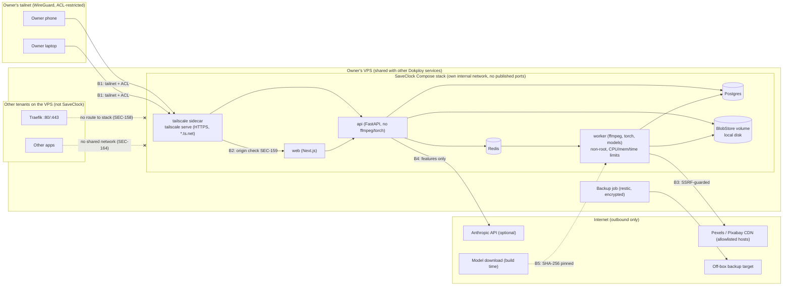

# SaveClock Studio — Security (Personal Edition)

Status: **Rev 3 — Personal edition** · Date: 2026-11-08 · Owner: project owner
Scope: pre-implementation documentation. Consistent with `DECISIONS.md` Rev 3 (canonical). The full public-edition security & privacy design (Rev 2.2) is archived unchanged at `archive/public-edition-rev2.2/SECURITY.md`; it becomes Phase P if the app ever goes public.

Conventions: control IDs are `SEC-xxx` (stable; retained controls keep their Rev 2.2 IDs, new controls start at SEC-157); threat IDs `T-xx`. **Phase tag** = the ROADMAP phase that delivers it: Ph0 Spike · Ph1 Walking skeleton · Ph2 Core pipeline · Ph3 Editor UX · Ph4 Personal polish & ops · Ph5 Post-MVP extras. "A / B" = starts in A, completes in B. **Level** is dropped in this edition: every retained control is either cheap or protects the owner's own machine/accounts.

## Rev 3 changelog (2026-11-08)

- **Rev 3.3 (2026-11-08, DECISIONS §8d):** no signed file tokens: the API streams files directly to the tailnet client (Tailscale is the boundary) and **path containment stays** (SEC-160, SEC-007). SEC-072 and SEC-073 are re-worded accordingly (IDs unchanged); the signed-token secret leaves the rotation list (SEC-082) and the key-leak runbook. Upload is one streamed `POST` with a size cap (SEC-001/003). Settings is `GET/PUT /settings` (booleans only for keys). SECURITY box label "Other Dokploy services + Traefik" relabelled (V3-13).
- **Rev 3.2 (2026-11-08):** every active control (75) now has an owner task in ROADMAP Appendix A.3 (SEC-122, 136, 157-164 added); the `worker-maint` service runs housekeeping (SEC-161); the read-only `GET /settings` endpoint returns key status as booleans only and `api` never holds the provider keys (SEC-080); the `tailscale serve` verification and Caddy-on-tailnet-IP fallback (T-0.15) keep SEC-157..159 unchanged. See `review/rev3-fixes-log.md`.
- Rescoped from public SaaS to a **single-owner app reachable only over Tailscale** (`DECISIONS.md` Rev 3). Security work shrinks from ~150 controls to **67 retained + 8 new**; **55 are deferred** to Phase P (table in section 6).
- Removed from the active catalog: accounts/passwords/OAuth/sessions/CSRF, Turnstile, quotas/abuse/fairness, Stripe, DMCA and fingerprinting, GDPR/CCPA/age gate/DPAs, email, worker VM + egress proxy + tunnel, second Redis, R2/presigned URLs, Cloudflare/Traefik public TLS, audit log, staging/prod split.
- Kept (adapted): upload validation, FFmpeg hardening (cheap subset), model-weight integrity, LLM prompt-injection and cost controls, secrets hygiene, supply chain including the **mandatory JS config-malware guard (SEC-096) and pre-push scan (SEC-097)**, ownership scoping seam (`user_id`), backups.
- Added (SEC-157 to SEC-164): Tailscale ACL, `tailscale serve` only / no public exposure, request-origin check, BlobStore path containment, disk quota and housekeeping, backup encryption, Tailscale key/device hygiene, co-tenant isolation on the shared VPS.
- Dropped the privacy/retention law sections and the DMCA operations summary (archive only). Incident runbook rewritten for one owner.

---

## 1. Scope and security objectives

**In scope:** the Compose stack (web, api, worker, postgres, redis, tailscale sidecar) on the owner's VPS; the owner's dev machine and repo; accounts for Tailscale, GitHub, Pexels, Anthropic, VPS provider, backup target.
**Out of scope now:** other people's accounts, public traffic, payments, legal compliance (see section 7).

Objectives, in priority order:
1. **Nothing is reachable except by the owner's tailnet devices.** No public port, no public Traefik route, ever.
2. **A bad media file or a bad dependency must not become code execution on the VPS**, and must not reach the VPS's other services.
3. **Secrets (Pexels, Anthropic, Tailscale auth key, backup credentials) do not leak** and are cheap to rotate.
4. **The owner's songs and renders are not lost** (tested backups) and the disk does not fill up.
5. **Cost surprises are bounded** (LLM cap, stock API budgets).

Non-objectives: defending against a hostile authenticated user (there is one user), abuse/DoS from the internet, multi-tenant isolation.

## 2. Asset inventory

| Asset | Where | Sensitivity | Main risk |
|---|---|---|---|
| Owner's songs (unreleased music possible) | `blobs/songs`, `work/audio_source` | High (creative IP) | exposure, loss |
| Plans, renders (incl. the Mode A file) | blob volume, Postgres | Medium | loss, disk fill |
| Pexels API key, Anthropic API key | env / secrets | Medium (quota, spend) | leak, cost |
| Tailscale auth key / node key | sidecar secret + state volume | **High** (grants tailnet membership) | leak -> rogue node |
| Backup credentials + encryption passphrase | env / owner's password manager | High | leak, loss (no restore) |
| Postgres data, Redis broker | internal volumes | Medium | loss, tamper |
| Model weights (Beat This, SigLIP 2, ...) | read-only image/volume | Medium (integrity) | tampered pickle -> RCE |
| Source repo + dev machine | owner's laptop, GitHub | High | config malware, token theft |
| VPS host + other Dokploy services | VPS | High | lateral movement either way |

## 3. Trust boundaries and data flow

Trust boundaries:
- **B1 tailnet edge:** only ACL-allowed owner devices reach the sidecar (SEC-157, SEC-163).
- **B2 sidecar -> app:** the API accepts requests only if they came through the Tailscale proxy (SEC-159); the API/web ports are never published on the host.
- **B3 stock fetch:** semi-trusted bytes and URLs from Pexels/Pixabay; host allowlist, SSRF guard, ffprobe gate (SEC-019).
- **B4 LLM:** computed features only; ID3 text is untrusted (SEC-040/041).
- **B5 model/dependency intake:** hashes and lockfiles (SEC-031, SEC-090).
- **VPS neighbours:** other Dokploy services are a separate trust domain (SEC-164).

## 4. Threat model (STRIDE)

| ID | Threat | STRIDE | Likelihood / impact | Controls |
|---|---|---|---|---|
| T-01 | **Tailnet exposure / ACL mistake:** default allow-all ACL, a shared or lost device, a stale node, or a leaked auth key lets a non-owner reach the app (there is no login behind it) | S, E, I | Medium / High | SEC-157, SEC-163, SEC-159 |
| T-02 | **Accidental public exposure:** a `ports:` mapping, a Dokploy domain/Traefik label, or `tailscale funnel` publishes the app that has no authentication | I, E | Medium / High | SEC-158, SEC-159, SEC-164, SEC-133 |
| T-03 | **VPS neighbour compromise:** another Dokploy service is breached and pivots (shared Docker network, `docker.sock`, host mounts, shared resources); or a compromised worker here pivots to them | E, T, D | Medium / High | SEC-164, SEC-131, SEC-013, SEC-130, SEC-016 |
| T-04 | **Malicious/malformed media hits FFmpeg/ffprobe** (RCE, SSRF via playlist demuxers, decompression/DoS) from a hostile stock file or a tampered song | T, E, D | Low-Med / High | SEC-005/006, SEC-010 to 013, SEC-015 to 018, SEC-023 |
| T-05 | **Supply chain:** poisoned pip/npm package, base image CVE, JS config malware executing when a dev tool loads a config, tampered model weights (`torch.load` pickle RCE) | T, E | Medium / High | SEC-090 to 099, SEC-030 to 033 |
| T-06 | **Secret leakage:** keys in git, images, logs, `NEXT_PUBLIC_*`; Tailscale auth key reused; backup key lost with the box | I | Medium / High | SEC-080, SEC-082, SEC-085, SEC-120, SEC-163, SEC-162 |
| T-07 | **LLM prompt injection via ID3 tags** (title/artist/comment) steering output, and runaway cost | T, D | Medium / Low-Med | SEC-040 to 046 |
| T-08 | **Path traversal in the filesystem BlobStore / direct file serving:** `../`, symlinks, absolute paths or a crafted `name`/`kind` read or write outside the blob root or reach `songs/`, `raw/`, `mezz/` | T, I, E | Medium / High | SEC-160, SEC-004, SEC-007, SEC-072 |
| T-09 | **SSRF via stock download URLs** (API response or redirect points at internal IPs, metadata endpoints, other containers) | I, E | Low-Med / High | SEC-019, SEC-043, SEC-067 |
| T-10 | **Data loss:** disk failure, bad migration, ransomware on the VPS, backups never restored | T, D | Medium / High | SEC-135, SEC-162, SEC-141 |
| T-11 | **Disk exhaustion:** mezzanines/renders fill the volume and take down Postgres and the neighbours | D | High / Medium | SEC-161, SEC-015, SEC-016, SEC-068, SEC-122 |
| T-12 | **XSS from untrusted text** (stock titles/author names, ID3 tags) in a UI with no auth to lose but a tailnet-trusted origin | T, E | Low / Medium | SEC-112, SEC-110, SEC-009 |

Deliberately not modelled now: credential stuffing, CSRF, abuse, copyright claims against third parties, payment fraud (all in the archive).

## 5. Control catalog (active)

Verification: **Test** = automated test; **Config** = deploy/config check script; **Scan** = tool run; **Manual** = owner checklist item. Controls tagged Ph0/Ph1 are part of the walking skeleton.

### 5.1 Tailnet, exposure and host (new + retained)

| ID | Control | Phase | How to verify |
|---|---|---|---|
| SEC-157 | **Tailscale ACL (new).** Tailnet policy is deny-by-default: only the owner's user/tagged devices may reach `tag:saveclock` on TCP 443; no `*:*` rule, no shared-in devices, SSH to the node only from the owner's devices. Policy file kept in the repo (`infra/tailscale-acl.hujson`). | Ph1 | Manual: `tailscale status` + admin console ACL test; from a non-allowed device the connection is refused |
| SEC-158 | **`tailscale serve` only (new).** The sidecar exposes the app with `tailscale serve` (tailnet-only HTTPS). **`tailscale funnel` is never enabled** (funnel disabled in ACL `nodeAttrs`). No `ports:` in the Compose file, no Traefik/Dokploy domain or label for this stack. A deploy check fails on any published port or Traefik label. | Ph1 | Config: compose lint (`ports:` / `traefik.*` absent); from the public internet `nmap`/`curl` of VPS IP shows nothing new; `tailscale funnel status` is empty; if the Phase 0 serve verification (T-0.15) forces the Caddy-on-tailnet-IP fallback, the same checks apply to the Caddy container (bound to the tailnet IP only, no published port) |
| SEC-159 | **Request-origin check (new).** The API (and web) listen only on the internal Compose network; a deny-by-default dependency rejects any request not arriving from the sidecar (peer address = sidecar, and Tailscale identity headers `Tailscale-User-Login` present and equal to the configured owner). Client-supplied identity headers are stripped at the sidecar. Replaces the Rev 2.2 auth dependency (SEC-070). | Ph1 | Test: request without/with forged headers or from another container -> 403; unauthenticated-route inventory is empty |
| SEC-163 | **Tailscale key and device hygiene (new).** Auth key is **tagged, single-use or ephemeral, short expiry**, stored only as a secret; node key expiry on; device approval on; MFA on the identity provider; device list reviewed monthly; lost device removed immediately (runbook 8.3). | Ph1 / Ph4 | Manual: admin console shows tagged node, no unknown devices, key expiry set |
| SEC-164 | **Co-tenant isolation on the shared VPS (new).** The stack has its own Compose project network; no external/shared networks; Postgres/Redis/Docker volumes not shared with other Dokploy services; no `network_mode: host`, no host bind mounts except the blob and backup dirs, no `privileged`; per-service CPU/memory limits so a render cannot starve neighbours (and vice versa). | Ph1 | Config: `docker network inspect` shows no neighbour containers; `docker inspect` policy script |
| SEC-130 | Host: SSH key-only, no root login, fail2ban/CrowdSec, automatic security updates, firewall allows only what the neighbours need (80/443) and SSH; Dokploy panel not exposed publicly (tailnet or IP allowlist) since it controls this stack too. | Ph1 / Ph4 | Manual: `sshd -T`, firewall rules, panel reachability from outside |
| SEC-131 | Docker daemon not exposed; no container mounts `/var/run/docker.sock`. | Ph1 | Config: inspect script |
| SEC-133 | Postgres and Redis on the internal network only; no published ports; passwords set; Redis `requirepass`/ACL; `pg_hba` restricted to the stack network. | Ph1 | Config: compose lint + connection attempt from outside fails |
| SEC-123 | NTP time sync on the VPS; request IDs propagated API -> worker. | Ph1 | Config |

### 5.2 Upload, file handling and BlobStore

| ID | Control | Phase | How to verify |
|---|---|---|---|
| SEC-001 | Upload flow (paths owned by ARCHITECTURE): create project -> upload via the API (streamed with a size cap) -> validate -> analyze. No client-supplied storage keys; declared size/MIME are hints only. | Ph1 / Ph2 | Test: oversize/mismatched upload rejected |
| SEC-003 | Limits: **<= 100 MB, <= 10 min, >= 15 s**. Streaming cap in the API; the worker's sandboxed `ffprobe` re-checks size, duration, stream count and codec before any decode. Unclaimed temp uploads are reaped. | Ph1 / Ph2 | Test: oversize / too-short / too-long files rejected and removed |
| SEC-004 | Filenames: display metadata only after normalising (NFC, strip path separators, control chars, RTL overrides, truncate 120); never used in blob keys, shell args, or `Content-Disposition` without RFC 6266 encoding. | Ph1 | Test: hostile-name corpus |
| SEC-005 | Magic-byte sniff in the worker for allowed containers (MP3, WAV, FLAC, OGG Vorbis/Opus, M4A/MP4 audio, AAC ADTS); declared MIME/extension never trusted; mismatch = reject. | Ph2 | Test: renamed-file corpus |
| SEC-006 | Codec allowlist: mp3, aac-lc, flac, pcm_s16le/s24le/f32le, vorbis, opus, alac. Video/cover-art/subtitle/data/attachment streams rejected or dropped. | Ph2 | Test: file with embedded video stream rejected |
| SEC-007 | Files are served only by the API itself (streamed from `BlobStore`, no signed tokens, no static route; only allowlisted proxy/render/Mode A files, SEC-072) with `Content-Type` from our own map, `X-Content-Type-Options: nosniff`, `Content-Disposition: attachment` for downloads; never serve raw blob dirs from the web server. | Ph1 | Test: headers asserted; direct path to blob dir 404 |
| SEC-009 | Metadata: ID3/vorbis/cover art stripped from the canonical copy (`-map_metadata -1 -map 0:a:0 -vn -sn -dn`); only numeric tags and a sanitised display title (<= 80 chars) stored; raw tags never reach the LLM (SEC-040). The validated original is kept as `work/audio_source` for Mode A until the owner deletes the project. | Ph2 | Test: canonical file has no tags (`ffprobe`) |
| SEC-160 | **BlobStore path containment (new).** Blob keys are server-generated (`u/{user_id}/{uuid}/{kind}`); the filesystem adapter resolves `realpath(root / key)` and refuses anything not under `root`; rejects absolute paths, `..`, NUL, backslashes; never follows symlinks (`O_NOFOLLOW` / lstat check); files created `0600`, dirs `0700`; blob volume mounted `noexec,nosuid`. | Ph1 | Test: traversal/symlink/absolute-path corpus raises; fuzz of key parser |
| SEC-141 | "Delete project" removes DB rows and all blobs (songs, intermediates, renders) and is verifiable; reaper handles orphans. | Ph4 | Test: after delete, no blob or row remains |
| SEC-071 | Ownership scoping seam: every project/song/render row carries `user_id`; every query filters by it (single seeded owner now; keeps Phase P cheap). | Ph1 | Test: query helper requires `user_id`; cross-user fixture returns 404 |
| SEC-072 | IDs are UUIDv4/ULID; **no signed file tokens** (Rev 3.3): file endpoints (`/projects/{id}/preview/{name}`, `/renders/{id}/download`) take only validated ids plus an allowlisted `name`/`kind`, run the owner/tailnet check, and resolve the path through `blob_keys.py` under `BLOB_ROOT`; `songs/` and `work/*/raw|mezz` are never servable. | Ph1 | Test: traversal / non-allowlisted name or kind / other-project id -> 404; request without the Tailscale origin -> 403 |
| SEC-073 | `Referrer-Policy: no-referrer` and `Cache-Control: private, no-store` on API responses; no secrets or song titles in access logs. | Ph1 | Config + log-scan test |
| SEC-074 | Mass-assignment guard: separate input/output Pydantic models, `extra="forbid"`, server-set fields never accepted. | Ph1 | Test |
| SEC-075 | Validate every input at the boundary (Pydantic v2); SQLAlchemy parameterised queries only; no raw SQL string-building. | Ph1 | SAST + Test |
| SEC-076 | Generic client error messages with correlation ID; no stack traces; centralised exception handlers. | Ph1 | Test |

### 5.3 FFmpeg and worker hardening (cheap subset, DECISIONS §4)

| ID | Control | Phase | How to verify |
|---|---|---|---|
| SEC-010 | Every ffmpeg/ffprobe call on song or stock input uses `-protocol_whitelist file` placed before `-i`; wrapper rejects caller-supplied protocol options; no `pipe`, network or `concat` protocols. | Ph2 | Test: wrapper unit tests, playlist file referencing `http://` fails |
| SEC-011 | Forced input demuxer from an allowlist, never auto-probe: audio `mp3, wav, flac, ogg, mov, aac`; stock video `mov, matroska`. HLS/DASH/concat/ffconcat/sdp/rtsp/image2/lavfi demuxers never applied to untrusted input. Explicit `-map`, `-sn -dn`, `-vn` for audio. | Ph2 | Test: negative corpus (playlist masquerading as .mp3); `-f` outside list rejected |
| SEC-012 | Single audited wrapper (`ffmpeg_runner`) builds argv; **argument lists only, never shell strings**; no user-controlled filter strings or option values beyond validated numerics. | Ph2 | SAST: ban `shell=True`/`os.system`; unit tests |
| SEC-013 | Worker containers: non-root UID, `read_only` rootfs, tmpfs `/tmp` with size limit, `cap_drop: [ALL]`, `no-new-privileges`, default seccomp, no Docker socket, no privileged, no host mounts beyond the blob volume. | Ph1 | Config: `docker inspect` policy script in deploy check |
| SEC-015 | `ffprobe` limits: `-probesize`/`-analyzeduration` capped (5 MB / 5 s), max streams 4, duration bounds, max sample rate 192 kHz, max channels 8; `-t`/`-fs` caps on decode. | Ph2 | Test: boundary files |
| SEC-016 | Per-job limits: cgroup CPU and memory (OOM kill), PIDs limit, tmpfs scratch size, wall-clock timeout (render 5 min, analysis 2 min, probe 15 s) with process-group kill. | Ph2 | Test: runaway fixture killed within limit |
| SEC-017 | **FFmpeg >= 8.1** (exact build pinned by the Phase 0 spike); built with only needed components (`--disable-network`, unused demuxers/protocols removed); version recorded in the SBOM and CI fails if an older binary is used. | Ph0 / Ph1 | Config: `ffmpeg -version`, `-protocols` lists only `file` |
| SEC-018 | Decode-once: upload canonicalised (PCM/FLAC, tags stripped) inside the worker; Beat This and the audio proxy consume the canonical copy only. Mode A remux reads the validated original `work/audio_source`. | Ph2 | Test |
| SEC-020 | Job payloads are IDs only; workers re-read authoritative state from Postgres and re-check `user_id`; Pydantic-validated message schemas. | Ph2 | Test: malformed message dead-lettered |
| SEC-021 | Crash isolation: one process per job, concurrency set per queue; failed job -> dead letter, owner sees a generic error. | Ph2 | Test |
| SEC-023 | Scratch hygiene: per-job random `0700` dir removed in `finally`; startup sweep of stale scratch. | Ph2 | Test |
| SEC-027 | Two images from one codebase: the `api` image has **no ffmpeg, no torch, no models**, so the web-facing process never parses media. | Ph1 | Scan: image contents check in CI |
| SEC-065 | Dramatiq: `max_retries <= 2` with backoff, per-actor `time_limit`, dead-letter handling, idempotent actors, unique job key. | Ph2 | Test |
| SEC-136 | Redis broker payloads contain no PII or audio (IDs only); one instance, `noeviction`, cache keys carry a TTL. | Ph1 | Config + review |

### 5.4 Stock providers and SSRF

| ID | Control | Phase | How to verify |
|---|---|---|---|
| SEC-019 | Stock downloads: HTTPS only, TLS verify on, **host allowlist (Pexels API/CDN `api.pexels.com`, `videos.pexels.com`, `images.pexels.com`; Pixabay `pixabay.com`, `cdn.pixabay.com` only if enabled)**, max size (100 MB), max duration, content-type check, ffprobe gate; redirects only to allowlisted hosts; resolve-then-connect with block of RFC1918, loopback, link-local, metadata and Docker-network IPs. | Ph2 | Test: SSRF test against internal IPs and redirect-to-internal |
| SEC-043 | LLM keywords used only as URL-encoded query values to fixed, allowlisted stock endpoints; never as URLs, paths, shell args or SQL. | Ph2 | Test |
| SEC-067 | Stock API keys server-side only; global token bucket respecting Pexels (200 req/h, 20k/month) and Pixabay limits; 429 handling with backoff; keys never in the browser. | Ph2 | Test: limiter + log shows no key |
| SEC-068 | Stock-derived intermediates (raw downloads, mezzanines, proxies) are per-project and removed by housekeeping (SEC-161); no cross-project cache. | Ph2 | Test |

### 5.5 Model loading and LLM

| ID | Control | Phase | How to verify |
|---|---|---|---|
| SEC-030 | Weights fetched at **build time**, stored in the image or a read-only volume, loaded from a fixed path; never from user-influenced or runtime-downloaded locations. | Ph2 | Config |
| SEC-031 | Each weight file pinned by SHA-256 in a committed manifest; entrypoint verifies before load and refuses to start on mismatch. Prefer `safetensors`; otherwise `torch.load(..., weights_only=True)` on verified files only, torch pinned well above 2.6.0 (CVE-2025-32434). | Ph2 | Test: tampered file -> boot fails; CI lint bans bare `torch.load`/`pickle.load` |
| SEC-032 | Model licences and provenance recorded in a manifest (source URL, commit, hash, licence); no non-commercial weights (`DECISIONS.md` §1). | Ph2 | Review |
| SEC-033 | No network during inference; `HF_HUB_OFFLINE=1` or equivalent so libraries never fetch at runtime. | Ph2 | Config: offline run test |
| SEC-040 | LLM prompt built from **computed features** (tempo bucket, energy summary, mood tags from our enum) plus optional owner "style hint" (<= 100 chars). Raw ID3 title/artist/album/comment/filename are **never** sent. | Ph2 | Test: ID3 fixture with injection string never appears in the prompt |
| SEC-041 | If title/artist is wanted, it passes a strict filter (charset allowlist, <= 60 chars, no URLs/newlines/markup), sits in a delimited data block, and the system prompt marks it untrusted. | Ph2 | Test |
| SEC-042 | Output must be JSON matching a Pydantic schema (<= N keywords, `^[a-z][a-z \-]{1,30}$`, closed field set); anything else -> reject and use the fallback keyword table. | Ph2 | Test |
| SEC-044 | **Cost cap:** `max_tokens` (~300), input token cap, 10 s timeout, <= 1 retry, one call per video, per-day call cap, monthly budget alarm and kill-switch flag forcing the fallback table; provider-side spend limit set. | Ph2 | Test + Manual: provider limit visible in console |
| SEC-045 | LLM calls go through a client wrapper logging token counts and latency only (no prompts/outputs); dedicated API key/workspace; app works with no key (fallback table). | Ph2 | Test: log scan; run with key unset |
| SEC-046 | Golden-prompt regression tests (`sattva-llm-features`): injection strings, JSON-breaking text, long unicode -> valid schema or fallback. | Ph2 | Test |

### 5.6 Secrets, web and logging

| ID | Control | Phase | How to verify |
|---|---|---|---|
| SEC-080 | Secrets only in Dokploy/Compose secrets or an env file outside git; never in git, images, or `NEXT_PUBLIC_*`; `.env` ignored, `.env.example` placeholders; `gitleaks` in pre-commit + CI; fail-fast startup validation. `api` receives no provider key: `GET /settings` (#24) is fed by derived `*_KEY_CONFIGURED` booleans and returns booleans only. | Ph1 | Scan: gitleaks; Test: boot fails on missing secret |
| SEC-082 | Rotation schedule: Pexels/Anthropic keys 90 d or on suspicion; Tailscale auth key at each (re)provision (never reuse); backup credentials 180 d. Rotation steps in section 8. | Ph4 | Manual: calendar entry + dry-run rotation once |
| SEC-084 | DB roles: app role is DML-only; separate migration role used only in the deploy step; no superuser use by the app. | Ph1 | Config |
| SEC-085 | No secrets in Docker build args/layers; multi-stage builds, non-root runtime, `.dockerignore` excludes `.env`/`.git`; Trivy secret scan on images. | Ph1 | Scan |
| SEC-110 | Content-Security-Policy on the web app (nonce-based or strict self-only policy; start in report-only), `frame-ancestors 'none'`. | Ph3 | Config: header test |
| SEC-111 | Headers: `X-Content-Type-Options: nosniff`, `Referrer-Policy: no-referrer`, `Permissions-Policy` minimal, `X-Frame-Options: DENY`. HSTS is provided by `tailscale serve` HTTPS (no preload). | Ph1 / Ph3 | Config: header test |
| SEC-112 | XSS hygiene: React escaping; ban `dangerouslySetInnerHTML` (lint); stock/ID3 text rendered as text only. | Ph3 | Lint + Test |
| SEC-115 | No secrets in the client bundle; no third-party scripts; no analytics. | Ph3 | Scan: bundle grep |
| SEC-120 | Structured JSON logs (job ID, request ID, status, timing); **never** log keys, tokens, ID3 text, prompts or LLM outputs; Tailscale identity logged as opaque owner id only. | Ph1 | Test: log-scan for secret patterns |
| SEC-122 | Alerts (lightweight: email/Pushover/Healthchecks): disk free < 20%, backup job failed or stale > 36 h, LLM spend > cap, worker OOM kills, certificate/Tailscale key expiry. | Ph4 | Manual: trigger each alert once |

### 5.7 Supply chain and developer security

| ID | Control | Phase | How to verify |
|---|---|---|---|
| SEC-090 | Python: `uv.lock` with hashes, installs with `--frozen`/`--require-hashes`; JS: `pnpm-lock.yaml` committed, `pnpm install --frozen-lockfile`, `ignore-scripts` unless allowlisted; no unpinned `latest`. | Ph0 / Ph1 | CI: frozen install fails on drift |
| SEC-091 | Base images pinned by **digest**, minimal (`python:3.12-slim`), refreshed monthly; multi-stage; non-root. | Ph1 | Config |
| SEC-092 | **Trivy** (or Grype) scans images and filesystem in CI: fail on HIGH/CRITICAL with a fix available; scans for secrets and Dockerfile/compose misconfig; periodic re-scan of the deployed digest. | Ph1 | Scan: CI log |
| SEC-093 | SBOM (CycloneDX via Syft/Trivy) per image build, stored with the release, to answer "am I affected?" for FFmpeg/library CVEs. | Ph4 | Scan |
| SEC-094 | Dependabot/Renovate for pip/uv, pnpm, Actions, Docker; `pip-audit` and `pnpm audit` in CI; FFmpeg and torch updates handled as manual high-priority reviews. | Ph1 | CI |
| SEC-095 | GitHub hardening: branch protection on `main`, Actions pinned to commit SHA, minimal `GITHUB_TOKEN` permissions, no long-lived cloud credentials in CI. | Ph1 | Manual |
| SEC-096 | **Config-malware guard (mandatory).** Before any `npm`, `pnpm`, `yarn`, `npx`, `next`, `vite`, `vitest`, `jest`, `eslint` or build/test/lint command, and after every `git pull`/`checkout`/`rebase`: `grep -lE "global\.[a-z]='[0-9]-|_\$_[0-9a-f]{4}=\(function" *.config.* 2>/dev/null`. **If it prints anything, STOP** and report repo config malware and the file. Implemented as a developer habit/alias or git hook, plus a CI job running the same grep repo-wide as the first step before any install/build. | Ph0 | CI job; seeded-fixture test: a file with the pattern fails the job |
| SEC-097 | **Pre-push / pre-deploy scan (mandatory), read-only, report FOUND/NOT FOUND with evidence:** (1) outgoing diff `git diff origin/<branch>..<branch>` grep for `global\.[a-z]='[0-9]-[0-9]+'` and `_\$_[0-9a-f]{4}=\(function`; (2) working-tree `grep -rIlE` of the same patterns excluding `node_modules`, `.git`, `.next`; (3) `*.config.{js,mjs,cjs,ts}` with any line > 1000 chars; (4) `createRequire` from `node:module` inside postcss/vite/eslint/jest/vitest configs; (5) check **refs, not just the tree**: `git grep -lE "<regex>" $(git for-each-ref --format='%(refname)' refs/heads refs/remotes)`. **Never push if anything is FOUND**; do not self-clean unless asked. Indicators of full machine compromise (`~/.node_module` dropper, npm logs with `--prefix ~/.node_module install axios socket.io-client`, unexpected node processes, C2 connection) -> treat the machine as compromised and revoke credentials **from a different device**. Replicated as a required CI check on PRs and on the deploy job. | Ph0 | CI required check; seeded fixtures; run before every push/deploy |
| SEC-098 | Dev machine: full-disk encryption, hardware key for GitHub and the Tailscale identity provider, no production secrets on the laptop beyond what dev needs. | Ph1 | Manual checklist |
| SEC-099 | Third-party accounts (Tailscale, GitHub, Anthropic, Pexels, VPS provider/Dokploy, backup target) protected with MFA; recovery codes stored offline. | Ph1 | Manual checklist |

### 5.8 Data safety and capacity

| ID | Control | Phase | How to verify |
|---|---|---|---|
| SEC-135 | **Backups:** nightly Postgres dump + blob volume (songs, plans, renders) to an off-box target via restic/borg/rclone; retention e.g. 7 daily / 4 weekly; **restore tested once before relying on it, then every quarter**; failure alerts (SEC-122). | Ph4 | Manual: documented restore drill to a scratch dir, row/file counts compared |
| SEC-161 | **Disk quota and housekeeping (new).** Dedicated blob volume/quota; free-space watermark (new analyze/fetch/render jobs refused below e.g. 10% free, alert at 20%); `maintenance` queue removes intermediates 7 days after last use and everything for deleted projects (DECISIONS §2); disk usage shown in settings; Docker log rotation and image prune scheduled. | Ph4 | Test: housekeeping unit tests + low-space refusal; Manual: dry-run on staging data |
| SEC-162 | **Backup encryption (new).** Backups are client-side encrypted (restic/borg repo passphrase) before leaving the VPS; the passphrase and backup credentials live in the owner's password manager (not only on the VPS); backup credentials are write-only/append-only where the target allows; the backup directory is not readable by other Dokploy services. | Ph4 | Manual: `restic snapshots` from the owner's laptop with only the password-manager secret; plaintext grep of the repo finds nothing |

## 6. Deferred to Phase P

These Rev 2.2 controls are not built in the personal edition. Full text, levels and verification are in `archive/public-edition-rev2.2/SECURITY.md` (control catalog, section 5.x shown). Do not reuse an ID for anything else.

| ID | Title | Archive |
|---|---|---|
| SEC-002 | Presigned PUT lifetime and signed headers | 5.1 |
| SEC-008 | Per-user storage cap and concurrent-upload cap | 5.1 |
| SEC-014 | Worker VM network model | 5.2 |
| SEC-022 | Optional gVisor/Firecracker sandbox for FFmpeg child | 5.2 |
| SEC-024 | Dedicated worker VM | 5.2 |
| SEC-025 | Egress proxy with host allow-list | 5.2 |
| SEC-026 | Worker <-> data-zone tunnel and `worker_rw` role | 5.2 |
| SEC-028 | Two Redis instances (broker / cache + rate limit) | 5.2 |
| SEC-029 | Per-job no-network FFmpeg child (netns) | 5.2 |
| SEC-050 | Argon2id password hashing | 5.5 |
| SEC-051 | Password policy and breached-password check | 5.5 |
| SEC-052 | Email verification gate | 5.5 |
| SEC-053 | Anti-enumeration on signup/login/reset | 5.5 |
| SEC-054 | `__Host-` session cookie | 5.5 |
| SEC-055 | Session lifecycle and revocation | 5.5 |
| SEC-056 | Login throttling and lockout | 5.5 |
| SEC-057 | CSRF protection | 5.5 |
| SEC-058 | No-CORS single-origin policy (trivially true now) | 5.5 |
| SEC-059 | Google OAuth with PKCE | 5.5 |
| SEC-060 | API rate limiting | 5.5 |
| SEC-061 | Cloudflare Turnstile | 5.5 |
| SEC-062 | Server-side atomic quotas | 5.5 |
| SEC-063 | Abuse signals (disposable email, velocity) | 5.5 |
| SEC-064 | Queue fairness and depth circuit breaker | 5.5 |
| SEC-066 | Compute budget alarm and render kill-switch | 5.5 |
| SEC-070 | Central auth dependency (replaced by SEC-159) | 5.6 |
| SEC-077 | Admin/ops endpoints separation | 5.6 |
| SEC-081 | R2 least-privilege buckets and tokens | 5.7 |
| SEC-083 | Stripe restricted keys | 5.7 |
| SEC-100 | Stripe webhook signature verification | 5.8 |
| SEC-101 | Webhook idempotency | 5.8 |
| SEC-102 | Entitlements from verified state only | 5.8 |
| SEC-103 | No card data on our servers (PCI SAQ-A) | 5.8 |
| SEC-104 | Refund/chargeback handling | 5.8 |
| SEC-113 | Traefik public TLS and routing (replaced by SEC-158) | 5.9 |
| SEC-114 | Cloudflare proxy/WAF with origin lock | 5.9 |
| SEC-121 | Append-only security audit log | 5.10 |
| SEC-132 | Worker/web VM separation | 5.12 |
| SEC-134 | Staging vs production separation | 5.12 |
| SEC-140 | Single 72 h retention clock | 5.13 |
| SEC-142 | Account deletion and 30-day purge | 5.13 |
| SEC-143 | Data minimisation to processors | 5.13 |
| SEC-144 | DPAs and international transfers | 5.13 |
| SEC-145 | Age gate (16+) | 5.13 |
| SEC-146 | Consent and cookie policy | 5.13 |
| SEC-147 | DSAR export/deletion tooling | 5.13 |
| SEC-148 | CCPA/CPRA basics | 5.13 |
| SEC-149 | Records of processing and DPIA | 5.13 |
| SEC-150 | DMCA designated agent registration | 5.14 |
| SEC-151 | Takedown intake and SLA | 5.14 |
| SEC-152 | Counter-notice procedure | 5.14 |
| SEC-153 | Repeat-infringer policy | 5.14 |
| SEC-154 | Rights warranty checkbox | 5.14 |
| SEC-155 | Abuse mailbox and `security.txt` | 5.14 |
| SEC-156 | Fingerprint policy (warn-only) | 5.14 |

Also archived (not control IDs): Privacy and data retention (archive section 6), DMCA operations summary (section 7), multi-party incident response and GDPR notification (section 8), security testing plan (section 9), pre-launch go/no-go checklist (section 10).

## 7. Phase P note: what returns if the app goes public

Going public re-opens the whole archived catalog, in roughly this order: (1) authentication, sessions, CSRF, rate limiting, Turnstile (SEC-050 to 064, 070); (2) worker VM, egress proxy and per-job netns isolation, because strangers' files become hostile input (SEC-014, 022 to 026, 029, 132); (3) object storage and presigned URLs (SEC-002, 081); (4) quotas, abuse and billing (SEC-008, 062 to 066, 083, 100 to 104); (5) privacy, retention and compliance (SEC-140 to 149) and DMCA/fingerprint operations (SEC-150 to 156), redesigned to be lawyer-free per DECISIONS §8b (songs stay on the device, so most of it does not apply); (6) public edge (Cloudflare/Traefik, SEC-113/114), audit log, staging split, and a pre-launch go/no-go review. The `user_id` scoping seam (SEC-071), the BlobStore adapter (SEC-160) and the API/worker image split (SEC-027) are what keep that work incremental.

**Browser-side processing would shrink it.** If beat analysis, matching and rendering ran in the user's browser (songs never leave the device), the server would hold no user media: the worker VM, FFmpeg sandboxing, retention/DSAR, fingerprinting and most DMCA work disappear, leaving auth, billing and the stock proxy. Decide this before reviving the archive (`DECISIONS.md` §8).

## 8. Incident and recovery runbook (one owner)

Keep this page and the credential list in the password manager, not only on the VPS.

### 8.1 Detect
Signals: backup/disk/LLM-spend alerts (SEC-122), an unknown device in the Tailscale admin console, a config-malware scan hit (SEC-096/097), odd processes or outbound traffic on the VPS, a provider notice (GitHub secret scanning, Anthropic, Pexels, Tailscale), a neighbour service compromised.

### 8.2 Key leak -> rotate
1. Identify the key (Pexels, Anthropic, Tailscale auth key, backup credential, DB/Redis password).
2. Revoke at the provider first (Anthropic console, Pexels dashboard, Tailscale keys page, backup target), then create a new one and update the secret store; redeploy the stack.
4. Check usage/billing for the leak window; check git history (`gitleaks detect`) and remove the secret from history only if it was committed (ask before rewriting history).
5. If the leak came from the dev machine, treat that as 8.5.

### 8.3 Tailnet device lost or stolen
1. In the Tailscale admin console: **remove the device** (revokes its node key) and expire its keys; sign out of the identity provider sessions and rotate that account's password/MFA if the device was unlocked.
2. Review the device list and ACL change log; confirm no new nodes were added.
3. If the lost device held the SSH key or password-manager session, rotate those too; if it ran a node with `tag:saveclock` access, re-issue the VPS sidecar auth key.

### 8.4 VPS compromise -> rebuild from backup
1. Contain: disconnect the stack (`docker compose down`), remove the node from the tailnet, and ask whether the neighbours are also affected (rotate their secrets too).
2. Preserve evidence: copy logs and `docker ps`/`ss -ltnp` output off-box before wiping.
3. Rebuild: reprovision the VPS (or wipe and reinstall) from a clean image; re-pull images by pinned digest; **rotate every secret** (section 8.2) including a fresh Tailscale auth key; do not restore any config or binary from the compromised host.
4. Restore data from the encrypted backup (SEC-135/162) into the new stack; verify row/file counts; run the pre-deploy scan (SEC-097) before redeploying code.
5. Verify exposure: `tailscale funnel status` empty, no published ports (SEC-158), ACL unchanged (SEC-157).

### 8.5 Dev machine compromised (config malware)
Stop, do not run any dev tool; revoke GitHub, Tailscale, Anthropic, Pexels and VPS credentials **from a different device**; wipe/reinstall; then follow 8.2 for every secret that was on the machine.

### 8.6 After any incident
Write three lines (what happened, root cause, what changed) in the repo's progress note; add or adjust a control and a test; re-run the restore drill if backups were involved.

## 9. Open questions

1. Is an owner-identity header check (SEC-159) enough, or should the API additionally require a static bearer token stored in the owner's browser, as defence if the sidecar is ever bypassed? (Cheap; decide in Phase 1.)
2. Backup target and tool (restic vs borg vs rclone) and where the passphrase lives (SEC-162).
3. Does the VPS provider's firewall allow blocking everything except the neighbours' needs, so that a mis-published port is blocked at the edge as well (SEC-158)?
4. Pixabay is optional (DECISIONS §3): if enabled, confirm its exact CDN hosts in Phase 0 and add them to SEC-019.
5. Dokploy vs plain Compose for deploying the stack: Dokploy adds a panel that can reach Docker (SEC-130/131); plain Compose reduces that surface.
