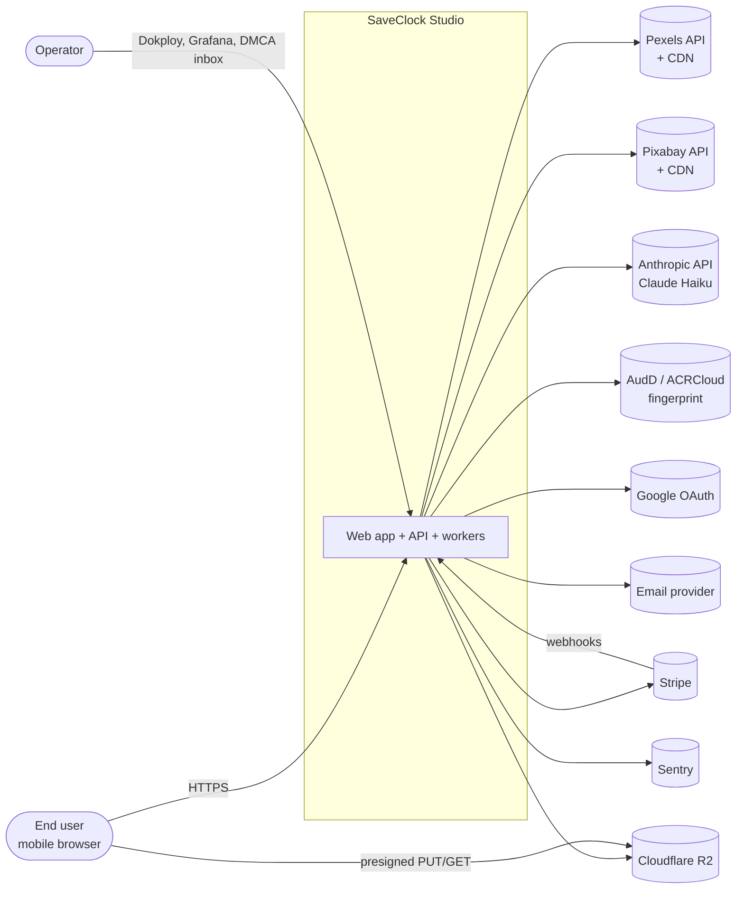
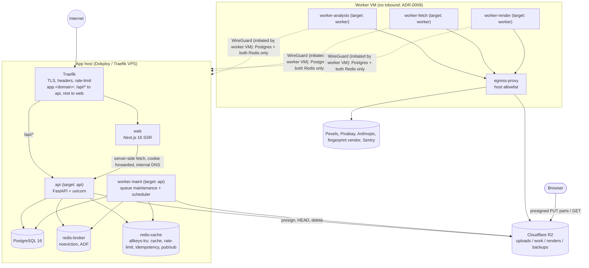
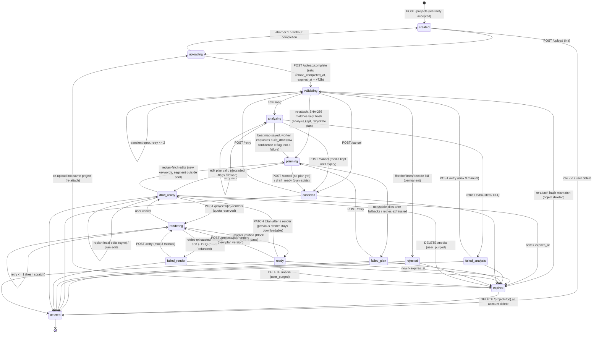
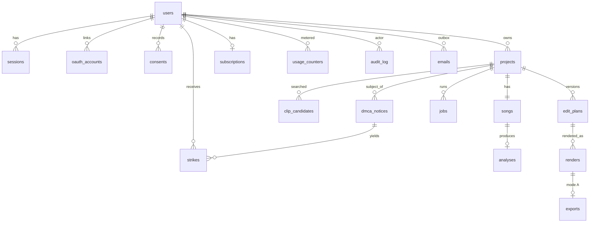

# SaveClock Studio — Architecture

Status: DRAFT · **Rev 2.2** · Date: 2026-11-08 · Source of truth for decisions: `DECISIONS.md` Rev 2.1 (this doc must agree; deviations are in §17 Open questions only).
Siblings (by filename): `PRD.md`, `ROADMAP.md`, `CHECKLIST.md`, `SECURITY.md`, `QUALITY.md`, `DESIGN.md`, `UX-SPEC.md`, `STANDARDS.md`, `adr/0001..0011`.

## Rev 2.2 changelog (2026-11-08)

- **Rev 2.2 (final verification):** "Frantic" density stop removed (`set_density` −2..+1; no `density_not_allowed`), minimum clip 0.5 s (15 frames), cuts on beat/downbeat only (V-01); `lead_frames` sign stated (positive = earlier) (V-05); §3 budgets are targets, G0 hard limits 40/180/90/10 s, contended-load measurement T-0.11 (V-02/V-03); endpoint shorthand replaced by canonical paths (V-08); maintenance actors clarified (V-17).

## Rev 2.1 changelog (2026-11-08)

- **Rev 2.1 (final cross-doc fixes, DECISIONS §8a):** edit-plan PATCH ops restored `move_clip` and `nudge_cut` (WCAG 2.5.7 non-drag alternatives) with validation and UX map rows; Mode A audio source = the validated original (kept as `work/audio_source.<ext>`, stream-copied when AAC-LC, else AAC-LC 48 kHz), canonical FLAC is for analysis/fingerprint/proxy only; four buckets confirmed canonical (`quarantine/` prefix and single-bucket wording removed elsewhere); "Notify me" cut (OQ-12 closed); benchmark threads = 4; re-attach starts a new 72 h clock.

## Rev 2 changelog (2026-11-08)

Reconciled to `DECISIONS.md` Rev 2 after the cross-check reviews (`review/consistency-review.md` C-xx/D-xx, `review/completeness-review.md` G-xx/S-x, `review/fact-check.md` F-xx).

- **Frame rule (C-01):** `f_i = floor((t_i − t0)·fps + 0.5)`; edit-plan schema gains `lead_frames` (default 0) and `cuts[].clip.locked`; `audio.mode`/`copy_allowed`/`manual` cut kind removed from the plan (the plan is silent; audio is an export concern).
- **Timing (C-02/C-03):** four separate budgets — analysis ≤ 20 s, draft ≤ 120 s, render ≤ 60 s, Mode A remux ≤ 5 s — with per-stage budgets that add up (§3).
- **Clip pipeline (D-10):** rank on raw low-res frames, normalize only top-K (~1.3 × cuts). **Mezzanines are per-project** (D-09): no `cache/mezz/` shared prefix, no `MEZZ_CACHE_TTL_HOURS`.
- **Export flow (C-12/D-14):** render = silent master + cut list; Mode A = remux of the song at export (no re-render, no extra quota); Mode B = separate downloads. **One retention clock** = upload-complete + 72 h (C-25/D-17). **Re-attach** by SHA-256 (D-25).
- **Flow (C-11/C-14/C-15):** one automatic pipeline from upload-complete to `draft_ready` driven by the worker chain (not the user); then user edits via `PATCH /plan` ops (tempo half/double, density, segment, keywords, lock/swap/remove/toggle cut, move clip earlier/later, nudge cut ±1 beat/±1 bar). State machine redrawn (15 states, §4). **One canonical endpoint table, 56 endpoints (§7).** Replan-local vs replan-fetch defined.
- **Topology (D-08/D-29/D-31/D-11/D-23):** single origin with Traefik `/api/*` routing, `__Host-` cookie, no CORS; dedicated worker VM (no inbound, allow-listed egress proxy); two Docker build targets (`api`, `worker`); 4 queues incl. `maintenance`; two Redis instances (§2, §14, ADR-0009/0010/0011).
- **Security (C-06/C-28/C-29):** FFmpeg `-protocol_whitelist file` only + forced input-format allowlist; analysis, fingerprint and the browser audio proxy consume a **canonical audio file** produced in the analysis sandbox; Mode A remux consumes the **gated original** (`audio_source`, Rev 2.1, DECISIONS §8a) read only through the same no-network, `-protocol_whitelist file`, forced-`-f` gate; workers use a least-privilege `worker_rw` DB role.
- **Auth/compliance (D-24/D-12/D-16):** minimal users+sessions from Phase 1; email provider + Mailpit (§24); age-16 attestation; fingerprint is warn-only and never creates strikes (C-40); DMCA admin tooling (§25).
- **Storage (C-27/C-31):** four buckets (`uploads`, `work`, `renders`, `backups`; canonical, DECISIONS §8a), multipart upload with per-part presigned URLs.
- **Versions (F-12, F-39..F-44):** Next.js 16.x, FastAPI 0.16x, Pydantic 2.14, SQLAlchemy 2.x, Dramatiq 2.x (quoted 1.x defaults marked unverified), PySceneDetect 0.7.x, FFmpeg ≥ 8.1.
- **Gaps filled (G-07..G-19):** env-var inventory (§18), local compose topology (§19), CI stages (§20), migrations plan by phase (§21), seed/dev data (§22), backup/restore (§23), email (§24), DMCA admin (§25), error-code catalogue (§7), data-model fields for watermark/quotas/locks/attribution/age/sha256/retention timestamps (§6).

Legend: facts with a URL were checked on 2026-11-08; "(inference)" = engineering estimate, must be benchmarked in the spike; "(unverified)" = could not be confirmed from a primary source today, re-check at scaffold time; **[spike]** = value fixed by Phase 0 measurements; **[counsel]** = needs lawyer sign-off. Legal statements are not legal advice and need a lawyer before public launch.

---

## 0. Version baseline (verified 2026-11-08, re-pin at scaffold time via lockfiles)

| Component | Decision (DECISIONS §3) | Found today | Note |
|---|---|---|---|
| Next.js | 16.x (App Router) | npm `next` latest **16.4.5** (fact-check F-39); Turbopack default, Node >= 20.9 | Pin exact `next` in `pnpm-lock.yaml`. Node: current LTS at scaffold (Node 22 is in maintenance by Nov 2026 — pin the LTS chosen in T-1.x via `.nvmrc`). |
| FastAPI | current (0.16x) | PyPI **0.162.2** (F-40) | Pre-1.0: pin exact, upgrade deliberately. |
| Pydantic / SQLAlchemy / Alembic | v2 / 2.x / — | Pydantic **2.14.3**; SQLAlchemy **2.1.8** latest (needs Python >= 3.11), 2.0.x still the conservative line (F-41/F-42); Alembic version not verified | SQLAlchemy: choose 2.0.x vs 2.1.x at scaffold after reading the 2.1 migration notes; DECISIONS says "2.x". |
| Dramatiq | 2.x on Redis | PyPI **2.2.1** (2.0.0 released; F-43), Python >= 3.10 | **Defaults quoted in earlier drafts (`TimeLimit` 10 min, `Retries` max 20, Results backend) come from 1.x docs and are unverified for 2.x.** This doc therefore sets every limit/retry explicitly per actor (§8) and never relies on a middleware default. Re-read the 2.x changelog before ADR-0003 is accepted. |
| FFmpeg | **>= 8.1; exact build pinned by the Phase 0 spike** | ffmpeg.org (F-12): **9.0.2 "Lei"** 2026-09-18, **8.1.3** 2026-09-21, 8.0.3, 7.1.5 | Spike runs golden + hardening tests on 8.1.x and 9.0.x, pins one build (static/distro) with checksum. Templates here are version-agnostic. |
| PySceneDetect | 0.7.x | PyPI **0.7.2** (F-44; benchmark page uses v0.7 defaults) | Use the `scenedetect` Python API (`detect`, `AdaptiveDetector`/`ContentDetector`); check 0.6 → 0.7 API changes at scaffold. BSD-3 (F-36). |
| TransNetV2 | adopt when weights terms checked (T-0.6) | repo LICENSE = **MIT** (code) (F-37); weights terms not separately stated | Closes the *code* licence question; weights check remains in T-0.6. |
| Beat This! | MIT, CPU | PyTorch >= 2.0 (+ `torchaudio`, F-06); API `File2Beats(checkpoint_path="final0", device="cpu", dbn=False)`; `final0` ~78 MB, `small0` ~8 MB (F-05); install from GitHub, extras: tqdm, einops, soxr, rotary-embedding-torch ([repo](https://github.com/CPJKU/beat_this)) | `dbn=True` / `--dbn` needs **madmom** (NC weights) — **never enable**; the plain CLI does not need madmom (F-07). Pin git commit SHA. Torch: current is 2.15 (F-16), pin well above 2.6 (CVE-2025-32434). |
| SigLIP 2 | Apache-2.0 | HF ids `google/siglip2-base-patch16-224` (MVP default), `-large-patch16-512`, `-so400m-patch14-384`; `transformers` >= 4.49 (F-35) | CPU speed not published; benchmark (§13). |
| Cloudflare R2 presigned | S3 API | Expiry 1 s – 7 days; S3 endpoint only (**not custom domains**); PUT supported; Content-Type bound in signature; multipart supported via S3 API; browser uploads need bucket CORS (F-24). `content-length-range` / POST policy: **not documented** (F-25) | PUT/part URLs TTL 5 min, GET 10 min. Size cap enforced by init-declared size + post-complete HEAD (§9). |
| Stripe webhooks | Checkout + Portal | Verify `Stripe-Signature` on raw body; return 2xx fast; dedupe by event id; order not guaranteed; retries up to 3 days live; process asynchronously ([Stripe docs](https://docs.stripe.com/webhooks)) | Snapshot events for subscriptions. |
| Pexels API | primary | `GET https://api.pexels.com/videos/search`, `Authorization: <key>`, `orientation=portrait`; `videos[].video_files[]`; 200 req/h, 20k/month default (F-18); params/fields **unverified** (F-20, docs behind Cloudflare challenge) | Verify with one live call in T-0.5. fps not documented (read from ffprobe). |
| Pixabay API | secondary | `GET https://pixabay.com/api/videos/?key=…&q=…`; 100 req/60 s; responses must be cached 24 h; no hotlinking (F-21/F-22); asks that users be shown the source | No orientation filter assumed (unverified, F-23) → filter by `width/height`. |
| Claude Haiku | `claude-haiku-5-5` | model exists (F-46); ~$0.10 / $0.50 per MTok in/out (F-47) | LLM cost per video is a ceiling (~$0.001–0.01). |

---

## 1. System context (C4 level 1)



---

## 2. Containers (C4 level 2)

Two hosts: the **app host** (existing Dokploy/Traefik VPS) and a **dedicated worker VM** (ADR-0009). Everything user-supplied is parsed only on the worker VM.



### Component responsibilities

| Component | Owns | Must not |
|---|---|---|
| `web` (Next.js) | UI, SSR shells, generated API client, SSE consumption, client-side preview player | Hold secrets other than public config; talk to DB/Redis/R2 directly except presigned URLs given by API |
| `api` (FastAPI, build target `api`) | Auth/sessions, CSRF, validation, ownership checks, quota enforcement, presign, enqueue, SSE stream, Stripe + email webhooks, DMCA intake and admin | Run FFmpeg/ML, parse media, call stock/LLM APIs (workers do), block > 1 s. Contains **no torch, no ffmpeg** |
| `worker-analysis` | validate/canonicalize (ffprobe + decode in sandbox), Beat This, energy segmenter, waveform peaks, then **enqueues the draft job** | Any network except via egress proxy (R2) and WireGuard to PG/Redis |
| `worker-fetch` | fingerprint call, keyword gen (LLM), stock search/download, low-res sampling, PySceneDetect, SigLIP rank, top-K normalize, planner, preview proxies, lazy normalize on swap | Receive user-controlled URLs (only API-returned stock URLs on allow-listed hosts) |
| `worker-render` | final render (silent master + cut list), verify, Mode A remux | Network beyond R2 (via proxy) + PG/Redis; the FFmpeg child gets no network where netns is available |
| `worker-maint` (build target `api`, **app host**) | retention sweeper, orphan/upload reaper, stuck-job reaper, usage-counter rollover, expired-session purge, Stripe/email webhook follow-ups, email outbox sender, DMCA restore timers | Parse media; business flows |
| PostgreSQL | System of record | Store audio/video blobs |
| redis-broker | Dramatiq broker + tiny result backend (`noeviction`, AOF `everysec`; payloads hold ids only) | Hold rate-limit or cache keys |
| redis-cache | stock-search cache, rate-limit counters, idempotency responses, SSE pub/sub, provider token buckets (`allkeys-lru`; losing it never loses work) | Be the only copy of anything |
| R2 | Blobs, 4 buckets (`uploads`, `work`, `renders`, `backups`) | Public access; presigned only |

Code layout: one Python package `services/api/src/saveclock` contains `api/` (routers), `services/`, `repositories/`, `adapters/` (pexels, pixabay, r2, llm, fingerprint, stripe, email, ffmpeg, scenedetect, siglip, beat_this), `domain/` (pure: beat grid, planner, edit-plan models), `workers/` (Dramatiq actors = thin wrappers around services). Two Docker build targets from the one codebase: `api` and `worker` (ADR-0011). Details in `STANDARDS.md`.

---

## 3. End-to-end pipeline

**Rule:** from upload-complete to `draft_ready` there is **one automatic pipeline driven by the worker chain**. The user (and the web client) never triggers planning; `analyze_song` enqueues `build_draft` itself with the project's defaults (30 s, auto-selected segment, default style, density 0, tempo octave as detected). The user then edits (`PATCH /plan`), renders, and exports.

```mermaid
sequenceDiagram
  autonumber
  actor U as User
  participant W as web
  participant A as api
  participant Q as Redis broker
  participant WA as worker-analysis
  participant WF as worker-fetch
  participant WR as worker-render
  participant R as R2
  participant X as Pexels/Pixabay/LLM/fingerprint
  U->>W: choose song, tick rights warranty
  W->>A: POST /projects {rights_warranty:true, options?}
  A-->>W: 201 project (created)
  W->>A: POST /projects/{id}/upload {filename,size_bytes,content_type}
  A-->>W: upload_id, part_size, parts_count
  W->>A: POST /projects/{id}/upload/parts {part_numbers}
  A-->>W: presigned part URLs (5 min, uploads bucket)
  W->>R: PUT parts (direct, resumable)
  W->>A: POST /projects/{id}/upload/complete {parts:[{n,etag}]}
  A->>R: CompleteMultipartUpload + HEAD (size <= 100 MB)
  A->>A: status=validating; upload_completed_at=now; expires_at=+72h
  A->>Q: enqueue analysis.validate
  Note over A,Q: from here on NO user action until draft_ready
  Q->>WA: validate: magic-byte sniff, ffprobe limits (forced -f), decode, SHA-256, canonical FLAC 48k
  WA->>R: work/audio_canonical.flac + work/audio_source (gated original bytes); delete the uploads object
  par analysis (budget 20 s)
    WA->>WA: Beat This final0 (4 torch threads) + octave clamp + energy segmenter + waveform peaks
  and fingerprint (non-blocking)
    Q->>WF: fingerprint (excerpt of canonical audio)
    WF->>X: AudD / ACRCloud
    WF->>A: songs.fingerprint_status, fingerprint_events row (warn-only)
  end
  WA->>A: analyses row saved, status=planning
  WA->>Q: enqueue fetch.build_draft(defaults)
  Q->>WF: keywords (LLM JSON schema; fallback table)
  WF->>X: search Pexels (portrait) + Pixabay (24 h cache)
  WF->>X: download candidates (allow-listed hosts, size caps) to work/raw/
  WF->>WF: ffprobe + PySceneDetect (reject internal cuts) + low-res frame sample
  WF->>WF: SigLIP 2 rank on low-res frames; no repeats
  WF->>WF: planner picks cuts; top-K (~1.3 x cuts) normalized to per-project mezzanines + preview proxies
  WF->>A: edit_plans v1 saved, status=draft_ready (SSE draft_ready)
  U->>W: preview (proxy clips vs audio proxy) and edit
  W->>A: PATCH /projects/{id}/plan {base_version, ops:[...]}
  A-->>W: 200 new plan (replan-local) or 202 (replan-fetch)
  U->>W: Render
  W->>A: POST /projects/{id}/renders {plan_version} + Idempotency-Key
  A->>A: quota reserve (1 unit per render)
  A->>Q: enqueue render.render_master
  Q->>WR: one filter_complex pass -> silent master + cutlist.json/csv; verify
  WR->>R: renders bucket: master.mp4, cutlist.json, cutlist.csv
  WR->>A: status=ready (SSE render_ready)
  U->>W: Export screen: choose mode
  alt Mode A with song
    W->>A: POST /renders/{rid}/exports {mode:"A"} + Idempotency-Key
    A->>Q: enqueue render.remux_with_song
    Q->>WR: stream-copy video + trimmed audio from audio_source (copy if AAC-LC, else AAC-LC 48 kHz); verify A/V
    WR->>R: with_song.mp4
    A-->>W: SSE export_ready
  else Mode B silent + beat map
    W->>A: POST /renders/{rid}/exports {mode:"B"}
    A-->>W: 200 (no job)
  end
  W->>A: GET /renders/{rid}/download?kind=...
  A-->>W: 200 {url, expires_at} presigned GET (10 min) after ownership check
  Note over A,R: expires_at = upload_completed_at + 72h for EVERYTHING in the project; maint sweeper + R2 lifecycle backstop
```

### Timing budgets (DECISIONS §6; all p95 on a 4-vCPU worker running 4 threads, **[spike]** until profiled)

The budgets below are the **targets** (G0 Should). The G0 **hard NO-GO limits** are analysis ≤ 40 s, draft ≤ 180 s, render ≤ 90 s, remux ≤ 10 s (QUALITY G0-13…G0-16). All numbers assume exclusive use of the 4 vCPU; contended-load p95 per stage and the worker-concurrency recommendation come from ROADMAP T-0.11 / QUALITY G0-27.

Four separate metrics, each with its own span. Stage budgets are allocated so that they **sum to the target**; a stage exceeding its allocation is an alert, the span total is the SLO.

**(1) Analysis — upload-complete → `analyzing` done (4-min song): ≤ 20 s.** Fingerprint runs in parallel and is not in this span.

| Stage | Queue | Budget |
|---|---|---|
| sniff + ffprobe + decode to canonical FLAC + SHA-256 | analysis | 4 s |
| Beat This (4 torch threads) + octave clamp + energy segmenter + waveform peaks | analysis | 14 s |
| persist + enqueue draft | analysis | 2 s |
| **Total** | | **20 s** |
| (parallel) fingerprint, timeout 8 s, failure non-blocking | fetch | — |

**(2) Draft — upload-complete → `draft_ready` (analysis + fetch + rank + normalize): ≤ 120 s.**

| Stage | Queue | Budget |
|---|---|---|
| analysis (above) | analysis | 20 s |
| keywords (LLM, timeout 8 s then fallback table) | fetch | 6 s |
| search + download (parallel 6, cached search) | fetch | 20 s |
| ffprobe + PySceneDetect (360 px) + low-res frame sample | fetch | 12 s |
| SigLIP 2 rank on sampled low-res frames | fetch | 12 s |
| top-K (~1.3 x cuts) normalize to mezzanine (semaphore 2 FFmpeg) | fetch | 35 s |
| planner + schema validate + preview proxies + persist | fetch | 10 s |
| queue hand-off slack | | 5 s |
| **Total** | | **120 s** |

**(3) Render — `POST /projects/{id}/renders` → silent master `ready` (30 s, 1080p): ≤ 60 s.**

| Stage | Budget |
|---|---|
| fetch mezzanines from R2 to scratch | 5 s |
| single-pass `filter_complex` render (veryfast, `-threads 4`) | 40 s |
| verify (frame count, duration, cut positions) | 10 s |
| upload master + cut list | 5 s |
| **Total** | **60 s** |

**(4) Mode A remux — `POST /renders/{id}/exports {mode:"A"}` → `export_ready`: ≤ 5 s.** download master 1 s, video stream copy + audio trimmed once from `audio_source` (stream copy if AAC-LC, else one AAC-LC 48 kHz encode) 2 s, A/V offset check 1 s, upload 1 s. No video re-encode, no quota.

Swapping to a candidate whose mezzanine does not exist yet (ranked on low-res only) triggers a **lazy normalize** (~3–5 s, `clip_ready` event) — not part of the budgets above. The p50/p95 columns of earlier drafts are replaced by these allocations; p50 is recorded in `jobs.timings` and reported by the spike.

---

## 4. Project / job state machine

`projects.status` (lowercase text + CHECK; the wire format is the same) holds the coarse state; every long step is a `jobs` row (stage, attempt, error) linked to it. **Fifteen states:** `created, uploading, validating, analyzing, planning, draft_ready, rendering, ready, failed_analysis, failed_plan, failed_render, rejected, canceled, expired, deleted`. Transitions are performed only by services (`ProjectStateService.transition(project, from, to, reason)`) using `UPDATE … WHERE status = :from` (optimistic; 0 rows = lost race).

Fingerprinting is **not a state**: it runs in parallel with analysis and only sets `songs.fingerprint_status` and a flag (warn-only, never blocks).



**`expired` means "media purged, project row + analysis + edit plan + song SHA-256 kept"** (DECISIONS §2). It is not the end: `expired --> uploading` is the re-attach path. `deleted` is terminal and only reached by an explicit user/account delete (blobs purged immediately, project row reduced to a tombstone, `audit_log` kept per retention).

### Rules

- **One clock.** `expires_at = upload_completed_at + RETENTION_HOURS` (default 72) and applies to **every** blob of the project: original upload (deleted early from `uploads`, see below), validated source audio, canonical audio, raw downloads, mezzanines, proxies, silent master, cut lists, Mode A export. A render finished at hour 70 dies at hour 72 with the rest; the UI shows one countdown per project. The sweeper (`worker-maint.sweep_expired`, every 10 min) sets `expired`, deletes the three bucket prefixes `u/{uid}/p/{pid}/`, nulls `songs.storage_key`/`renders.storage_key`, sets `projects.media_purged_at`, keeps `analyses`, `edit_plans`, `songs.sha256`, writes `audit_log`. Alert threshold: object older than 73 h.
- **Re-attach (D-25).** From `expired`, `POST /projects/{id}/upload` is allowed (same size/type limits). `upload/complete` runs validate + SHA-256; if it **equals the retained `songs.sha256`** the project goes `validating → planning` in *rehydrate* mode (analysis reused; plan pinned; download + normalize the clips already named in the plan; no re-rank; `audio_canonical` and `audio_source` are regenerated by the same validate step), landing in `draft_ready` with the previous plan. Mismatch → object deleted, 409 `reattach_hash_mismatch`, status stays `expired`; the user starts a new project. A re-attach is a new upload-complete and therefore starts a new 72 h clock (flagged for counsel, OQ-11).
- **Original upload is short-lived in `uploads`; the gated original lives on in `work`.** `validate_audio` (analysis sandbox) probes the upload under the SEC-010/011/015 gate, records `songs.sha256`, writes `work/audio_canonical.flac` (FLAC 48 kHz, tags stripped) and copies the **byte-identical validated original** to `work/audio_source.<ext>`, then deletes the `uploads` object. Beat This, fingerprint and the browser audio proxy read only the canonical file; the **Mode A remux reads `audio_source`** (DECISIONS §8a) inside the render sandbox (no network, `-protocol_whitelist file`, forced `-f`), never the raw `uploads` object (SEC-018). Both audio objects die on the project clock.
- **Replan modes (C-15).** *replan-local*: tempo octave, BPM override, density, segment within the fetched pool, lock/swap(ready candidate)/remove/toggle cut — domain planner only, synchronous in the API request (target ≤ 2 s p95, no fetch), status stays `draft_ready`. *replan-fetch*: new keywords/vibe chips or a segment whose sections need clips not in the pool — `draft_ready → planning` via `fetch.replan` (202 + SSE), locked cuts are kept.
- **Concurrency.** At most one active job per project among stages `draft`, `replan`, `render`, `remux` (unique partial index, §6). A second request returns 409 `conflict` or, with a matching idempotency key, the existing resource. `PATCH /plan` while a render is running is allowed (it edits the working version, not the version being rendered).
- **Failures.** `jobs.error_code` (catalogue §7), `jobs.attempt`, `jobs.retryable`. Automatic retries where marked; manual retries bounded by `projects.manual_retries` (3).
- **Cancel.** `POST /projects/{id}/cancel` / `POST /renders/{id}/cancel` sets `cancel_requested` (DB + Redis); the worker checks between sub-steps and FFmpeg progress ticks, kills the process group, transitions as drawn, refunds quota for a render. Cancel during analysis keeps the media until expiry (the project can be retried).
- **Fingerprint.** Does not gate any transition. A match sets flag `fingerprint_match` (UX shows "may be a released track" and nudges to Mode B; never the matched title); a vendor outage sets `fingerprint_status=error` and shows a neutral "You can continue" (no nudge).
- **Planning is never user-triggered after upload.** `POST /plan` does not exist; the only user-visible entry into `planning` after the first draft is a replan-fetch `PATCH`.

### UI status mapping (UX-SPEC S9 pills)

| `projects.status` | UI pill |
|---|---|
| `created`, `uploading` | Uploading |
| `validating`, `analyzing`, `planning` | Analysing / Building draft |
| `draft_ready` | Draft |
| `rendering` | Rendering |
| `ready` | Ready |
| `failed_*`, `rejected` | Failed (reason from `jobs.error_code`) |
| `canceled` | Canceled |
| `expired` with `status_reason=user_purged` | Song removed |
| `expired` otherwise | Files expired |
| `deleted` | hidden |

Render rows have their own sub-state (`queued, running, verifying, ready, failed, canceled, expired`); the project status is derived from the latest render and the working plan.

---

## 5. Edit-plan contract (schema version `1.0`)

The edit plan is the **only** contract between planner (writes), preview (reads), renderer (reads), and the cut-list export. A plan **version is mutable only while it is the unfrozen working version**; `POST /renders` freezes it (`frozen_at`), and the next edit after a freeze creates version N+1 (this is how editor autosave stays cheap: many `PATCH` ops coalesce into one working version; undo/redo is client-side and replays ops). A frozen version is immutable and is what a render references. JSON Schema lives at `packages/contracts/schemas/edit-plan.v1.schema.json`; Pydantic models generate it; TS types derive from it.

The plan is **silent**: it carries no audio mode. Audio is an export concern (Mode A remux uses `audio.trim` below on `audio_source`; Mode B ignores it).

```json
{
  "schema_version": "1.0",
  "plan_id": "01JD…ULID",
  "project_id": "01JD…",
  "version": 3,
  "created_by": "planner",
  "fps": 30,
  "lead_frames": 0,
  "resolution": {"width": 1080, "height": 1920},
  "song": {
    "sha256": "hex64",
    "duration_s": 214.12,
    "sample_rate": 48000
  },
  "segment": {"start_s": 62.4, "end_s": 92.4, "start_snapped_to": "downbeat"},
  "beat_grid": {
    "source": "beat_this:final0",
    "tempo_bpm": 128.0,
    "tempo_octave_adjust": 0,
    "confidence": 0.93,
    "beats_s": [62.4, 62.86875, 63.3375],
    "downbeats_s": [62.4, 64.275],
    "fallback": null
  },
  "options": {"density": 0, "style": "default", "keywords_override": null},
  "cuts": [
    {
      "index": 0,
      "out_start_frame": 0,
      "out_end_frame": 56,
      "beat_ref": {"beat_index": 0, "kind": "downbeat", "t_s": 62.4},
      "section": {"id": "s2", "label": "e3"},
      "clip": {
        "provider": "pexels",
        "provider_id": "3571264",
        "mezzanine_key": "u/{uid}/p/{pid}/mezz/pexels_3571264.mp4",
        "mezzanine_frames": 270,
        "in_frame": 41,
        "keywords": ["neon city night"],
        "score": 0.31,
        "locked": false,
        "attribution": {"author": "Jane Doe", "author_url": "https://www.pexels.com/@jane", "page_url": "https://www.pexels.com/video/3571264/"}
      },
      "effects": []
    }
  ],
  "total_frames": 900,
  "audio": {"trim": {"start_s": 62.4, "duration_frames": 900}},
  "overlays": {"watermark_version": "wm-1", "credits_text": null},
  "output": {"tier": "free", "scale_to": {"width": 720, "height": 1280}, "crf": 20, "preset": "veryfast"},
  "provenance": {"llm_model": "claude-haiku-5-5", "keyword_source": "llm", "planner_version": "0.1.0", "seed": 12345},
  "content_hash": "sha256 over canonical JSON excluding plan_id, created_by, provenance.seed"
}
```

Differences from the Rev 1 schema: `lead_frames` added; `cuts[].clip.locked` added; `song.storage_key` and `audio.mode/encode/copy_allowed` removed (the plan stays silent; the Mode A copy-vs-transcode choice is made by the remux actor from the probed codec of `audio_source`); `beat_ref.kind ∈ {downbeat, beat}` only (**no `manual` kind: every cut is on the grid; a free "nudge ±n frames" is not an op, but `nudge_cut` (±1 beat / ±1 bar, grid-snapped) and `move_clip` (reorder) ARE MVP ops, Rev 2.1**); `mezzanine_key` now lives under the project prefix; `options` mirrors the replan inputs; `sections[].label ∈ {e1,e2,e3,e4}` (energy levels, QUALITY §10 table is the versioned data file); `options.density` is an integer −2..+2 applied to that table.

Invariants (enforced by a validator run in planner, API on PATCH, and renderer before FFmpeg):
1. `cuts[0].out_start_frame == 0`; `cuts[i].out_end_frame == cuts[i+1].out_start_frame`; `cuts[-1].out_end_frame == total_frames`; all lengths >= 1 (planner minimum per QUALITY §10.3 table; validator only requires >= 1).
2. For `i > 0`, `out_start_frame_i == floor((beat_ref.t_s − segment.start_s) * fps + 0.5) − lead_frames` (**positive `lead_frames` = the cut happens EARLIER than the beat**; planner-computed; validator recomputes exactly, ±0 frames; use `math.floor(x + 0.5)`, never `round()`). `lead_frames` defaults to 0 and is non-zero only after an A/B test (DECISIONS §4).
3. `clip.in_frame + (out_end_frame − out_start_frame) <= clip.mezzanine_frames`.
4. No `provider+provider_id` repeats unless `pool_exhausted=true` (planner flag).
5. `audio.trim.duration_frames == total_frames`.
6. `fps == 30` and resolution 1080x1920 in v1.0 (fields kept for future).
7. Locked cuts (`clip.locked=true`) are never changed by a replan; a replan that cannot honour a lock fails with 409 `lock_conflict`.
8. Unknown fields rejected on write (`additionalProperties: false`); consumers ignore unknown fields only within the same major.
9. Versioning: `schema_version` is `MAJOR.MINOR`. Minor = additive optional fields (adding `lead_frames`/`locked` before any plan exists was free; later additions follow this rule); Major = breaking, requires a `plan_migrations/` function v(N−1)→vN and a renderer that supports both for one release.

### PATCH ops (the whole editor surface, `PATCH /projects/{id}/plan`)

Body `{base_version, op_id, ops:[…]}`; stale `base_version` → 409 `plan_version_conflict`; `op_id` dedupes retries.

| Op | Args | Replan mode | Result |
|---|---|---|---|
| `set_tempo_octave` | `octave: -1\|0\|1` (half / as detected / double) | local | grid recomputed from retained beat map (no re-inference), cuts re-planned |
| `set_bpm` | `bpm` (tap / typed) or `use_even_grid: true` | local | fallback grid, banner |
| `use_detected_beats` | `on: bool` | local | toggles the low-confidence fallback |
| `set_density` | `level: -2..1` (four UX stops: Calm −2, Relaxed −1, Steady 0, Busy +1) | local | cut-rate table offset |
| `set_segment` | `start_s`, `duration_s \| auto: true` | local if the fetched pool covers the sections, else fetch | segment snapped to downbeats |
| `set_keywords` | `section_id?`, `keywords[]` or `vibe_chips[]` | **fetch** | `draft_ready → planning` |
| `lock_clip` | `cut_index`, `locked` | local | flag only |
| `swap_clip` | `cut_index`, `candidate_id` | local if candidate has a mezzanine, else lazy normalize (202, `clip_ready`) | |
| `remove_cut` | `cut_index` | local | merged into the previous cut |
| `toggle_cut` | `beat_index`, `on` | local | add/remove a cut on a grid beat (respecting minimum length) |
| `move_clip` | `cut_index`, `direction: "earlier"\|"later"` | local | **reorder (WCAG 2.5.7 non-drag alternative).** Swaps the whole `clip` object (provider, id, mezzanine, `in_frame`, `locked`, attribution) between slot `cut_index` and its neighbour `cut_index∓1`/`+1`; cut times (`out_*_frame`, `beat_ref`) are untouched |
| `nudge_cut` | `cut_index` (≥ 1), `by: "beat"\|"bar"`, `steps: -1\|+1` | local | **cut nudge (WCAG 2.5.7 non-drag alternative).** Moves the start boundary of cut `cut_index` (= the end of the previous cut) to the grid beat 1 beat / 1 bar (= beats-per-bar beats, taken from `downbeats_s` spacing) earlier or later; frames recomputed with the frame rule |

**Validation of the Rev 2.1 ops** (failures are 422 `validation_error` with `details.reason`, or 409 `lock_conflict`; the plan is never partially applied):
- `move_clip`: `cut_index ± 1` must exist (`details.reason = no_neighbour`); if **either** clip is `locked`, 409 `lock_conflict` (a locked clip never moves); after the swap invariant 3 must hold for both slots, the planner first re-clamps `in_frame` into `[0, mezzanine_frames − length]` and only if the clip is still too short for the slot rejects with `details.reason = clip_too_short`; invariant 4 (no repeats) is unaffected.
- `nudge_cut`: `cut_index` in `1..len(cuts)−1` (cut 0 starts at the segment start; move that with `set_segment`); the target must be an existing grid beat strictly inside the segment (`target_out_of_range`); both adjacent cuts keep at least the planner minimum clip length from QUALITY §10.3 (`min_clip_length`); the target may not equal another cut's boundary; the new `beat_ref` (`kind` recomputed as `downbeat`/`beat`) and `out_start_frame` obey invariant 2 exactly; the left cut's `in_frame + length` and right cut's fit are re-checked (invariant 3, `in_frame` re-clamped first). A locked clip may have its boundary nudged (only clip identity is locked, not timing).
- Both ops are replan-local (synchronous, ≤ 2 s p95, no fetch, no quota) and are idempotent by `op_id`.
- **Density and minimum clip length (Rev 2.2, V-01):** there is no "Frantic"/half-beat stop in the MVP. Cut points are beats or downbeats only (`beat_ref.kind ∈ {downbeat, beat}`), and the planner enforces the single **0.5 s (15 frames)** minimum clip length (QUALITY §10.3); when a density level would produce shorter shots (beat interval < 15 frames, BPM > 120) the planner coarsens that span to the next sparser grid step instead of failing.

Mode B cut-list export (`cutlist.json` and `cutlist.csv`) is derived from the plan at render time: `index, start_frame, end_frame, start_s, end_s, beat_index, kind, provider, provider_id, attribution`. No audio, no song hash, no matched title.

---

## 6. Data model



All ids are ULID/UUIDv7 stored as `uuid`. All timestamps `timestamptz` UTC. Every table has `created_at`; mutable ones `updated_at`. snake_case plural tables. **Enums are lowercase `text` + CHECK** (STANDARDS §5); the wire uses the same values (this reverses Rev 1's UPPERCASE statuses, C-22). The column **Ph** is the ROADMAP phase in which the table ships (§21).

| Ph | Table | Columns (type, notes) | Indexes / constraints |
|---|---|---|---|
| 1 | `users` | id uuid PK; email citext UNIQUE NOT NULL; email_verified_at; password_hash text NULL (argon2id; NULL for Google-only); display_name; role (`user`,`admin`) default user; tier (`free`,`pro`) default free; locale text default `en`; disabled_at; banned_at; **age_attested_at timestamptz NOT NULL** (16+ self-declaration, SEC-145 / D-12); **age_attested_version text**; last_login_at; delete_requested_at | UNIQUE(email); idx(tier) |
| 1 | `consents` | id; user_id FK; kind (`tos`,`privacy`,`age_16`); version text; accepted_at; ip_hash bytea | idx(user_id, kind, accepted_at DESC). Source of ToS/Privacy version at signup; per-upload warranty is on `projects` |
| 1 | `sessions` | id; user_id FK CASCADE; token_hash bytea UNIQUE (SHA-256 of random 256-bit token; raw token only in cookie); csrf_secret_hash bytea; last_seen_at; expires_at (idle 7 d / absolute 30 d); revoked_at; **ip_hash bytea** (truncated HMAC, SEC-120); user_agent | UNIQUE(token_hash); idx(user_id); idx(expires_at) |
| 4 | `oauth_accounts` | id; user_id FK; provider (`google`); provider_user_id; email; | UNIQUE(provider, provider_user_id); idx(user_id) |
| 4 | `email_tokens` | id; user_id FK; purpose (`verify`,`reset`,`email_change`); token_hash UNIQUE; expires_at; used_at | idx(user_id), idx(expires_at) |
| 1 | `projects` | id; user_id FK NOT NULL; title; status (§4) NOT NULL; status_reason text; **rights_warranty_at timestamptz NOT NULL**; **rights_warranty_tos_version text NOT NULL**; flags jsonb (`fingerprint_match`, `low_confidence`, `degraded_keywords`, `pool_exhausted`); options jsonb (duration 15/30/60, style, density −2..2, tempo_octave −1/0/1; defaults for the automatic draft); **upload_completed_at**; **expires_at** (= upload_completed_at + RETENTION_HOURS; the single clock); **media_purged_at**; manual_retries smallint; takedown_at; deleted_at | idx(user_id, created_at DESC); idx(status) WHERE status NOT IN ('deleted','expired'); idx(expires_at) WHERE media_purged_at IS NULL AND expires_at IS NOT NULL |
| 1 | `songs` | id; project_id FK UNIQUE; original_filename; storage_key NULL after purge; size_bytes; content_type; duration_s numeric(8,3); codec; sample_rate; channels; **sha256 bytea (kept after purge — enables re-attach)**; canonical_key NULL after purge; source_key NULL after purge (`work/audio_source.<ext>`); fingerprint_status (`pending`,`no_match`,`match`,`error`); purged_at | UNIQUE(project_id); idx(sha256) |
| 2 | `fingerprint_events` | id; user_id; project_id uuid (no FK, survives purge); song_sha256; result (`no_match`,`match`,`error`); vendor; score real; at. **No matched title/artist is stored in MVP** [counsel may require it]. Never a strike by itself (C-40) | idx(user_id, at); retained 12 months (D-28 proposal) |
| 2 | `analyses` | id; song_id FK UNIQUE; model (`beat_this:final0`); model_version; tempo_bpm numeric(6,2); tempo_octave_adjust smallint; beat_confidence real; fallback text NULL (`energy_grid`/ladder step); beat_map jsonb (`beats_s[]`, `downbeats_s[]`); sections jsonb (`[{id,start_s,end_s,label,energy}]`); energy_curve jsonb (10 Hz); **waveform_peaks jsonb (<= 2000 points)**; **low_confidence_ranges jsonb** (`[{start_s,end_s}]`); timing jsonb | UNIQUE(song_id). Kept after media expiry (no audio) |
| 2 | `clip_candidates` | id; project_id FK; provider (`pexels`,`pixabay`); provider_id; query; **page_url; author; author_url; license text; fetched_at** (attribution metadata); width/height; duration_s; fps real (ffprobe); download_url (ephemeral, nulled after use); raw_key; mezzanine_key; proxy_key; status (`found`,`downloaded`,`rejected_cut`,`rejected_quality`,`ranked`,`normalized`,`selected`); reject_reason; score; frame_scores jsonb | UNIQUE(project_id, provider, provider_id); idx(project_id, status) |
| 2 | `edit_plans` | id; project_id FK; version int; schema_version; plan jsonb NOT NULL; content_hash bytea; created_by (`planner`,`user`); **frozen_at** (set by `POST /renders`) | UNIQUE(project_id, version); idx(content_hash) |
| 2 | `renders` | id; project_id FK; edit_plan_id FK; user_id FK (denormalized ownership); idempotency_key; job_hash bytea (`sha256(plan.content_hash ‖ song.sha256 ‖ tier)` — **no audio mode**); tier_at_render; **watermark_version text NULL** (NULL for Pro); state (`queued`,`running`,`verifying`,`ready`,`failed`,`canceled`,`expired`); attempt; error_code; master_key; cutlist_json_key; cutlist_csv_key; size_bytes; duration_frames; verify jsonb (QUALITY §7 Block/Warn results: `max_cut_error_frames`, `duration_delta_frames`, `watermark_present`, `attribution_present`, …); render_ms; counted_in_usage bool; started_at; finished_at; expires_at (= project.expires_at) | UNIQUE(user_id, idempotency_key); UNIQUE(job_hash) WHERE state IN ('queued','running','verifying','ready'); idx(project_id); idx(expires_at) |
| 2 | `exports` | id; render_id FK UNIQUE; user_id FK; mode (`A`); state (`queued`,`running`,`ready`,`failed`); idempotency_key; storage_key; size_bytes; verify jsonb (`av_offset_frames`); expires_at (= project.expires_at). Mode B has **no row**: its artefacts are the render's master + cut lists | UNIQUE(render_id) |
| 1 | `jobs` | id; project_id FK; render_id FK NULL; stage (`validate`,`analyze`,`fingerprint`,`draft`,`replan`,`swap_normalize`,`render`,`remux`,`sweep`,…); queue; attempt; state (`queued`,`running`,`ok`,`error`,`dead`); error_code; error_detail (sanitized); started_at; finished_at; timings jsonb; cancel_requested bool | idx(project_id, stage); idx(state) WHERE state IN ('queued','running') |
| 4 | `usage_counters` | id; user_id FK; period_kind (`day`,`month`); period_start date; renders int; analyses int; uploads int; reserved int (in-flight); Pro `month` rows anchored to `subscriptions.current_period_start` (C-46); **per-user storage cap (500 MB) and concurrent-job cap (Free 1 / Pro 2) are enforced from live queries over non-purged rows, not stored** | UNIQUE(user_id, period_kind, period_start) |
| 5 | `subscriptions` | id; user_id FK UNIQUE; stripe_customer_id UNIQUE; stripe_subscription_id UNIQUE; status; price_id; current_period_start; current_period_end; cancel_at_period_end; updated_from_event_id | |
| 5 | `stripe_events` | event_id text PK; type; received_at; processed_at; payload jsonb (minimal) | PK = dedupe |
| 1 | `audit_log` | id bigserial PK; at; actor_user_id NULL; actor_type (`user`,`system`,`admin`); action (`project.purged`, `dmca.takedown`, `auth.login_failed`, `fingerprint.match`, …); entity_type; entity_id; **ip_hash**; data jsonb (no PII beyond ids) | idx(entity_type, entity_id); idx(at); append-only for `app_rw`; retention purge by the separate `retention` role/job (12 months, D-28 proposal) |
| 4 | `dmca_notices` | id; received_at; complainant_name/email/address; work_description; target_project_id uuid NULL (FK SET NULL); target_url text; statement_good_faith; statement_accuracy; signature; **checklist jsonb** (17 USC 512(c)(3) elements); status (`received`,`valid`,`invalid`,`actioned`,`counter_notice`,`restored`); actioned_at; counter_notice jsonb; **restore_after timestamptz** (10–14 business days); reviewer_id | idx(status); idx(target_project_id). Retained 3 years (proposal) |
| 4 | `strikes` | id; user_id FK; dmca_notice_id FK; at; cleared_at NULL | idx(user_id). Strikes come **only** from validated DMCA notices |
| 4 | `banned_email_hashes` | email_hash bytea PK; at; reason | repeat-infringer ban list (SEC §7.5) |
| 4 | `deletion_tombstones` | user_id uuid PK (hash); deleted_at | replayed after a backup restore (§23) |
| 4 | `emails` | id; user_id NULL; to_hash; template; payload jsonb (merge fields, no secrets); state (`queued`,`sent`,`bounced`,`complained`,`failed`); provider_msg_id; attempts; created_at; sent_at | idx(state); outbox drained by `maintenance` |
| 3 | `feedback_reports` | id; user_id; project_id NULL; category; body; attachments_opt_in bool; beat_map_snapshot jsonb; created_at | `POST /feedback` |

Extra constraints: `CREATE UNIQUE INDEX uq_jobs_active ON jobs(project_id) WHERE state IN ('queued','running') AND stage IN ('draft','replan','render','remux');`. All user-owned queries are scoped by `user_id` (directly or via join) — repository methods take `user_id` as a required argument; cross-user access returns 404. Workers re-check ownership (`project.user_id` vs the message's `user_id`) before touching blobs (SEC-020).

Retention of rows: media 72 h from upload-complete (`projects.expires_at`); `analyses`, `edit_plans`, `songs.sha256` kept with the project after expiry; `clip_candidates.download_url` nulled after use; `sessions` purged on expiry; `audit_log` 12 months, DMCA records 3 years, `fingerprint_events` 12 months [counsel]; deleted-account rows reduced to `deletion_tombstones`.

DB roles (least privilege): `app_rw` (api + maintenance: CRUD, no DDL, no DELETE on `audit_log`), **`worker_rw`** (analysis/fetch/render workers: SELECT/UPDATE only on the tables they own — `projects.status`, `songs`, `analyses`, `clip_candidates`, `edit_plans`, `renders`, `exports`, `jobs`; no access to `users.password_hash`, `sessions`, `emails`, billing tables), `migrator` (DDL; only the migrate job), `retention` (DELETE on `audit_log`/expired rows for the sweeper only), `readonly` (BI).

---

## 7. REST API contract (v1) — the ONE canonical endpoint table

Base: `https://app.<domain>/api/v1` (single origin, ADR-0010); all paths below are relative to `/api/v1`. JSON; UTC ISO-8601; ids ULID/UUID strings. OpenAPI generated by FastAPI is the contract (`packages/contracts/openapi.json` committed, TS client generated; CI fails on drift). Names in ROADMAP/SECURITY/UX that differ (`POST /uploads`, `GET /jobs/{id}/events`, `/healthz`, `/projects/{id}/upload-url`, `POST /plan`) are superseded by this table (C-17, G-06).

**Auth**: session cookie `__Host-sc_session` (httpOnly, Secure, SameSite=Lax, `Path=/`, no `Domain`). Next.js server components forward it to `http://api:8000/api/v1` over the internal network. **No CORS** on the API (same origin); bucket CORS exists only on the R2 `uploads` bucket for the part PUTs. CSRF: double-submit token in `X-CSRF-Token` (from `GET /auth/csrf`, bound to the session) on all POST/PUT/PATCH/DELETE except `/webhooks/*` (signature-authenticated) and `POST /auth/register|login|password/forgot|password/reset|verify-email|resend-verification` (strict `Origin` check + rate limit + Turnstile where listed). `Origin` must equal `https://app.<domain>` on every state-changing request. Admin routes additionally require role=admin and the Traefik IP allow-list.

**Error envelope** (all non-2xx):

```json
{"error": {"code": "quota_exceeded", "message": "Daily render limit reached.", "details": {"limit": 3, "reset_at": "2026-11-09T00:00:00Z"}, "request_id": "01JD…", "doc_url": null}}
```

Validation errors: `code:"validation_error"`, `details.fields = [{"loc":[…],"msg":"…","type":"…"}]`. Never stack traces.

### Error-code catalogue (G-17; exported as an OpenAPI enum; UX S12 maps `code` → copy key)

| Code | HTTP | Retryable | When |
|---|---|---|---|
| `validation_error` | 422 | no | schema failure |
| `bad_request` | 400 | no | malformed body / header |
| `unauthenticated` | 401 | no | no/expired session |
| `forbidden` | 403 | no | role / CSRF / origin |
| `email_unverified` | 403 | no | `POST /projects`, `/upload`, `/renders` when verification enforced (Phase 4) |
| `age_not_attested` / `tos_not_accepted` | 422 | no | register without the checkboxes |
| `not_found` | 404 | no | missing **or not owned** |
| `conflict` | 409 | later | wrong state, active job exists |
| `plan_version_conflict` | 409 | refetch | stale `base_version` |
| `lock_conflict` | 409 | no | replan cannot honour a locked clip |
| `reattach_hash_mismatch` | 409 | no | re-attached file differs from the retained SHA-256 |
| `idempotency_mismatch` | 422 | no | same key, different body |
| `payload_too_large` | 413 | no | > 100 MB |
| `unsupported_media` | 415 | no | not in the format allowlist |
| `file_rejected` | 422 | no | `details.reason ∈ file_too_long, file_too_short, unsupported_codec, too_many_streams, decode_failed, corrupt` |
| `quota_exceeded` | 429 | after reset | tier quota (`Retry-After`) |
| `rate_limited` | 429 | after `Retry-After` | request rate |
| `gone` | 410 | no | `expires_at` passed |
| `stock_unavailable` | — (job `error_code`) | yes | both providers down and cache empty |
| `verification_failed` | — (job `error_code`) | yes (1 auto) | render Block checks failed twice |
| `upstream_unavailable` | 503 | yes | R2/Redis/PG down, queue depth over limit |
| `internal_error` | 500 | yes | unexpected (logged with `request_id`) |

### Rate limits (one table; SECURITY cites it — C-45)

Redis sliding window on `redis-cache`, per user else per IP: general 120/min/user; auth endpoints 10/min/IP; login 5 failures/15 min/account → 15-min throttle with Turnstile (not a hard lock); register 5/h/IP; password-reset 5/h/IP + 3/h/email; `upload` init 30/h/user, part-URL batch 120/min; `PATCH /plan` 60/min; `POST /renders` 10/min; downloads 30/min; SSE 5 concurrent/user; concurrent active jobs 1 (Free) / 2 (Pro) per **user**; DMCA/feedback 5/h/IP. Headers `RateLimit-Limit/Remaining/Reset`, `Retry-After` on 429. Backpressure: `POST /renders` returns 503 `upstream_unavailable` when render queue depth > 200 (`QUEUE_DEPTH_LIMIT`).

Idempotency: `Idempotency-Key` (UUID) **required** on `POST /projects/{id}/renders` and `POST /renders/{id}/exports`; recommended on `POST /projects`; stored 24 h in `redis-cache` with request hash + response; same key+body → original response; different body → 422 `idempotency_mismatch`. **Redis cache loss is tolerated**: the DB backstops are `UNIQUE(user_id, idempotency_key)` and `UNIQUE(job_hash)` on `renders`/`exports`. `PATCH /plan` uses `base_version` + `op_id` instead.

### Endpoints (56)

Legend for Replan column in `PATCH /plan`: see §5. "owner" = session + project owned by caller (else 404). "+CSRF" applies to every non-GET.

| # | Method & path | Auth | Request → Response | Errors | Idem. | Rate |
|---|---|---|---|---|---|---|
| **Auth** |
| 1 | `POST /auth/register` | none (+Turnstile) | `{email,password,tos_accepted:true,age_16_plus:true,turnstile_token?}` → **202 always** `{}` (generic body; verification email queued; no enumeration) | 422 | no | 5/h/IP |
| 2 | `POST /auth/verify-email` | none | `{token}` → 204 | 400 | yes | 10/min |
| 3 | `POST /auth/resend-verification` | none (+Turnstile) | `{email}` → 202 always | 429 | no | 3/h/email |
| 4 | `POST /auth/login` | none (+Turnstile after failures) | `{email,password}` → 200 `{user}` + Set-Cookie | 401 generic, 429 | no | 10/min/IP |
| 5 | `POST /auth/logout` | session+CSRF | → 204 | — | yes | std |
| 6 | `POST /auth/logout-all` | session+CSRF | revokes all sessions → 204 | — | yes | std |
| 7 | `GET /auth/csrf` | session | → `{token}` | 401 | yes | std |
| 8 | `GET /auth/google/start` | none | signed expiring `state` + PKCE → 302 | — | no | 20/min |
| 9 | `GET /auth/google/callback` | none | → 302 (+Set-Cookie); new Google users must still pass the age/ToS interstitial | 400 bad state | no | 20/min |
| 10 | `POST /auth/password/forgot` | none (+Turnstile) | `{email}` → 202 always | — | no | 5/h/IP, 3/h/email |
| 11 | `POST /auth/password/reset` | none | `{token,new_password}` → 204 (revokes sessions) | 400 | no | 5/h |
| **Account** |
| 12 | `GET /me` | session | profile, tier, flags, `email_verified`, `locale` | 401 | yes | std |
| 13 | `PATCH /me` | session+CSRF | `{display_name?, locale?, new_email?, current_password+new_password?, unlink_google?}` → 200 (email change sends a confirm mail) | 401 wrong password | yes | std |
| 14 | `DELETE /me` | session+CSRF+**re-auth** (`{password}` or fresh Google) | → 202; full purge job, tombstone, confirmation email | 401 | yes | std |
| 15 | `GET /me/usage` | session | `{tier, today:{renders,limit,resets_at}, month:{…}, storage_bytes}` | | yes | std |
| 16 | `POST /me/data-export` | session+CSRF | → 202 (MVP: recorded and fulfilled by the operator runbook within SLA; emails the user) | | yes | 1/day |
| 17 | `GET /me/sessions` | session | list (device, last_seen, current) | | yes | std |
| 18 | `DELETE /me/sessions/{id}` | session+CSRF | revoke one → 204 | 404 | yes | std |
| **Projects & upload** |
| 19 | `POST /projects` | session+CSRF (+verified) | `{title?, rights_warranty:true, options?:{duration:15\|30\|60, style?, density?}}` → 201 project (stores `rights_warranty_at` + ToS version) | 422 warranty false; 403 `email_unverified` | key optional | 30/h |
| 20 | `GET /projects` | session | cursor pagination `?limit&cursor&status` → `{items,next_cursor}` (each item: UI status, `expires_at`, countdown) | | yes | std |
| 21 | `GET /projects/{id}` | owner | project + song meta + analysis summary + working-plan summary + latest render/export + flags + UI status + `queue_position?` | 404 | yes | std |
| 22 | `PATCH /projects/{id}` | owner+CSRF | `{title?, options?}` (options only before `upload/complete`; afterwards use plan ops) | 409 | yes | std |
| 23 | `DELETE /projects/{id}` | owner+CSRF | full delete now → 202 (cancels jobs, purges blobs, tombstone) | 404 | yes | std |
| 24 | `DELETE /projects/{id}/media` | owner+CSRF | "Delete song & renders now": purge blobs, keep project + beat map + plan → 202; status `expired` / reason `user_purged`; within 5 min | 404, 409 | yes | std |
| 25 | `POST /projects/{id}/upload` | owner+CSRF | **init** multipart `{filename,size_bytes,content_type}` → `{upload_id, part_size, parts_count, max_bytes:104857600, expires_at}`; also the re-attach entry from `expired` | 413 (>100 MB), 415, 409, 429 | yes | 30/h |
| 26 | `POST /projects/{id}/upload/parts` | owner+CSRF | `{upload_id, part_numbers:[…]}` → `{urls:[{n,url,headers}], expires_at}` (5 min, content-type bound, `uploads` bucket) | 409 | yes | 120/min |
| 27 | `POST /projects/{id}/upload/complete` | owner+CSRF | `{upload_id, parts:[{n,etag}]}` → 202; completes multipart, HEAD size check, sets `upload_completed_at`/`expires_at`, enqueues validate | 409, 422 size/parts mismatch | yes | std |
| 28 | `DELETE /projects/{id}/upload` | owner+CSRF | abort multipart → 204 | 404 | yes | std |
| 29 | `GET /projects/{id}/events` | owner | SSE (§12) | 404 | n/a | 5 conc. |
| 30 | `POST /projects/{id}/cancel` | owner+CSRF | cancel in-flight validate/analyze/plan → 202 | 409 | yes | std |
| 31 | `POST /projects/{id}/retry` | owner+CSRF | from `failed_*`/`canceled` → 202 (max 3 manual) | 409, 429 | yes | std |
| **Analysis & editing** |
| 32 | `GET /projects/{id}/analysis` | owner | beat map, tempo (+octave), sections, energy, `waveform_peaks`, `low_confidence_ranges`, confidence, fallback, flags | 409 not ready | yes | std |
| 33 | `GET /projects/{id}/plan` | owner | current working plan (edit-plan 1.0) + `version`, `frozen` | 409 | yes | std |
| 34 | `GET /projects/{id}/plans/{version}` | owner | a specific frozen/working version | 404 | yes | std |
| 35 | `PATCH /projects/{id}/plan` | owner+CSRF | `{base_version, op_id, ops:[…]}` (§5 op table, incl. `move_clip` / `nudge_cut`). Replan-local → **200** new plan; replan-fetch / lazy normalize → **202** `{job_id}` | 409 `plan_version_conflict`/`lock_conflict`, 422 invariants | by `op_id` | 60/min |
| 36 | `GET /projects/{id}/candidates` | owner | `?cut_index` → ranked alternatives with `ready` flag + preview proxy URLs | | yes | std |
| 37 | `GET /projects/{id}/preview-manifest` | owner | `{audio_proxy_url, clips:[{key,url,frames}], plan, expires_at}` presigned GETs (10 min) | 409 | yes | std |
| 38 | `GET /projects/{id}/credits` | owner | attribution list for the plan (Pexels/Pixabay author + page URLs) and a ready-to-copy credits string | 409 | yes | std |
| **Render & export** |
| 39 | `POST /projects/{id}/renders` | owner+CSRF+`Idempotency-Key` (+verified) | `{plan_version?}` (default working) → 202 `{render_id}`; freezes the plan; reserves **1 quota unit**; produces the **silent master + cutlist.json + cutlist.csv** | 409, 429 `quota_exceeded`, 503 backpressure | yes (key + `job_hash`) | 10/min |
| 40 | `GET /renders/{id}` | owner | state, `verify` summary, files available, export state, `expires_at`, queue position | 404, 410 | yes | std |
| 41 | `POST /renders/{id}/cancel` | owner+CSRF | → 202 (quota refunded) | 409 | yes | std |
| 42 | `POST /renders/{id}/exports` | owner+CSRF+`Idempotency-Key` | `{mode:"A"\|"B"}`. **A** → 202 `{export_id}` (remux ≤ 5 s; no re-render, no quota; repeat calls return the existing export). **B** → 200 (no job; records the choice) | 409 render not ready, 410 | yes | 10/min |
| 43 | `GET /renders/{id}/download` | owner | `?kind=silent_video\|cutlist_json\|cutlist_csv\|with_song` → 200 `{url, expires_at}` presigned GET (≤ 10 min, `Content-Disposition: attachment`); `with_song` only after Mode A export is ready; repeatable within retention | 404, 409, 410 | yes | 30/min |
| **Billing (Phase 5)** |
| 44 | `POST /billing/checkout` | session+CSRF | `{price:"pro_monthly"}` → `{url}` | 409 already pro | yes | 10/h |
| 45 | `POST /billing/portal` | session+CSRF | → `{url}` | 404 | yes | 10/h |
| 46 | `POST /webhooks/stripe` | Stripe signature | raw body; verify, dedupe `stripe_events`, enqueue on `maintenance`, 200 fast | 400 | by event id | none (Traefik IP allow-list optional) |
| 47 | `POST /webhooks/email` | provider signature | bounce/complaint → update `emails`, suppress address | 400 | by msg id | none |
| **Compliance & support** |
| 48 | `POST /dmca/notices` | none (+Turnstile) | notice fields → 202 + acknowledgement email | 422 | no | 5/h/IP |
| 49 | `POST /feedback` | session+CSRF | `{category, body, project_id?, attach_beat_map?:bool}` → 201 | 422 | no | 5/h |
| **Health** |
| 50 | `GET /health/live` | none | 200 | | | |
| 51 | `GET /health/ready` | none | 200/503 (PG, both Redis, R2 HEAD cached 30 s) | | | |
| **Admin** (role=admin + Traefik IP allow-list; each action also in `audit_log`; thin CLI `saveclock admin …` wraps the same services — §25) |
| 52 | `GET /admin/dmca` | admin | `?status` list with SLA ages | 403 | yes | std |
| 53 | `GET /admin/dmca/{id}` | admin | notice + checklist + target project/user + prior strikes | 404 | yes | std |
| 54 | `POST /admin/dmca/{id}/transition` | admin+CSRF | `{action: validate\|reject\|takedown\|record_counter_notice\|restore, checklist?, note?}` → 200. `takedown` deletes blobs, sets `projects.takedown_at`, records a strike, sends templates | 409 illegal transition | yes | std |
| 55 | `GET /admin/users/{id}` | admin | account state, strikes, projects (ids/status only) | 404 | yes | std |
| 56 | `POST /admin/users/{id}/disable` | admin+CSRF | `{reason, ban_email?:bool}` → 204 (adds `banned_email_hashes`) | 404 | yes | std |

Pagination: cursor (opaque base64 of `(created_at,id)`), `limit` default 20, max 100. No offset pagination.

### UX screen action → endpoint (every action has an endpoint)

| UX screen / action | Endpoint(s) |
|---|---|
| S2 sign up / log in / resend / forgot / Google | 1–11 |
| S3 choose file, tick warranty, upload (resumable), retry/abort | 19, 25–28 |
| S4 fingerprint notice (read-only; analysis continues) | 21/29 (`flags.fingerprint_match`) |
| S5 progress stepper, cancel, retry | 29 (steps §12), 30, 31 |
| S6 editor: waveform, preview, tempo ½/×2, tap tempo, density, segment, vibe chips, lock, swap, remove/toggle cut, undo/redo | 32, 33, 35, 36, 37 |
| S6 clip strip "Move earlier" / "Move later" (`Shift+[` / `Shift+]`; UX §3.4 reorder alternative) | 35 → op `move_clip` |
| S6 selected cut "Nudge −1 beat / +1 beat / −1 bar / +1 bar" (UX §3.4 cut-marker alternative) | 35 → op `nudge_cut` |
| S6 segment start/end ±1 beat / ±1 bar nudge buttons | 35 → op `set_segment` (client computes `start_s`/`duration_s` from the beat grid) |
| S7 render progress, cancel | 39, 40, 29, 41 |
| S8 export: choose A/B, download MP4/JSON/CSV, copy credits | 42, 43, 38 |
| S9 projects list, rename, delete, delete song now, countdown | 20, 22, 23, 24 |
| S9 re-attach song after expiry | 25–27 (hash-checked) |
| S10 pricing / upgrade / manage | 44, 45 (pricing page "Coming soon" until Phase 5; static "Coming soon" text, no email capture, no "Notify me" — cut per DECISIONS §8a, OQ-12 closed) |
| S11 account: profile, password, email, unlink Google, sessions, log out everywhere, export data, delete account, usage | 12–18 |
| S12 errors | error catalogue above |
| Report an issue | 49 |

---

## 8. Queue design (Dramatiq 2.x + Redis)

Four queues (DECISIONS §3). Every time limit, retry count and backoff below is **set explicitly per actor**; no Dramatiq default is relied on (the 1.x defaults are unverified for 2.x, §0). Dramatiq 2.x middleware names/semantics (`Retries`, `TimeLimit`, `Results`, `Prometheus`, per-message `priority`, the `.DQ` dead-letter queue and its TTL) are **(unverified)** and re-checked at scaffold.

| Queue | Host | Actors | Worker process config (4 vCPU box) | Time limit | Retries | Notes |
|---|---|---|---|---|---|---|
| `analysis` | worker VM | `validate_audio`, `analyze_song` | 1 proc x 2 threads; `OMP_NUM_THREADS=4` for the Beat This step (torch threads = 4 is the budgeted configuration, §3) — the box runs one analysis at a time | 120 s | `max_retries=2`, backoff 5 s → 30 s; `ValidationFailed` is non-retryable | Model loaded once per process (lazy module-level singleton). On success `analyze_song` **enqueues `fetch.build_draft`** |
| `fetch` | worker VM | `fingerprint`, `build_draft` (parent), `search_stock`, `download_clip`, `sample_rank`, `normalize_topk`, `replan`, `swap_normalize`, `rehydrate_plan` | 2 procs x 4 threads (I/O heavy); normalize via semaphore of 2 concurrent FFmpeg | 180 s per actor | `max_retries=3`, backoff 2 s → 60 s (HTTP 429/5xx only) | Fan-out via `group`/pipeline; each sub-actor idempotent by `(project_id, provider, provider_id)` |
| `render` | worker VM | `render_master`, `verify_render`, `remux_with_song` | 1 proc x 1 thread per 4 vCPU (FFmpeg `-threads 4`) | `render_master` **300 s** (FFmpeg subprocess 270 s); `remux_with_song` 30 s | `max_retries=1` | `prefetch=1`; remux messages get `priority=0` so they never wait behind a render backlog |
| `maintenance` | app host | `sweep_expired`, `reap_orphans` (incomplete uploads, stuck jobs), `reset_counters`, `purge_sessions`, `stripe_event_handler`, `send_email`, `dmca_restore_timer`, `purge_media`, `delete_account` | 1 proc x 2 threads | 60 s | `max_retries=5` | Retention and webhooks cannot starve behind renders (DECISIONS §3). Built from the `api` image target (no torch/ffmpeg); runs DB/R2 maintenance only on the app host and never parses media (media-touching cleanup such as `purge_media` deletes objects by key; any decode/probe work stays on the worker VM queues) |

Rules:
- **Priority**: per-message `priority` (lower = sooner): Pro 0, Free 10, remux 0, within a queue; no separate Pro queue in MVP. (inference — verify Redis broker behaviour on 2.x.)
- **Time limits** raise inside the Python thread and cannot kill a child process. Every FFmpeg/ffprobe call goes through `adapters/ffmpeg.py::run()` using `subprocess.Popen(..., start_new_session=True)` with a wall-clock timeout, `os.killpg` on timeout/`TimeLimitExceeded`/cancel, and `prlimit` (`RLIMIT_AS`, `RLIMIT_CPU`). Stderr tail (last 4 KB) logged on failure.
- **Idempotency**: `render_master` receives `render_id`; on start `UPDATE renders SET state='running', attempt=attempt+1 WHERE id=:id AND state IN ('queued','running')`; output keys are deterministic (`renders/{rid}/master.mp4`), written to a temp key then copied, so a retry overwrites safely. Cross-request dedupe: `job_hash = sha256(plan.content_hash ‖ song.sha256 ‖ tier)`; the unique partial index returns the existing active/ready render (an identical `ready` render within the retention window is reused and consumes no quota). Mode A: `exports.UNIQUE(render_id)` — repeat calls return the same export.
- **At-least-once**: actors can run twice; all are written idempotent (check state, act under row lock, deterministic keys, upsert).
- **Dead letter**: after retries are exhausted the message goes to the queue's dead-letter queue; a failure hook marks `jobs.state='dead'`, project `failed_*`, refunds a render's quota reservation, emits SSE `failed`, sends a Sentry event with `job_id`. Operator CLI `saveclock jobs requeue-dead <id>` (runbook in `docs/RUNBOOK.md`, to be written, G-23). Alert if DLQ depth > 0 for 10 min.
- **Stuck-job reaper** (`reap_orphans`, every 5 min): re-drives or fails jobs whose Redis message was lost (the broker holds ids only; Postgres `jobs` is the record).
- **Results**: Postgres is the state of record. The Results backend (if enabled) holds ids only, TTL 1 h, on the broker instance.
- **Redis split**: `redis-broker` = `noeviction`, AOF `everysec`, queue payloads (ids only). `redis-cache` = `allkeys-lru`: stock cache, rate-limit counters, idempotency responses, SSE pub/sub, provider token buckets. A cache loss degrades latency/limits but loses no work (ADR-0011).
- **Graceful shutdown**: `SIGTERM` → stop consuming, wait up to `stop_timeout` (render: 60 s), unfinished messages are requeued; stop grace period 90 s on `worker-render`; test: SIGTERM during a render (S-7).
- **Backpressure**: `POST /projects/{id}/renders` → 503 `upstream_unavailable` when render queue depth > `QUEUE_DEPTH_LIMIT` (200).
- **Remote workers**: the worker VM reaches the broker/PG/cache over the WireGuard tunnel it initiates (ADR-0009). Broker connection loss: workers reconnect with backoff and stop consuming until healthy.

---

## 9. Storage layout & lifecycle (Cloudflare R2)

Four private buckets per environment (canonical layout, DECISIONS §8a; SECURITY Q-20 answered: four buckets, per-bucket tokens, no `quarantine/` prefix, no single-bucket variant) (R2 per-bucket API tokens are the least-privilege mechanism; prefix-level IAM does not exist, C-27). No public access, no custom-domain serving; presigned URLs only, on the S3 endpoint.

| Bucket | Content | Written by | Read by | Token scope |
|---|---|---|---|---|
| `saveclock-{env}-uploads` | original upload (multipart parts land here) | browser via presigned part PUT | `worker-analysis` (validate) | api: presign/HEAD/delete; analysis worker: read/delete; **nothing else** |
| `saveclock-{env}-work` | canonical audio, validated source audio (Mode A input), raw stock downloads, per-project mezzanines, preview proxies, audio proxy | analysis / fetch workers | fetch / render workers; browser via presigned GET (proxies, audio proxy) | workers RW; api: presign GET only |
| `saveclock-{env}-renders` | silent master, cut lists, Mode A export | render worker | browser via presigned GET | render worker RW; api: presign GET + delete |
| `saveclock-{env}-backups` | encrypted Postgres dumps (§23) | backup job | restore drill | backup job only; separate credentials |

Key layout inside the first three buckets: `u/{user_id}/p/{project_id}/…`

| Key | Content | Lifetime |
|---|---|---|
| `uploads: …/src/original` | original upload | deleted by `validate_audio` as soon as the canonical copy, the validated `audio_source` copy and the SHA-256 exist (hard cap: upload_completed_at + 72 h) |
| `work: …/audio_canonical.flac` | FLAC 48 kHz, tags stripped, produced in the analysis sandbox; input for Beat This, fingerprint and the audio proxy | project clock (72 h) |
| `work: …/audio_source.<ext>` | byte-identical copy of the validated original (SHA-256 = `songs.sha256`); the **only** audio input of the Mode A remux (DECISIONS §8a); analysis worker writes, render worker reads | project clock (72 h) |
| `work: …/audio_proxy.m4a` | 128 kbps AAC trimmed to the segment for the browser player | project clock |
| `work: …/raw/{provider}_{id}.mp4` | raw stock download (kept for lazy normalize on swap) | project clock; never shared |
| `work: …/mezz/{provider}_{id}.mp4` | **per-project mezzanine** (1080x1920, 30 fps CFR, no audio) | project clock; never shared (D-09) |
| `work: …/proxy/{provider}_{id}.mp4` | 270x480 preview proxy (resolution 270x480 vs 540x960 decided in T-3.4, C-23) | project clock |
| `renders: …/{render_id}/master.mp4`, `cutlist.json`, `cutlist.csv` | silent master + cut list | project clock |
| `renders: …/{render_id}/with_song.mp4` | Mode A export | project clock |

**One clock.** Every object in the three buckets for a project dies at `projects.expires_at = upload_completed_at + 72 h` (a render finished at hour 70 dies at hour 72). No `cache/mezz/` shared prefix and no `MEZZ_CACHE_TTL_HOURS` exist any more; a shared cross-user cache is reconsidered only if Pexels/Pixabay terms permit and the spike shows a worthwhile hit rate (T-0.5; hit rate guessed 5–20 %). A plan is therefore renderable for the whole retention window without re-fetching.

Lifecycle: the **authoritative** 72 h guarantee is the application sweeper (`worker-maint.sweep_expired`, every 10 min; deletes by prefix in all three buckets and verifies with `list`; alert at an object older than 73 h). R2 lifecycle rules are the backstop (day granularity, asynchronous): `uploads` and `work` and `renders` → delete after 3 days; abort incomplete multipart after 1 day. Download endpoints check `expires_at` and return 410 after expiry even if the object still exists. Applied from `infra/r2/lifecycle-rules.json`.

Upload constraints: multipart with per-part presigned PUT (part size 8 MiB, parts URLs 5 min, `Content-Type` bound). R2 presigned URLs cannot enforce `content-length-range` (F-25), so the size cap is enforced by (a) `size_bytes` declared at init (rejects > 100 MB), (b) per-part sizes at `upload/complete` (HEAD of the assembled object; reject and delete if > 100 MB), (c) short URL TTL + per-user rate limits + per-user storage cap (500 MB), and (d) an orphan reaper (`reap_orphans`, every 15 min) for uploads without a project completion. Client-side resume re-requests part URLs (`POST …/upload/parts`); the 5-min TTL applies per URL, not to the whole upload.

CORS: `uploads` bucket allows `PUT` from `https://app.<domain>` only and exposes `ETag`. `work`/`renders` GETs are made by `<video>`/`<audio>` elements and `fetch` for downloads (navigation), so no bucket CORS is needed there.

---

## 10. Caching

| What | Where | Key | TTL | Reason |
|---|---|---|---|---|
| Stock search responses | `redis-cache` | `stock:{provider}:{sha256(normalized query+params)}` | **24 h** (Pixabay requires 24 h response caching; Pexels same for symmetry) | API terms, rate limits |
| Provider rate-limit state | `redis-cache` | token buckets: Pexels 200/h, Pixabay 100/60 s (global, shared by all workers) | rolling | avoid key revocation; on exhaustion jobs wait up to 20 s then degrade (§16) |
| Mezzanines, raw downloads, proxies | R2 `work` bucket, **per project** | `u/{uid}/p/{pid}/…` | project clock (72 h) | "no persistent mirror" (ADR-0004); no cross-user sharing |
| Keyword generation | `redis-cache` | `kw:{sha256(features+style)}` | 24 h | cost; deterministic via `temperature=0` |
| Idempotency responses | `redis-cache` | `idem:{user}:{key}` | 24 h | volatile; DB unique indexes are the backstop |
| Frame-embedding scores | Postgres `clip_candidates.frame_scores` | per project | project clock | re-rank on tweak without re-running SigLIP |
| Session lookup | `redis-cache` | token hash | 60 s, invalidated on revoke | avoids a DB hit per request (ADR-0006) |

---

## 11. FFmpeg command templates

All commands built by `adapters/ffmpeg.py` as **argument lists** (`subprocess.run([...], shell=False)`), never shell strings. Common prefix `COMMON = ["ffmpeg","-hide_banner","-nostdin","-loglevel","error","-protocol_whitelist","file","-y"]`. **`-protocol_whitelist file` only** (no `pipe`; DECISIONS §4, C-06). Inputs are only local files in a per-job scratch dir (`/scratch/{job_id}`, `tmpfs` or ephemeral volume, 0700, deleted in `finally`). No filter string ever contains user text: the watermark is a constant PNG overlay; dynamic text is not supported in MVP. `-threads` explicit. Progress: `-progress /scratch/{job_id}/progress.txt -nostats` (a file, not `pipe:1`, so it works under `file`-only; the spike confirms), tailed and throttled to 1 SSE event/s.

**Forced input format (F-17).** Untrusted input is never auto-detected: a Python magic-byte sniff (first bytes: `ID3`/MPEG sync → `mp3`; `RIFF…WAVE` → `wav`; `fLaC` → `flac`; `OggS` → `ogg`; `ftyp` → `mov,mp4,m4a,3gp,3g2,mj2`) selects the demuxer, which is passed explicitly as `-f <fmt>` before `-i` (ffprobe too). Anything else is `unsupported_media`. `hls`, `concat`, `ffconcat`, `image2`, `sdp`, `rtsp` and playlist-style demuxers are never in the allowlist; stock clips are forced to `-f mov,mp4,m4a,3gp,3g2,mj2`. After the probe, `format_name` must still be in the allowlist. Verified against the pinned FFmpeg build in the spike (hardening tests).

Probe (user audio and stock clips):
```
ffprobe -v error -protocol_whitelist file -f {forced_fmt} -print_format json -show_format -show_streams -show_entries stream=codec_type,codec_name,width,height,r_frame_rate,avg_frame_rate,duration,nb_frames,channels,sample_rate,sample_aspect_ratio,pix_fmt:format=duration,size,format_name <file>
```
Limits enforced after parse: audio duration **15 s – 10 min**, **<= 100 MB**, >= 1 audio stream, <= 4 streams total, no attached picture > 2 MB, unknown `format_name` rejected; stock clips: duration 3–60 s, 1 video stream, size <= 120 MB, width >= 720. Output length is capped at song length (a 60 s output from a 30 s song is not offered).

**Canonicalize** (analysis sandbox, once): `ffmpeg … -f {fmt} -i original -map 0:a:0 -vn -map_metadata -1 -c:a flac -ar 48000 -ac 2 audio_canonical.flac`, plus a 44.1 kHz mono PCM temp for Beat This. SHA-256 of the **original** bytes is computed while streaming it from R2 and stored in `songs.sha256`. The validated original is copied byte-for-byte to `work/audio_source.<ext>` and the `uploads` object is deleted; render and remux never read the raw `uploads` object, and the remux reads `audio_source` only inside the no-network sandbox (C-28, SEC-018, Q-19 answered).

**Low-res sampling for ranking** (raw download, before normalization): `ffmpeg … -f mov,mp4,… -i raw.mp4 -vf "fps=1,scale=224:-2" -frames:v 8 frames_%02d.jpg` (frame count/size tuned by the spike); SigLIP ranks on these frames and PySceneDetect runs on a 360 px stream of the raw file.

**Normalize (mezzanine)** — only for the top-K ranked clips (K ~ 1.3 x number of cuts, spike validates), written to the per-project `mezz/` prefix:
```
ffmpeg … -f mov,mp4,m4a,3gp,3g2,mj2 -i raw.mp4 -map 0:v:0 -an -sn -dn \
  -ss {window_start_s} -t {window_len_s} \
  -vf "fps=30,scale=1080:1920:force_original_aspect_ratio=increase:flags=bicubic,crop=1080:1920,setsar=1,format=yuv420p" \
  -r 30 -fps_mode cfr \
  -c:v libx264 -preset veryfast -crf 14 -profile:v high -g 15 -keyint_min 15 -sc_threshold 0 -bf 2 \
  -video_track_timescale 30000 -movflags +faststart \
  out_mezz.mp4
```
Why: `fps=30` + `-fps_mode cfr` makes timestamps exact multiples of 1/30; `scale…increase,crop` fills 9:16 (a 16:9 source loses ~68 % of width — the planner penalises landscape clips); `setsar=1`; `-g 15 -sc_threshold 0` gives a keyframe every 0.5 s so trim seek cost is bounded and no scene-cut keyframes break the cadence; timescale 30000 = 1000 ticks per frame, a common timescale across all mezzanines so concat has no rounding; `-ss/-t` select the cut-free window chosen by PySceneDetect (<= 15 s), which bounds work. Rotation metadata is applied by FFmpeg autorotate. Expected size ~8–12 MB per 15 s clip at crf 14 (inference).

**Browser preview proxy** (per selected clip): `scale=270:480…,crop=270:480`, `-crf 28 -preset ultrafast -g 15`, `-an`, `-movflags +faststart` (resolution decided in T-3.4). The audio proxy `audio_proxy.m4a` is a 128 kbps AAC trim of `audio_canonical.flac` (analysis-side input) to the segment, per project, 72 h.

**Final render → silent master** — one pass, trim by frame index, concat, **no audio at all**:
```
ffmpeg … \
  -i m_0.mp4 -i m_1.mp4 … -i m_{N-1}.mp4 \
  -filter_complex "
    [0:v]trim=start_frame=S0:end_frame=E0,setpts=PTS-STARTPTS[v0];
    [1:v]trim=start_frame=S1:end_frame=E1,setpts=PTS-STARTPTS[v1];
    …
    [v0][v1]…[vN-1]concat=n=N:v=1:a=0[vc];
    [vc]{scale+watermark chain for tier}[vout]" \
  -map "[vout]" -an \
  -c:v libx264 -preset veryfast -crf 20 -profile:v high -pix_fmt yuv420p -r 30 -fps_mode cfr \
  -g 60 -video_track_timescale 30000 \
  -frames:v {total_frames} \
  -movflags +faststart -f mp4 master.mp4
```
- `Sk = clip.in_frame`, `Ek = clip.in_frame + (out_end_frame − out_start_frame)` — **frame counts, never seconds**. Each segment emits exactly `Ek−Sk` frames, so the output frame index of cut i is the cumulative sum of exact integers = `f_i`.
- N inputs: ~10–30 cuts per 30 s; cap N at 60 per render (planner minimum shot length per the QUALITY §10 table). Above 60, two-stage segments (not MVP).
- Free-tier watermark chain: `[vc]scale=720:1280:flags=bicubic,format=yuv420p` then overlay of a pre-rendered transparent PNG (`-i watermark.png`, `overlay=W-w-24:H-h-120`); `renders.watermark_version` records the asset; verify checks it is present for Free and absent for Pro. Pro: `[vc]null[vout]`. Asset spec lives in DESIGN (G-14).
- Alongside the master the worker writes `cutlist.json` and `cutlist.csv` (§5). **Every render produces these three files**; Mode B is simply "download them separately".

**Mode A remux** (`remux_with_song`, ≤ 5 s; DECISIONS §8a): the audio source is the **validated original** (`work/audio_source.<ext>`), trimmed once at the segment start, **no gain, loudness, EQ or other processing**. Video is stream-copied. The codec is read from `songs.codec`: **AAC-LC → audio stream copy; anything else → one transcode to AAC-LC 48 kHz**. Input read under `-protocol_whitelist file` with a forced `-f {fmt}` in the no-network child:
```
# source codec is AAC-LC (m4a/aac): stream copy, packet-accurate (±1 AAC frame = 21.3 ms)
ffmpeg … -i master.mp4 -ss {audio_start_s} -t {total_frames/30:.6f} -f {fmt} -i audio_source.m4a \
  -map 0:v:0 -map 1:a:0 -c:v copy -c:a copy \
  -t {total_frames/30:.6f} -movflags +faststart -f mp4 with_song.mp4
# any other codec (mp3/wav/flac/ogg): one transcode, no filters
ffmpeg … -i master.mp4 -ss {audio_start_s} -t {total_frames/30:.6f} -f {fmt} -i audio_source.<ext> \
  -map 0:v:0 -map 1:a:0 -c:v copy -c:a aac -b:a 192k -ar 48000 -ac 2 \
  -t {total_frames/30:.6f} -movflags +faststart -f mp4 with_song.mp4
```
`-ss` before `-i` on the transcode path is sample-accurate in practice; AAC encoder priming (1024 samples = 21.3 ms at 48 kHz) is written to the MP4 edit list by the mov muxer so players compensate; the A/V offset check below verifies it. The song is never loudness-normalized or concatenated per clip; it is trimmed once and either stream-copied (AAC-LC source) or encoded once to AAC-LC 48 kHz (every other source), with no other processing (DECISIONS §8a; the Rev 2 "canonical FLAC re-encode" is superseded). Loudness is measured and a warning shown if far from platform targets (QUALITY QM-073).

### 11.1 The frame-index cut rule (math)

Let `fps = 30`, segment start `t_0` (a downbeat), beat times `t_i` absolute in the song. Output frame boundary
`f_i = ⌊(t_i − t_0)·fps + ½⌋` (round half up; **not** Python `round()`, which is banker's rounding and makes results depend on parity; use `math.floor(x + 0.5)`), with `f_0 = 0`, and `f_i −= lead_frames` for `i > 0` (**positive `lead_frames` = the cut happens EARLIER than the beat**; integer shift applied after rounding; `lead_frames` defaults to 0).

- Each cut shows output frames `[f_i, f_{i+1})`, length `d_i = f_{i+1} − f_i` (an exact integer by construction).
- Error of every boundary `|f_i/fps − (t_i − t_0)| ≤ ½/fps = 16.7 ms`, **independent of i** (no accumulation).
- Wrong way (sum rounded durations): `F_i = Σ round(Δt_k·fps)`. Worked example at 128 BPM: beat = 0.46875 s = 14.0625 frames. Rounded duration 14 frames/beat. After 64 beats (30 s): true boundary 900 frames, summed boundary 896 → 4 frames (133 ms) late and growing 0.0625 frame/beat. With the correct rule: boundaries 14, 28, 42, 56, 70, 84, 98, 113 (112.5→113), … 900; durations are 14 x7 then 15, repeating, total exact.
- The audio is trimmed once at `t_0` and runs untouched, so cuts stay anchored to absolute song time. Video clock and audio clock both start at 0; video is CFR 30, audio 48 kHz; both are exact multiples so no drift: 900 frames = 30.000000 s = 1,440,000 samples.
- Beat times come from Beat This at 50 fps resolution (20 ms) (inference), so model quantisation (±10 ms) adds to cut error vs ground truth; the render requirement (DECISIONS §6) is "±1 frame vs the planned frame index", which this rule satisfies.
- `lead_frames` (D-04): early-cut bias is **off in MVP**; the field exists in the schema so an A/B result needs no major bump. When non-zero, `beat_ref.t_s` stays the beat and the validator applies the integer shift.

### 11.2 Verification (post-render, `verify_render`)

The **authority is QUALITY.md §7** (Block vs Warn checks; results stored in `renders.verify` jsonb — no separate `render_checks` table in MVP, C-18). Block checks include: frame count == `total_frames`; `r_frame_rate == 30/1`; video duration within ±1 frame; each planned `f_i` has a detected cut at ±0 frames (±1 warn) on a 64x112 gray decode (cuts between near-identical clips are unobservable → frame-count test only); watermark present iff Free; attribution present in the cut list. Mode A adds an A/V offset check (cross-correlation of onset envelopes at start and end; offset ≤ 1 frame, audio duration ±1 AAC frame). Failure → one automatic re-render with clean scratch, then `failed_render` (`verification_failed`). Warn checks (loudness, unplanned cuts) never fail a render.

### 11.3 Hardening checklist (FFmpeg)
`-protocol_whitelist file` on every call; forced `-f` input format from a closed allowlist (above); inputs referenced by absolute scratch path (no `concat:` demuxer on user lists, no `-i` URLs, no `subfile:`); no `-filter_complex_script` from user data; the worker runs as UID 10001 non-root, `ulimit -v 4GiB`, `RLIMIT_CPU` 600 s, read-only root FS, writable scratch only, `--cap-drop=ALL`, `no-new-privileges`, seccomp default, on the dedicated worker VM with no inbound ports and an allow-listed egress proxy (ADR-0009); when feasible the FFmpeg child runs in a new network namespace (`unshare -n`/bubblewrap, optional extra layer — the VM-level egress control no longer depends on it); FFmpeg **>= 8.1**, exact build pinned (and checksummed) by the Phase 0 spike, with the CVE list in SECURITY re-checked against it.

### 11.4 Golden tests
Synthetic songs (click tracks at 120/128/133.3 BPM, 30/60 s) → plan → render with solid-colour clips → decode frame colours → assert colour switch at exact frames; assert 900/1800 frames; remux with the click track and measure A/V offset at `t_0 + k` beats. Runs in CI with a small FFmpeg.

---

## 12. Progress reporting (SSE)

`GET /api/v1/projects/{id}/events` — same origin as the web app. `Content-Type: text/event-stream`, `Cache-Control: no-store`, `X-Accel-Buffering: no` (disable Traefik compression/buffering middleware on this route), `retry: 3000`, heartbeat comment `: ping` every 15 s, `Last-Event-ID` supported: the server first sends the current snapshot (`state` event) then live events from `redis-cache` pub/sub channel `proj:{id}`; missed events are not replayed beyond the snapshot, because the snapshot is authoritative.

Event types (JSON `data`): `state {status, ui_status, flags}`, `progress {step, pct, message_key, eta_s?, queue_position?}`, `draft_ready {version}`, `render_ready {render_id}`, `export_ready {export_id}`, `clip_ready {cut_index}`, `failed {stage, code, retryable}`, `quota {…}`. `message_key` is an i18n key, never raw server text.

**One stepper spans the whole automatic pipeline** (UX S5): the step → state table lives in `domain/progress.py` (percentages monotonic, clamped):

| UX step | project status | sub-stage |
|---|---|---|
| Checking your file | `validating` | sniff, probe, canonicalize |
| Finding the beat | `analyzing` | Beat This, energy, waveform |
| Choosing clips | `planning` | keywords, search, download, scene check, rank |
| Building your draft | `planning` | normalize top-K, plan, proxies |
| Draft ready | `draft_ready` | — |

Auth: session cookie (same origin); ownership check on connect; connection closed after a terminal event (`draft_ready` stays open for edits up to 15 min; client reconnects); max 5 concurrent streams/user; max connection age 15 min. Fallback: `GET /projects/{id}` polling every 3 s with backoff if SSE fails twice.

---

## 13. Capacity & cost model

Assumptions (inference; replace with spike measurements): 4-vCPU worker VM; a 30 s Pro video; analysis 4-min song. Budgets in §3 are the SLO targets; this table is the CPU-time estimate behind them.

| Step | CPU-seconds of 4 vCPU (wall ≈ CPU/ cores used) | Notes |
|---|---|---|
| Validate + WAV convert | 3 | ffmpeg decode of 4-min MP3 |
| Beat This final0 | 10–30 wall at 2 threads | feasibility report: 5.1 s for 4:32 on Apple M4 (Rust port comparison); x86 est. 3–10 s on all cores |
| Energy segmenter | 2 | librosa DSP |
| Clip downloads | I/O, ~20 s wall parallel | 12–16 clips x 8–25 MB |
| PySceneDetect on 14 clips | 14 x 1.0 = 14 | downscaled analysis, `AdaptiveDetector` |
| Normalize **top-K only** (K ~ 1.3 x cuts, restricted to the cut-free window of each clip; crf14, veryfast) | ~25–35 wall at 4 threads (budget 35 s) | biggest cost; ranking on low-res frames first (D-10) avoids normalizing the other ~60 % of downloads; K validated in the spike |
| SigLIP2-base, 14 clips x 6 frames = 84 images | 84 / ~15–30 img/s (CPU, 4 vCPU, 224px) ≈ 3–6 s | CPU speed not published; benchmark |
| Render 30 s 1080p veryfast (silent master) | 20–35 wall (budget 40 s) | per feasibility estimate 20–60 s |
| Mode A remux (video copy + audio copy/AAC) | 1–2 | no video re-encode |
| **Total per video** | **~2.0–2.5 min wall typical; p95 budget 120 s draft + 60 s render + 5 s remux** | |

Worker sizing (assume peak-hour factor 4x average; target utilisation ≤ 60 % at peak; each video uses ~2.25 min of one 4-vCPU worker (draft + render)):

| Videos/day | Avg per hour (10 active h/day) | Peak per hour | Worker-minutes at peak/h | 4-vCPU workers needed |
|---|---|---|---|---|
| 100 | 10 | 40 | 90 | **2** (1 fetch/analysis + 1 render; one box is enough off-peak) |
| 500 | 50 | 200 | 450 | **8–9 → use 3 boxes x 4 vCPU (parallel stages) + queue wait** — or 10-vCPU split; raise by splitting fetch vs render workers |
| 2,000 | 200 | 800 | 1,800 | ~32 vCPU-workers → add worker VMs (each independent, same image) or burst render to serverless GPU per DECISIONS §3 "only if profiling justifies" |

Cost (inference, Hetzner-style 4-vCPU box ≈ €15–30/month after June 2026 hikes; see feasibility report): per video compute ≈ 2.25 min x (€25 / (43,200 min/month) ≈ €0.00058/min) ≈ **€0.0013 at 100 % utilisation**, ≈ €0.003 at 40 %. LLM ≈ $0.005–0.01, fingerprint ≈ $0.002–0.005, R2 storage negligible (72 h; 30 s 1080p ≈ 8–15 MB), egress free. Total ≈ **$0.01–0.03 / video** (inside the feasibility $0.02–0.06 band). Memory: analysis ≤ 2.5 GB (torch + audio), fetch ≤ 3 GB (SigLIP base ≈ 0.4 GB + buffers), render ≤ 2 GB. Disk scratch ≤ 1 GB per concurrent job. Provision 8 GB RAM per 4-vCPU worker VM. Worker VM and app host are sized separately; the app host no longer runs ML or FFmpeg.

Spike must measure: Beat This x86 latency at 4 threads (analysis budget 20 s), SigLIP base vs large CPU throughput on low-res frames, top-K size and normalize cost, vertical clip supply per keyword, fingerprint vendor price (F-49), FFmpeg 8.1 vs 9.0 (feasibility §Risks).


---

## 14. Deployment topology (Dokploy / Traefik + dedicated worker VM)

```mermaid
flowchart LR
  inet((Internet)) --> traefik
  subgraph app["App host: Dokploy VPS"]
    subgraph edge_net["network: edge"]
      traefik
      web
      api
    end
    subgraph back_net["network: backend (internal)"]
      api2[api]
      wM[worker-maint]
      pg[(postgres)]
      rb[(redis-broker)]
      rc[(redis-cache)]
    end
    wgA[wg0 :51820 outbound-reachable endpoint]
  end
  subgraph wvm["Worker VM: no inbound from the internet"]
    wgW[wg0 initiated by the VM]
    wA[worker-analysis]
    wF[worker-fetch]
    wR[worker-render]
    px[egress-proxy allowlist]
  end
  api --- api2
  wgW === wgA
  wA & wF & wR -->|PG 5432, Redis 6379/6380 only| wgW
  wA & wF & wR --> px
  px --> ext[(R2, Pexels, Pixabay, Anthropic, fingerprint vendor, Sentry)]
  api & wM --> ext2[(R2, Stripe, Google OAuth, email provider, Sentry) via host egress]
```

| Service | Host | Image / target | Networks | Outbound internet | Resources (limits) | Replicas | Healthcheck |
|---|---|---|---|---|---|---|---|
| traefik | app | existing | edge | yes (ACME) | — | 1 | — |
| web | app | `saveclock-web` (Node LTS slim, standalone, non-root) | edge | **none** (reaches api via internal DNS) | 512 MB / 1 CPU | 2 | `GET /healthz` (the Next.js container's own liveness route, not part of the `/api/v1` contract; the API uses `/api/v1/health/live` and `/ready`, #50-51) |
| api | app | `saveclock-api` **target `api`** (python:3.12-slim, uvicorn, non-root; **no torch, no ffmpeg, no model weights**) | edge + backend | R2 presign/HEAD/delete, Google OAuth, Stripe, email provider, Sentry (host firewall allowlist) | 1 GB / 1 CPU | 2 | `/api/v1/health/ready` |
| worker-maint | app | `saveclock-api` target `api`, command `dramatiq saveclock.workers.maintenance` | backend | R2, Stripe, email provider, Sentry | 512 MB | 1 | process + Redis ping |
| postgres | app | `postgres:16` | backend only | **none** | 2 GB | 1 + nightly dump (§23) | `pg_isready` |
| redis-broker | app | `redis:7`, `noeviction`, AOF `everysec`, ACL users per role | backend only | **none** | 512 MB | 1 | `PING` |
| redis-cache | app | `redis:7`, `allkeys-lru`, no persistence | backend only | **none** | 256 MB | 1 | `PING` |
| worker-analysis | worker VM | `saveclock-worker` **target `worker`** (api + `ml` extra: torch CPU, transformers, beat-this, ffmpeg pinned, weights baked) | VM-local | via egress-proxy: R2 | 3 GB / 4 CPU | 1–2 | process + Redis ping |
| worker-fetch | worker VM | same | VM-local | via proxy: R2, Pexels API/CDN, Pixabay API/CDN, Anthropic, fingerprint vendor, Sentry | 4 GB / 2–4 CPU | 1–2 | same |
| worker-render | worker VM | same | VM-local | via proxy: R2, Sentry. **FFmpeg child: no network (netns) where available** | 3 GB / 4 CPU | 1–N | same |
| egress-proxy | worker VM | tinyproxy/squid with host allowlist | VM-local + default route | yes (allowlist only) | 128 MB | 1 | — |

Notes:
- **Single origin (ADR-0010).** Traefik router for `app.<domain>`: `PathPrefix(/api)` → `api` (priority above the catch-all), everything else → `web`. No `stripPrefix`: FastAPI mounts routers under `/api/v1`. The Next.js app must not define routes under `/api/*`. SSE route: no compression/buffering middleware. Stripe/email webhooks are ordinary public paths under `/api/v1/webhooks/*` with signature auth. `/api/v1/admin/*` additionally carries an IP-allowlist middleware. No CORS headers anywhere.
- **Worker VM (ADR-0009).** No inbound ports from the internet (host firewall `INPUT` drop; SSH not exposed). The VM initiates a WireGuard tunnel to the app host; only Postgres and the two Redis ports are reachable through it, and Postgres/Redis listen on the tunnel/backend interfaces only. All other egress from containers goes through the allow-listed proxy; the host firewall (nftables) allows outbound only from the proxy and the tunnel. Containers: non-root UID 10001, read-only rootfs, `cap_drop: ALL`, `no-new-privileges`, default seccomp, cgroup CPU/mem limits, wall-clock job limits. Allowlist (proxy): `<account>.r2.cloudflarestorage.com`, `api.pexels.com`, `videos.pexels.com` (unverified hostname), `pixabay.com`, `cdn.pixabay.com` (unverified), `api.anthropic.com`, the fingerprint vendor host, Sentry ingest. The proxy allowlist is also the SSRF guard for downloads; the downloader additionally validates URLs against per-provider host allowlists before requesting.
- **Deploy to the worker VM** is pull-based (the VM polls for the release tag recorded in a signed manifest) or Dokploy remote-server over the WireGuard interface; decided in the Phase 1 isolation spike (T-1.16, OQ-9). Staging uses the same shape (a small worker VM).
- Images: multi-stage, `USER 10001`, `.dockerignore` (no `.env`, `.git`), base pinned by digest, built in CI, pushed to a registry, deployed by tag `sha-<commit>`. Two Python targets from `infra/docker/Dockerfile.api` (`--target api`, `--target worker`) plus `Dockerfile.web` (ADR-0011).
- Migrations: a one-shot `migrate` job (`alembic upgrade head`, `migrator` role) runs before api rollout; backward-compatible (expand/contract) so old api and new schema coexist for one release.
- Secrets: Dokploy secret store on the app host; worker-VM env delivered by the same mechanism over the tunnel or a root-only env file; `.env.example` placeholders only; never in images. A copy of the secret inventory is kept in the owner's password manager (DoD item, S: who holds secrets if the VPS is lost).
- Environments: `staging` (own buckets, Stripe test, Pexels test key, small worker VM) and `prod`.
- Scaling: workers are stateless; add worker VMs / replicas per queue; `render` count follows queue depth.
- Backups: see §23.

---

## 15. Observability

- **Logs**: structured JSON to stdout (`structlog`), fields: `ts, level, service, env, version, request_id, user_id (hash), project_id, job_id, render_id, stage, event, duration_ms, error_code`. Request id from `X-Request-Id` (generate if absent), propagated into Dramatiq message options (`options={"request_id":…}`) and into SSE. No PII (no emails, no song titles, no fingerprint result text in logs), no tokens, no presigned URLs (strip query string).
- **Errors**: Sentry (api, web, workers); tag `stage`, `queue`; scrub `Authorization`, cookies, presigned URL params.
- **Metrics** (Prometheus format from `prometheus_client`; Dramatiq `Prometheus` middleware for per-actor counters/histograms; `/metrics` on an internal port, not routed by Traefik; worker-VM metrics scraped over the tunnel):
  `http_requests_total{route,status}`, `http_request_duration_seconds`, `job_duration_seconds{stage}`, `jobs_total{stage,outcome}`, `queue_depth{queue}`, `dlq_depth`, `render_cut_error_frames` (histogram), `render_drift_frames`, `stock_requests_total{provider,status}`, `stock_quota_remaining{provider}`, `llm_calls_total{outcome}`, `llm_fallback_total`, `beat_low_confidence_total`, `fingerprint_matches_total`, `quota_rejections_total`, `storage_bytes{prefix}`, `expired_purged_total`, `dmca_open_total`, `exports_total{mode}`, `remux_duration_seconds`, `egress_denied_total` (proxy), `reattach_total{outcome}`.
- **Traces**: OpenTelemetry (FastAPI + SQLAlchemy + Redis + httpx auto-instrumentation) exporting to Sentry/OTLP collector; per-job spans for each stage (propagate `traceparent` in Dramatiq options). Optional in MVP; per-job timing in `jobs.timings` is mandatory.
- **SLOs** (30-day windows, initial):

| SLI | SLO | Alert |
|---|---|---|
| API availability (non-5xx / total, excl. 4xx) | 99.5 % | burn rate 2x/1h |
| API p95 latency (non-SSE) | < 500 ms | > 1 s for 10 min |
| Analysis p95 (upload-complete → analyzed, 4-min song) | ≤ 20 s (DECISIONS §6) | > 30 s 15 min |
| Draft p95 (upload-complete → `draft_ready`) | ≤ 120 s | > 180 s 15 min |
| Render p95 (click → silent master `ready`, 30 s 1080p, 4 vCPU) | ≤ 60 s | > 90 s 15 min |
| Mode A remux p95 | ≤ 5 s | > 10 s 15 min |
| Job success rate (non-user-error) | ≥ 98 % | < 95 % 30 min |
| Verification pass rate (cut ≤1f, drift ≤1f) | ≥ 99.5 % | any failure pages (it breaks a hard requirement) |
| Retention compliance (objects past `expires_at` still present) | 0 older than 73 h (72 h + 1 h grace) | any > 73 h pages |
| DLQ depth | 0 | > 0 for 10 min |

- **Dashboards**: queue depth/latency per queue; stage durations; stock quota; failure reasons; storage by prefix; retention sweeper lag.
- **Audit**: security-relevant events in `audit_log` (login failure, password change, takedown, purge, tier change).


---

## 16. Failure modes & degradation

| Failure | Detection | Behaviour | User impact |
|---|---|---|---|
| Pexels down / 429 / key revoked | HTTP 5xx/429, circuit breaker (5 failures in 30 s → open 60 s) | Use Pixabay + cached results; if both fail and cache empty → `failed_plan` `stock_unavailable` (retryable) | Warning "limited footage", or retry button |
| Pixabay down | same | Pexels only | none/minor |
| Stock rate-limit exhausted | token bucket empty | queue stage waits ≤ 20 s then degrades to cache | slower |
| Few portrait results for a keyword | < 6 candidates for a section | broaden query (drop adjectives → single noun → section-agnostic fallback list), accept Pixabay landscape with centre-crop | possible weaker match |
| LLM down / timeout (8 s) / invalid JSON (after 1 repair retry) | exception or schema validation fail | **fallback keyword table** keyed by `(energy_bucket, tempo_bucket, style)` → curated 10-keyword lists per bucket (committed in repo `domain/keywords_fallback.py`); flag `degraded_keywords` | none visible; slightly generic footage |
| Beat This low confidence (activation peakiness below threshold, or inter-beat-interval variance high, or tempo outside clamp) | `beat_confidence < 0.5` heuristic (to calibrate in spike) | tempo octave fold into 70–180 BPM; if still low → **energy-onset grid** (fixed BPM from autocorrelation of onset envelope, or user-entered tempo), `fallback="energy_grid"`; UI banner + "half/double tempo" and "tap tempo / enter BPM" override | cuts less tight, user can fix |
| Beat This crashes/OOM | worker exit | retry once on a fresh process; then the QUALITY §6.2 fallback ladder (energy grid) | |
| Fingerprint service down | timeout 8 s | proceed with `fingerprint_status=error`; neutral "You can continue", **no nudge** (C-41) | none |
| Fingerprint match | vendor result | show "may be a released track" (never the matched title), **nudge to Mode B but do not block**, both choices equal weight; `fingerprint_events` + `audit_log` row; **never a strike** — strikes come only from validated DMCA notices (C-40) | notice |
| Clip has internal cut or low quality | PySceneDetect, ffprobe, Laplacian-variance blur | reject candidate; if pool exhausted, relax threshold once, else allow repeats flag `pool_exhausted` | |
| FFmpeg timeout/crash | exit code, timeout | kill process group; retry once; then `failed_render` + quota refund | retry button |
| Verification fails | verify metrics (Block checks) | re-render once (clean scratch); then fail with `verification_failed` | |
| Mode A remux fails / A/V offset > 1 frame | export verify | retry once; then `exports.state=failed`; the silent master and Mode B downloads remain available | message + Mode B still works |
| Mezzanine missing at render (should not happen: single clock) | `NoSuchKey` | rehydrate from `raw/` or re-fetch by `(provider, id)` inside the render job; else `failed_render` | slower render |
| Worker VM unreachable (tunnel down) | queue age, PG/Redis timeouts | jobs wait in the broker; API still serves reads; alert on queue age; restart tunnel | draft/render delayed |
| R2 unavailable | boto errors | retries with backoff (3, jittered); API returns 503 for presign | try later |
| Redis broker down | ping | API returns 503 for enqueue; sessions are in Postgres so reads still work; workers reconnect; stuck-job reaper re-drives after recovery | degraded |
| Redis cache down | ping | rate limits fail **open for reads, closed for `upload`/`renders`**; SSE falls back to polling; idempotency falls back to the DB unique indexes; no work lost | degraded |
| Postgres down | health | API 503; workers retry with backoff; no data loss (jobs in Redis re-run) | outage |
| Worker killed mid-job | broker redelivery after ack timeout | idempotent actors resume/redo | |
| Stripe webhook failure | non-2xx | Stripe retries up to 3 days; events deduped by id; periodic reconcile job (`stripe.Subscription.list` for users with mismatches) | tier lags briefly |
| Quota race | double click | `usage_counters` reserve with `UPDATE … WHERE renders + reserved < limit` in one statement | |
| Retention sweeper down | metric `retention_lag` | alert at 73 h; R2 lifecycle backstop (day granularity) | |
| Abuse (many uploads) | rate limits + per-user storage cap (500 MB) | 429 | |

---

## 17. Open questions (disagreements / gaps — not silently decided)

Resolved by DECISIONS Rev 2 and removed from this list: OQ-1 FFmpeg version (≥ 8.1, build pinned by spike), OQ-3 fourth queue, OQ-4 lazy normalize (top-K), OQ-5 mezzanine TTL (per-project), OQ-6 domain layout (single origin), OQ-7 two Redis. Remaining or new:

1. **OQ-1 FFmpeg build.** 8.1.x vs 9.0.x, static vs distro build, checksum — decided by the Phase 0 spike (golden tests + hardening tests on both). Confirm `-progress <file>` and the forced-`-f` allowlist behave under `-protocol_whitelist file` on the chosen build (F-17 unverified).
2. **OQ-2 Mode A when a fingerprint matches.** Current rule: warn and nudge to Mode B, never block, both choices equal weight. Block-on-match remains a counsel decision at the launch gate.
3. **OQ-4 Top-K size and sampling.** K ~ 1.3 x cuts, frames per clip (6 vs 8), SigLIP aggregation and prompt template — tuned in the spike, then ADR-0008 updated (C-49).
4. **OQ-8 Beat This training-data caveat** (README warns some training data is copyright/CC-limited) — counsel.
5. **OQ-9 Worker-VM isolation proof (T-1.16).** Confirm on the real VMs: nftables egress rules, proxy-only egress, WireGuard reachability limited to PG/Redis, read-only rootfs/cap-drop, optional per-FFmpeg netns; decide pull-agent vs Dokploy remote-server deployment (ADR-0009).
6. **OQ-10 Audit-log and DMCA-record retention** (proposal 12 months / 3 years) — counsel.
7. **OQ-11 Re-attach starts a new 72 h clock.** Technically a new upload-complete; DECISIONS says "no extension without counsel" — counsel confirms this reading, otherwise re-attach keeps the original `expires_at` (then it would be almost always already past).
8. **OQ-12 "Notify me" — CLOSED (Rev 2.1, DECISIONS §8a):** cut from MVP; the pricing page shows static "Coming soon" text only; no `waitlist` table, no consent flow.
9. **OQ-13 Email provider** (Postmark vs Resend vs SES) — chosen in Phase 1 (§24); sender domain and DMARC policy.
10. **OQ-14 Preview proxy resolution** 270x480 vs 540x960 (bandwidth/CPU test T-3.4); the 540x960 option raises preview-proxy generation inside the draft budget.
11. **OQ-15 Fingerprint vendor** (AudD vs ACRCloud) and its price (F-49); whether the matched title must be retained for counsel (currently not stored).
12. **OQ-16 CI host** — GitHub is assumed by the PR template and CODEOWNERS (S-6); record in DECISIONS if confirmed.
13. **OQ-17 SQLAlchemy 2.0.x vs 2.1.x** and the Dramatiq 2.x middleware/default semantics — settled at scaffold (§0).
14. **OQ-18 Analytics events** stay first-party, cookie-free aggregates (DECISIONS §2); event list lives in QUALITY §11 / PRD FR-039.

---

## 18. Environment-variable inventory (G-09)

`Settings` (pydantic-settings) is the single reader of the environment; CI fails if `.env.example` and `Settings` diverge. "Svc" = which service needs it: W=web, A=api, M=maintenance worker, K=worker VM (analysis/fetch/render). Secret = never logged, stored in the secret store.

| Name | Type / default | Req | Secret | Svc | Notes |
|---|---|---|---|---|---|
| `APP_ENV` | `local\|ci\|staging\|prod` | y | n | all | |
| `APP_ORIGIN` | url, `https://app.<domain>` | y | n | A,W | single origin; Origin check, cookie, links |
| `API_INTERNAL_URL` | url, `http://api:8000/api/v1` | y | n | W | SSR → API over internal network |
| `LOG_LEVEL` | `INFO` | n | n | all | |
| `SENTRY_DSN` / `SENTRY_ENV` | url / `APP_ENV` | n | y | all | |
| `DATABASE_URL` | postgres+asyncpg url | y | y | A,M | role `app_rw` |
| `WORKER_DATABASE_URL` | url | y | y | K | role `worker_rw` |
| `MIGRATOR_DATABASE_URL` | url | migrate job | y | migrate | role `migrator` |
| `REDIS_BROKER_URL` | `redis://…:6379/0` | y | y | A,M,K | `noeviction` instance |
| `REDIS_CACHE_URL` | `redis://…:6380/0` | y | y | A,M,K | LRU instance |
| `SESSION_COOKIE_NAME` | `__Host-sc_session` | n | n | A | fixed by `__Host-` rules |
| `SESSION_IDLE_DAYS` / `SESSION_ABSOLUTE_DAYS` | `7` / `30` | n | n | A | |
| `TRUSTED_PROXY_CIDRS` | list | y | n | A | client-IP derivation behind Traefik |
| `TURNSTILE_SITE_KEY` / `TURNSTILE_SECRET` | | prod | secret | W / A | non-interactive challenge |
| `R2_ACCOUNT_ID`, `R2_ENDPOINT` | | y | n | A,M,K | S3 endpoint only |
| `R2_BUCKET_UPLOADS` / `_WORK` / `_RENDERS` / `_BACKUPS` | names | y | n | A,M,K | |
| `R2_TOKEN_*` (access key id + secret) per role | | y | y | A / K-analysis / K-render / backup | per-bucket scoped tokens |
| `PRESIGN_PUT_TTL_S` / `PRESIGN_GET_TTL_S` | `300` / `600` | n | n | A | max 600 for GET |
| `MAX_UPLOAD_MB` / `MIN_SONG_S` / `MAX_SONG_S` | `100` / `15` / `600` | n | n | A,K | DECISIONS §1 |
| `UPLOAD_PART_MB` | `8` | n | n | A | |
| `USER_STORAGE_CAP_MB` | `500` | n | n | A | |
| `RETENTION_HOURS` | `72` | n | n | A,M | > 72 refused unless `RETENTION_LEGAL_OVERRIDE=true` |
| `SWEEP_INTERVAL_MIN` | `10` | n | n | M | |
| `QUEUE_DEPTH_LIMIT` | `200` | n | n | A | render backpressure |
| `FFMPEG_BIN` / `FFPROBE_BIN` | paths | y | n | K | pinned build |
| `FFMPEG_THREADS` / `OMP_NUM_THREADS` | `4` / `4` | n | n | K | |
| `BEAT_THIS_CHECKPOINT` | `final0` | n | n | K | `small0` only if the spike requires |
| `SIGLIP_MODEL` | `google/siglip2-base-patch16-224` | n | n | K | baked into image |
| `TOPK_FACTOR` | `1.3` | n | n | K | **[spike]** |
| `PEXELS_API_KEY` / `PIXABAY_API_KEY` | | y | y | K | |
| `PEXELS_RATE_PER_HOUR` / `PIXABAY_RATE_PER_MIN` | `200` / `100` | n | n | K | token buckets |
| `STOCK_HOST_ALLOWLIST` | list | y | n | K | download SSRF guard |
| `ANTHROPIC_API_KEY` | | y | y | K | |
| `LLM_MODEL` / `LLM_TIMEOUT_S` / `LLM_MAX_TOKENS` | `claude-haiku-5-5` / `8` / `300` | n | n | K | one repair retry |
| `LLM_ENABLED` / `LLM_DAILY_CALL_CAP` / `LLM_COST_CAP_USD_PER_VIDEO` | `true` / n / n | n | n | K | kill-switch + cost cap |
| `FINGERPRINT_PROVIDER` / `FINGERPRINT_API_KEY` | `audd\|acrcloud` | prod | y | K | |
| `FINGERPRINT_EXCERPT_S` / `FINGERPRINT_TIMEOUT_S` | `20` / `8` | n | n | K | |
| `HTTPS_PROXY` / `NO_PROXY` | proxy url | y | n | K | egress proxy on the worker VM |
| `WIREGUARD_*` | host-level, not app env | — | y | K host | |
| `GOOGLE_OAUTH_CLIENT_ID` / `_SECRET` | | Phase 4 | y | A | |
| `EMAIL_PROVIDER` / `EMAIL_API_KEY` / `EMAIL_FROM` / `SMTP_URL` | `postmark\|resend\|ses\|smtp` | y | y | M | dev: Mailpit `smtp://mailpit:1025` |
| `EMAIL_WEBHOOK_SECRET` | | Phase 4 | y | A | bounce webhook |
| `STRIPE_SECRET_KEY` / `STRIPE_WEBHOOK_SECRET` / `STRIPE_PRICE_PRO` | | Phase 5 | y | A,M | |
| `BILLING_ENABLED` | `false` | n | n | A,W | feature flag |
| `REQUIRE_EMAIL_VERIFIED` | `false` until Phase 4 | n | n | A | |
| `FREE_RENDERS_PER_DAY` / `PRO_RENDERS_PER_MONTH` | `3` / `60` | n | n | A | placeholders until Phase 5 |
| `MAX_ACTIVE_JOBS_FREE` / `_PRO` | `1` / `2` | n | n | A | |
| `ADMIN_IP_ALLOWLIST` | CIDRs | prod | n | Traefik | |
| `WATERMARK_ASSET_PATH` / `WATERMARK_VERSION` | `assets/wm-1.png` / `wm-1` | y | n | K | |
| `MEZZ_*` | — | — | — | — | **removed** (no shared cache) |
| `NEXT_PUBLIC_APP_ORIGIN`, `NEXT_PUBLIC_TURNSTILE_SITE_KEY` | | y | n | W | only `NEXT_PUBLIC_*` reach the browser |
| `FAKE_STOCK`, `FAKE_ML`, `FAKE_LLM` | `false` | n | n | local/CI only | dev/CI test doubles (§19, §22); rejected when `APP_ENV` is staging/prod |

---

## 19. Local development topology (G-07)

`infra/compose/compose.dev.yml` (profiles keep the laptop light):

| Service | Image | Port | Profile |
|---|---|---|---|
| postgres | `postgres:16` | 5432 | default |
| redis-broker | `redis:7` (`noeviction`) | 6379 | default |
| redis-cache | `redis:7` (`allkeys-lru`) | 6380 | default |
| minio | `minio/minio` (S3 API; creates the 4 buckets at start) | 9000 / 9001 | default |
| mailpit | `axllent/mailpit` (SMTP 1025, UI 8025) | 1025 / 8025 | default |
| api | build target `api`, `uvicorn --reload` | 8000 | default |
| web | `pnpm dev` (host) or container | 3000 | default |
| traefik (dev) | routes `localhost:8080`: `/api` → api, rest → web (same single-origin shape as prod) | 8080 | default |
| worker-light | target `api` + `FAKE_ML=1 FAKE_STOCK=1 FAKE_LLM=1`: deterministic stub analysis/plan, tiny generated clips | — | `light` (default for UI work) |
| worker-full | build target `worker` (torch, ffmpeg, weights) | — | `full` |
| egress-proxy | squid allowlist (optional, for proxy-path tests) | 3128 | `proxy` |

Make targets: `make up` (compose up), `make migrate` (alembic), `make seed` (§22), `make dev` (up + migrate + seed + web), `make test`, `make check` (all gates), `make contracts` (regenerate OpenAPI + edit-plan schema + TS client), `make down`. Acceptance: **fresh clone → first successful render of the seeded synthetic project in ≤ 15 min** (model-weights download is a one-time `make weights`, skipped in the `light` profile). Dev origin is `http://localhost:8080`; the `__Host-` cookie needs `Secure`, so the dev Traefik terminates a local self-signed/mkcert TLS (`https://localhost:8443`) — `localhost` is treated as secure by browsers but `__Host-` still requires the `Secure` attribute, so `APP_ENV=local` serves HTTPS locally.

## 20. CI/CD pipeline (G-08)

Host assumed: GitHub Actions (OQ-16). Actions pinned by commit SHA; secrets only in the CI secret store; no real third-party calls (recorded fixtures; `live` marker nightly with test keys).

| Stage | Jobs (parallel where possible) | Blocking |
|---|---|---|
| 0 guard | config-malware guard (`scripts/check-config-malware.sh`) **before any node tool**; gitleaks | yes |
| 1 static | `ruff format --check`, `ruff check`, `mypy --strict`, `lint-imports`; `prettier --check`, `eslint --max-warnings 0`, `tsc --noEmit`, eslint boundaries | yes |
| 2 unit | `pytest -m "not integration and not golden and not live"` with coverage floor (85 % overall, 95 % on critical modules, enforced from Phase 1 — S-5); `vitest run --coverage` | yes |
| 3 integration | testcontainers PG + 2 Redis + MinIO; Dramatiq StubBroker; real FFmpeg; Stripe fixture signatures; auth/CSRF/ownership suites | yes |
| 4 contracts | regenerate `openapi.json`, `edit-plan.v1.schema.json`, TS client; `git diff --exit-code`; `tsc` | yes |
| 5 migrations | `alembic upgrade head` on empty DB; `alembic check`; `downgrade -1` then `upgrade head`; seed script runs | yes |
| 6 golden | synthetic click-track render tests (frame-exact cuts, A/V offset) on paths touching planner/ffmpeg + nightly | yes (path-filtered) |
| 7 build | `docker build --target api`, `--target worker`, web; hadolint; trivy image scan; image-size guard (api image must contain no torch/ffmpeg) | yes |
| 8 security | `pip-audit`, `pnpm audit --prod`, license check (no GPL/AGPL/NC runtime deps), security-header test against the built web, CSP report-only soak config check (S-3), SBOM (CycloneDX) | yes |
| 9 e2e | Playwright smoke (sign-up → upload fixture → draft → edit → render → export A/B) against compose with `worker-light` | pre-merge to main + nightly |
| 10 release | on tag: push images `sha-<commit>` + `vX.Y.Z` to the registry; staging deploy automatic; **prod deploy manual-approved** (Dokploy webhook for the app host; worker-VM pull manifest updated); rollback = redeploy previous tag; **pre-deploy malware scan** (CLAUDE.md rule) is part of the release job | approval |
| nightly | beat-F1 evaluation on the golden set (`eval/`), live-key stock/LLM smoke, full golden suite, dependency freshness | report |

## 21. Migration plan by phase (G-19)

Alembic only; baseline revision `0001_baseline` creates the Phase-1 tables. Each revision is one logical change, expand → migrate → contract, with `downgrade()` unless irreversible. **Every revision is announced as `DB CHANGE: … — run this SQL: alembic upgrade head`** (or the exact DDL) before commit. Production rollback = forward-fix via a new expand/contract revision, plus restore from the pre-migration dump for destructive failures (§23); `downgrade` is exercised in CI and staging only.

| Phase | Revision | Tables / columns introduced |
|---|---|---|
| 1 | `0001_baseline` | `users` (incl. `age_attested_at/version`), `consents`, `sessions`, `projects` (incl. `upload_completed_at`, `expires_at`, `media_purged_at`, `rights_warranty_*`), `songs` (incl. `sha256`), `jobs`, `audit_log`; roles `app_rw`, `worker_rw`, `migrator`, `retention`, `readonly`; naming convention |
| 2 | `0002_analysis_pipeline` | `analyses` (incl. `waveform_peaks`, `low_confidence_ranges`), `clip_candidates`, `edit_plans`, `renders`, `exports`, `fingerprint_events`; `uq_jobs_active` |
| 3 | `0003_editor_support` | `feedback_reports`; any editor columns found missing in Phase 3 (flag in plan JSON needs no DDL) |
| 4 | `0004_accounts_compliance` | `oauth_accounts`, `email_tokens`, `emails`, `usage_counters`, `dmca_notices`, `strikes`, `banned_email_hashes`, `deletion_tombstones`; `users.banned_at`, `users.delete_requested_at` |
| 5 | `0005_billing` | `subscriptions`, `stripe_events` |

Adding any column outside this map requires its own `DB CHANGE` notice and an update to this table.

## 22. Seed & dev data (G-07)

`make seed` (idempotent, `APP_ENV=local|ci` only): users `dev@example.test` (verified, free), `pro@example.test` (pro), `admin@example.test` (admin), all with a documented dev password; a **synthetic click-track project** generated by `eval/scripts/make_click_track.py` (120/128/133.3 BPM, 30/60 s — no copyrighted audio) already analyzed with a known beat map; three tiny solid-colour/testsrc stock clips generated with `ffmpeg -f lavfi` (≤ 200 KB each, STANDARDS §7); recorded Pexels/Pixabay/Anthropic/fingerprint fixtures (VCR cassettes, scrubbed) served when `FAKE_STOCK/FAKE_LLM=1`; sample DMCA notice for admin tooling. Nothing from `make seed` runs in staging/prod.

## 23. Backup & restore (G-11)

| Item | Policy |
|---|---|
| Postgres | nightly `pg_dump` (custom format), encrypted client-side (age key held offline by the owner), uploaded to the `backups` bucket under a separate token; **retention 14 days** (matches the privacy notice, C-34); WAL/PITR not in MVP |
| RPO / RTO | RPO 24 h, RTO 4 h (PRD NFR-025) |
| Restore drill | **monthly until launch, quarterly after**; the drill restores into a scratch instance and runs the smoke suite; result logged in the runbook |
| Deletion replay | after any restore, `deletion_tombstones` are replayed (users deleted since the dump are re-purged) before the app is re-opened |
| Pre-migration | a manual dump is taken before every production migration that alters data |
| Redis | not backed up: the broker holds ids only; in-flight work is re-driven by the stuck-job reaper from Postgres; cache is disposable |
| R2 media | ephemeral by design, not backed up |
| Config & secrets | Dokploy config exported after changes; secret inventory in the owner's password manager (who holds the Dokploy secrets if the VPS is lost); WireGuard keys and the worker-VM firewall script live in `infra/` (no secrets) |

## 24. Email (G-03)

- **Provider:** chosen in Phase 1 among Postmark, Resend, SES (OQ-13); adapter `EmailPort` with `ProviderAdapter` (HTTP API) and `SmtpAdapter` (dev → Mailpit). Sender `no-reply@mail.<domain>` with SPF, DKIM, DMARC (`p=none` → `quarantine` after a clean month); a monitored `support@` and `dmca@` mailbox.
- **Sending path:** the API (or any service) inserts an `emails` outbox row in the same transaction as the triggering change; the `maintenance` queue's `send_email` actor sends with retry/backoff (max 5) and records `provider_msg_id`. Bounce/complaint webhook (`POST /webhooks/email`) marks rows and suppresses the address. No email bodies containing secrets are stored (tokens are one-time links; only template + merge fields kept).
- **Templates:** `verify_email`, `password_reset`, `email_change_confirm`, `welcome` (optional), `deletion_done`, `dmca_ack` (to complainant), `content_removed` (to user), `strike_issued`, `counter_notice_received`, `content_restored`, `data_export_ready`. Copy owner: product; legal templates reviewed by counsel.
- **Dev:** Mailpit at `localhost:8025`; CI asserts template rendering and the outbox → send flow against Mailpit.

## 25. DMCA admin tooling (G-04)

Pre-launch blocker for the G4 tabletop ("notice → removal → user notice → strike in < 24 h"). No admin UI in MVP; instead:
- **Endpoints 52–56** (§7) behind role=admin + the Traefik IP allow-list, and a thin CLI `saveclock admin dmca list|show|validate|reject|takedown|counter|restore` and `saveclock admin user show|disable` that call the same services. Every action writes `audit_log` (actor, notice, project).
- **Flow:** `POST /dmca/notices` stores the notice (`received`) and emails an acknowledgement → operator `validate` records the 17 USC 512(c)(3) checklist in `dmca_notices.checklist` → `takedown`: delete all blobs of the target project, set `projects.takedown_at`, status → `expired` (reason `dmca`), insert a `strikes` row, send `content_removed` + `strike_issued`; repeat-infringer ban at the policy threshold (`banned_email_hashes`) → `record_counter_notice` sets `restore_after` (10–14 business days) and emails the complainant → `dmca_restore_timer` (maintenance) restores access or leaves removed per the operator's final transition. Restoration cannot recreate purged blobs; the user re-attaches by SHA-256.
- **Not strikes:** fingerprint matches (C-40). Records retained 3 years [counsel].
- **Runbook** (`docs/RUNBOOK.md`, to be written, G-23): daily inbox check, SLA clock, template wording, escalation to counsel.
