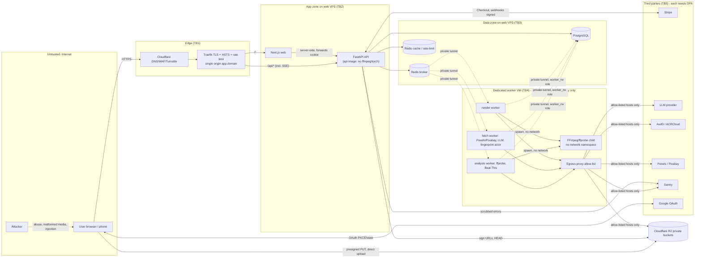

# SaveClock Studio — Security & Privacy

Status: **Rev 2.2** — reconciled to `DECISIONS.md` Rev 2.2 after the cross-check review · Date: 2026-11-08 · Owner: project owner
Scope: pre-implementation documentation only. No code exists yet. Consistent with `DECISIONS.md` (canonical). Siblings: `PRD.md`, `ROADMAP.md`, `CHECKLIST.md`, `ARCHITECTURE.md`, `STANDARDS.md`, `QUALITY.md`, `DESIGN.md`, `UX-SPEC.md`.

> **Legal notice.** Everything in sections 7 (privacy), 8 (DMCA) and the GDPR/CCPA/COPPA remarks is an operational engineering view, NOT legal advice. A qualified lawyer must review the Privacy Policy, ToS, DPAs, DMCA process, cookie/consent design and age gate before public launch.

Conventions: "(inference)" = reasoning, not directly sourced; **UNVERIFIED** = must be proven in the Phase 0 spike; **[counsel]** = lawyer sign-off needed. Control IDs are `SEC-xxx` (stable; new IDs only appended); threat IDs `T-xx`. **Level** (renamed from "Pri" to avoid clashing with phase numbers): L0 = blocks public launch, L1 = before paid launch, L2 = hardening. **Phase/gate** tag = the ROADMAP phase that owns delivery: Ph0 Spike · Ph1 Walking skeleton (incl. minimal auth) · Ph2 Core pipeline · Ph3 Editor UX · Ph4 Accounts/limits/compliance · Ph5 Paid launch · Ph6 Post-launch · **PL** = pre-launch go/no-go gate (§10). "A / B" = starts in A, completes in B.

## Rev 2.2 changelog (2026-11-08)

- **Rev 2.2 (final verification):** header and source references updated to DECISIONS Rev 2.2 (V-09). No control changed.

## Rev 2.1 changelog

- **Rev 2.1 (final cross-doc fixes):** Q-19 answered (Mode A remux reads the gated original `work/audio_source`, DECISIONS §8a) and SEC-018/009 aligned; Q-20 answered (four buckets, no `quarantine/` prefix) and SEC-001/003/081, key-flow text and data inventory aligned to ARCHITECTURE §9; traceability re-run (see ROADMAP Appendix A).

## Rev 2 changelog

Source of truth: `DECISIONS.md` Rev 2.2. Reviews applied: `review/consistency-review.md` (C-xx/D-xx), `review/completeness-review.md` (G-xx), `review/fact-check.md` (F-xx).

**Topology and isolation**
- Single origin (Traefik path routing; `__Host-` session cookie; **no CORS**). The `api.` same-site subdomain design is removed (infeasible with `__Host-`). SEC-054, 057, 058 rewritten; SEC-058 now means "no CORS" (ID kept); R2 bucket CORS is the only CORS (SEC-081). Q-01 closed.
- Worker isolation model rewritten around a **dedicated worker VM**: no inbound, outbound only via an allow-listed egress proxy, non-root/read-only/cgroup limits. SEC-013, 014, 016, 020, 132 rewritten; the SEC-014 vs SEC-020 contradiction (workers "no Postgres" vs "re-read from Postgres") is resolved with a `worker_rw` role. New: SEC-024 (worker VM), 025 (egress proxy allow-list), 026 (tunnel + `worker_rw` + Redis ACLs), 027 (two images; `api` image has no ffmpeg/torch), 028 (two Redis), 029 (per-job no-network FFmpeg child). SEC-022 (gVisor) moved to Ph6. Q-07 closed.

**FFmpeg and uploads**
- `-protocol_whitelist file` only (`pipe` removed, SEC-010); forced input-demuxer allowlist, no HLS/concat/playlist demuxers on untrusted input (SEC-011); FFmpeg **>= 8.1**, exact build pinned in the spike, CVE tracking (SEC-017). Q-05, Q-16 closed.
- Limits 100 MB / 10 min / >= 15 s (SEC-003, 015). R2 presigned-PUT Content-Length enforcement stays **UNVERIFIED** (F-25): spike + server-side HEAD/ffprobe check (SEC-002, 003).
- SEC-007: downloads via R2 S3-endpoint presigned URLs (no custom cookieless domain; F-24).

**Retention, privacy, policy**
- One 72 h clock from upload-complete incl. per-project mezzanines (SEC-140); shared mezzanine cache removed (SEC-068; Q-04, Q-15 closed); `songs.sha256` retained (SEC-009, 142). Age 16+ self-declared (SEC-145); cookie-free first-party analytics (SEC-115, 146); fingerprint warn-only, no matched title shown (SEC-153, new SEC-156); Turnstile fail-closed on signup / fail-open with stricter limits on login (SEC-061); no password pepper (SEC-050); audit 12 mo (SEC-121) / DMCA 3 yr (SEC-151) proposed **[counsel]**; backups 14 d with monthly-then-quarterly drills (SEC-135).

**Fact-check corrections**: F-14 CVE-2025-22920 is a DoS per NVD, not RCE (T-01, §5.2, §11); F-13 "fixed in 8.0" dropped (unverified); F-16 torch pin well above 2.6 (SEC-031); F-17 `file` whitelist alone is insufficient (SEC-010/011); F-24/F-25 R2 presign semantics (SEC-002, 007); F-31 ASVS v5 requirement numbering (§1).

**Structure**: every control now carries a Phase/gate tag; priority column renamed Level (P0/P1/P2 -> L0/L1/L2). **Retired IDs: none.** Changed meaning: SEC-058 (CORS -> no-CORS), SEC-068 (shared cache -> per-project), SEC-022 (stronger sandbox, now Ph6).

---

## 1. Scope and security objectives

**In scope:** Next.js web app, FastAPI API (`api` image: no ffmpeg/torch), Dramatiq workers on a dedicated worker VM (`analysis`, `fetch`, `render`, `maintenance` queues; FFmpeg >= 8.1; PyTorch models: Beat This!, SigLIP 2; `worker` image), PostgreSQL 16, two Redis instances (broker, cache/rate-limit), Cloudflare R2, Stripe, Pexels/Pixabay, LLM provider (Claude Haiku), fingerprinting provider (AudD or ACRCloud), Sentry, Dokploy/Traefik VPS (single origin), CI/CD and developer workstations (config-malware risk).

**Out of scope (MVP):** native apps, public share links, team workspaces, AI video generation (these would require a re-run of the threat model).

**Objectives**
1. **Confidentiality of user audio and renders:** only the owner can read them; all project media auto-deletes 72 h after upload-complete (`DECISIONS.md` §2, SEC-140).
2. **Worker integrity:** untrusted media can never give code execution, network pivot, or local file read on a worker; a fully compromised worker still reaches only the egress allow-list and its scoped credentials (SEC-024..029).
3. **Account integrity:** no account takeover, no cross-tenant access (IDOR).
4. **Cost integrity:** one actor cannot burn unbounded compute, LLM, stock-API, or storage budget (denial-of-wallet).
5. **Payment integrity:** entitlements follow verified Stripe state only.
6. **Supply-chain integrity:** no malicious dependency, image, model weight, or dev-tool config reaches production or a teammate (includes this team's JS config-malware guard).
7. **Privacy by design:** data minimisation, short retention, no PII in logs, working DSAR/deletion, breach notice within 72 h.
8. **Copyright-process readiness:** takedown, counter-notice, repeat-infringer handling operable on day one.

Baseline standard: OWASP ASVS 5.0 Level 2 for auth/session/API/files ([ASVS 5.0 chapter overview](https://cheatsheetseries.owasp.org/IndexASVS.html); ASVS 5.0.0 released May 2025 with Authentication in V6 and Session Management in V7 — secondary source: [arc42 quality summary](https://quality.arc42.org/standards/owasp-asvs)). Requirement IDs must use v5 numbering (`v5.0.0-x.y.z`, F-31); re-check chapter numbers against the official ASVS repository before mapping the checklist (inference: secondary sources disagree on requirement counts). Engineering baseline: `sattva-production-grade-engineering` (parameterised queries, ownership checks, non-root containers, pinned deps, secrets out of git).

---

## 2. Asset inventory

| ID | Asset | Sensitivity | Where | Notes |
|---|---|---|---|---|
| A1 | Uploaded song (possibly copyrighted) | High (legal + privacy) | R2 `uploads/` | 72 h TTL; owner-only |
| A2 | Intermediates (per-project mezzanine clips, stems, proxies) | Medium | R2 `work/`, worker tmpfs | Same single 72 h clock as the project; no shared cross-user cache (SEC-068) |
| A3 | Renders (MP4) | High | R2 `renders/` | signed short-lived URL; 72 h |
| A4 | Beat map / project JSON, `songs.sha256` | Low-Medium (no audio; may contain title/artist metadata; hash lets a user re-attach the same file) | Postgres | kept after media expiry |
| A5 | Account data (email, name, password hash, OAuth subject, age attestation) | High PII | Postgres | argon2id hashes |
| A6 | Sessions, CSRF tokens, verification/reset tokens | Critical | Postgres/Redis | hashed at rest |
| A7 | Billing data (Stripe customer/subscription IDs; no card data) | Medium | Postgres, Stripe | PCI scope SAQ-A via Stripe Checkout (inference) |
| A8 | Third-party secrets: Stripe keys + webhook secret, R2 tokens, LLM key, Pexels/Pixabay keys, fingerprint vendor key, Sentry DSN, DB/Redis passwords, tunnel keys, session signing key, OAuth client secret | Critical | Dokploy env (web VPS); per-role subset on the worker VM | rotation schedule SEC-082 |
| A9 | Model weights (Beat This!, SigLIP 2) | Medium (integrity) | Baked into worker image / R2 | checksum-pinned |
| A10 | Compute and API budgets (CPU minutes, LLM tokens, Pexels 200 req/h, Pixabay 100 req/60 s quotas, R2 storage) | Business-critical | — | quota exhaustion = outage or key revocation |
| A11 | Rights/audit records (DMCA notices, fingerprint results, repeat-infringer strikes, consent log) | High (legal evidence) | Postgres | retained longer than media, minimised |
| A12 | Source code, CI secrets, developer machines | Critical | GitHub, laptops | JS config-malware target |
| A13 | Web VPS host, worker VM, Docker daemons, Dokploy panel, Traefik certs, egress proxy config | Critical | VPS + worker VM | worker VM is dedicated (SEC-024) |
| A14 | Brand / domain / DNS | High | Registrar, Cloudflare | takeover, phishing |

---

## 3. Trust boundaries and data flow

Trust boundaries: **TB1** internet to edge; **TB2** edge to app (TLS terminates at Traefik; one origin, no CORS); **TB3** app to data (credentials per service, no public ports; two Redis); **TB4** web VPS to the dedicated worker VM and queue to worker, the highest-risk boundary because workers parse attacker-controlled binary formats (no inbound, egress proxy, no-network FFmpeg child); **TB5** to third parties (data leaves our control; DPA + minimisation); **TB6** developer/CI to production (supply chain).

Key flows: (1) verified user creates a project and requests an upload slot; API validates metadata/quota, returns a presigned PUT; (2) browser PUTs the parts to the R2 `uploads` bucket (multipart, per-part presigned URLs; ARCHITECTURE §9); (3) API checks size via HEAD and enqueues `analysis`; the worker downloads to scratch and a no-network child runs ffprobe/canonicalisation to a canonical FLAC and copies the validated original to `work/audio_source` (Mode A input), then deletes the `uploads` object; Beat This, fingerprint and the audio proxy use the canonical copy, the Mode A remux uses `audio_source` through the same no-network gate; (4) the fingerprint actor (on the `fetch` queue) sends an excerpt/hash to the vendor via the proxy; the LLM, called from the `fetch` worker, receives numeric features plus sanitised constrained fields, never raw ID3 text (SEC-040+); (5) the fetch worker downloads only from allow-listed stock hosts; (6) the render FFmpeg child has no network; (7) signed download URL; one 72 h purge clock from upload-complete.

---

## 4. Threat model (STRIDE)

Likelihood/Impact: L/M/H. Control IDs refer to §5. Verification refers to §10 test types.

| ID | STRIDE | Threat | Component | Likelihood | Impact | Control(s) | Verification |
|---|---|---|---|---|---|---|---|
| T-01 | E | Crafted media triggers memory-corruption in an FFmpeg demuxer/decoder, leading to code execution on a worker (FFmpeg has a steady CVE flow, e.g. CVE-2025-9951 jpeg2000 heap-buffer-overflow write (RCE or DoS per NVD), CVE-2025-22920 avformat heap overflow (**DoS only** per NVD), CVE-2025-59730 SANM decoder — see §11) | render/analysis worker | M | H | SEC-010..017, 021, 024, 025, 029 | fuzz corpus run; sandbox escape test; Trivy/ffmpeg version + CVE watch gate |
| T-02 | I | HLS/m3u8 or concat-based SSRF / local file read via a "media" file that is really a playlist (Black Hat 2016 technique, [slides](https://www.blackhat.com/docs/us-16/materials/us-16-Ermishkin-Viral-Video-Exploiting-Ssrf-In-Video-Converters.pdf)); a `file`-only whitelist does not stop local reads by itself | ffprobe/ffmpeg | M | H | SEC-010, 011, 012, 013, 014, 029 | negative test uploading m3u8/concat/sdp as .mp3; assert rejection and no egress |
| T-03 | I | Metadata/subtitle/attached-picture streams or embedded filenames used to coax FFmpeg into reading other files or emitting them in output | ffmpeg | L | H | SEC-011 (map only audio stream 0), SEC-015 | test: output stream list == 1 audio |
| T-04 | D | Decompression/duration/stream bomb (tiny file, huge decoded size; thousands of streams; endless probing) exhausts CPU/RAM/disk | workers | H | M | SEC-016, 017, 018, 023 | bomb corpus; cgroup OOM kill observed; job fails cleanly |
| T-05 | E | Polyglot file (valid MP3 + valid HTML/ZIP/PE) served back from our origin and executed in browser or by downstream tool | R2, downloads | M | M | SEC-005, 006, 007 | content-type/CSP `sandbox`, `nosniff`, `Content-Disposition: attachment`, polyglot corpus |
| T-06 | S | Uploaded filename path traversal / header injection (`../`, CRLF, null, unicode tricks) | API, R2 keys, Content-Disposition | M | M | SEC-004 | unit tests with hostile names; keys are server-generated UUIDs |
| T-07 | T | Direct-to-R2 upload bypasses size/type limits (R2 presigned PUT binds Content-Type; no POST policy `content-length-range`; Content-Length enforcement **UNVERIFIED**, F-25, [Cloudflare docs](https://developers.cloudflare.com/r2/api/s3/presigned-urls/)) so a user stores a 5 GB object | R2 upload | H | M | SEC-001, 002, 003, 008 | upload oversize object; assert HEAD check + reaper delete + job rejected |
| T-08 | T | Unsafe deserialization: `torch.load` of an untrusted or tampered checkpoint runs arbitrary code (even `weights_only=True` was bypassed in [CVE-2025-32434](https://www.wiz.io/vulnerability-database/cve/cve-2025-32434), fixed in torch 2.6.0) | model loader | L | H | SEC-030, 031, 032 | CI check: no `torch.load` on non-pinned file; hash mismatch aborts boot |
| T-09 | T | Compromised model-weight download (HF/GitHub) or dependency swaps weights at build time | image build | L | H | SEC-031, 032, 090 | hash pin test; build fails on mismatch |
| T-10 | T | Prompt injection through ID3 title/artist/comment (or filename) reaches the keyword LLM and steers output (OWASP LLM01 — [OWASP GenAI](https://genai.owasp.org/llmrisk/llm01-prompt-injection/); metadata as injection channel noted in [secondary write-ups](https://securityarsenal.com/blog/owasp-llm-top-10-defending-against-prompt-injection-in-2026)) | LLM step | H | L-M | SEC-040..045 | injection corpus; schema reject rate; golden tests |
| T-11 | D | LLM cost amplification (long metadata, repeated regenerate, retries) | LLM step | M | M | SEC-044, 045, 060 | budget test: max tokens enforced; per-user cap trips |
| T-12 | I | LLM output used to build search URLs/queries enabling SSRF or stock-API parameter injection | fetch worker | L | M | SEC-043, 046, 051 | keywords are plain tokens, URL-encoded, host fixed in code |
| T-13 | S | Credential stuffing / brute force against login | auth | H | H | SEC-050, 051, 052, 060 | rate-limit test; lockout test; breached-password check |
| T-14 | I | Account enumeration via signup/login/reset responses and timing | auth | H | L | SEC-053 | identical responses + timing test |
| T-15 | S | Session hijack (XSS cookie theft, fixation, sniffing) | session | M | H | SEC-054, 055, 056, 110 | cookie flags scan; fixation test; CSP report-only review |
| T-16 | T | CSRF on state-changing endpoints (cookie auth, single origin) | API | M | H | SEC-057, 058 | cross-origin forged POST test must fail |
| T-17 | E | OAuth flaws: missing `state`/PKCE, open redirect, account takeover by linking unverified email (Google) | OAuth | M | H | SEC-059 | OAuth test suite; reject unverified `email_verified=false` |
| T-18 | S | Fake signups / bot farms exhaust free tier (3 renders/day x N accounts) | signup, quota | H | M | SEC-060, 061, 062, 063 | Turnstile bypass test; per-IP/device/ASN limits |
| T-19 | D | Queue flooding by one user starves others; poison jobs loop forever | Dramatiq | H | M | SEC-064, 065, 066 | load test with abusive user; DLQ test |
| T-20 | E | IDOR: user fetches/renders/deletes another user's project, upload, render, or signed URL via guessed ID | API | M | H | SEC-070, 071, 072 | authz test matrix (every route x two users); UUIDv4/ULID IDs |
| T-21 | I | Signed URL leakage (referrer, logs, shared link) gives long-lived access to a render | R2 downloads | M | M | SEC-072, 073 | TTL <= 10 min, `Referrer-Policy`, no URL logging; expiry test |
| T-22 | T | Forged Stripe webhook grants Pro / replayed event double-credits | billing | M | H | SEC-100, 101, 102 | signature-fail test; replay test |
| T-23 | T | Race on quota (parallel requests exceed daily render limit) | quota | H | M | SEC-062 (atomic counter) | concurrent request test |
| T-24 | E | Stored XSS via project title, user-supplied text, or stock clip metadata rendered in UI | web | M | H | SEC-110, 111, 112 | XSS payload corpus; CSP; React escaping; Trusted Types where feasible |
| T-25 | I | Secrets leaked via logs, Sentry events, error pages, git, Docker image layers, or env dump | all | M | H | SEC-080..085, 120 | gitleaks, log-scan test, image layer scan |
| T-26 | E | Over-privileged R2 token (account-wide) lets a compromised worker read all buckets or delete data | R2 | M | H | SEC-081 | token scope audit; negative access tests |
| T-27 | E | Container escape / worker-VM pivot / host takeover through Docker socket, privileged flags, or egress to internal networks | worker VM, web VPS | L | H | SEC-013, 014, 024, 025, 029, 130..134 | `docker inspect` policy check; no socket mount; outbound deny test |
| T-28 | T | Malicious or typosquatted dependency (pip/npm) / compromised CI action | supply chain | M | H | SEC-090..095 | lockfile hash install; Renovate review; Trivy/SBOM |
| T-29 | T | JS config-injection malware in `*.config.*` (next/vite/postcss/eslint/jest/vitest) executing on dev machine or CI when a tool loads it | dev + CI | M | H | SEC-096, 097 | pre-command grep; pre-push scan; CI job |
| T-30 | R | No audit trail: cannot prove who uploaded what, who took down what, or reconstruct an incident | audit | M | M | SEC-121, 122, 123 | audit-event tests; log retention check |
| T-31 | I | PII (email, IP, ID3 titles) in logs/Sentry/metrics violates GDPR minimisation | observability | H | M | SEC-120 | log-scrub unit test; Sentry `before_send` test |
| T-32 | I | Data retained beyond 72 h from upload-complete (purge job fails, backups, per-project mezzanines, caches) | storage | M | M | SEC-068, 140, 141, 142 | R2 lifecycle backstop check; purge-lag alert at 73 h; backup-restore doesn't resurrect media |
| T-33 | I | Third-party processor receives more than needed (full song to fingerprint vendor, raw tags to LLM) | AudD/LLM | M | M | SEC-041, 143, 144 | data-map review; payload capture test |
| T-34 | S | Fraudulent / abusive DMCA notices (takedown abuse) or missed valid notice losing safe-harbour | DMCA ops | M | M | SEC-150..153 | runbook drill; SLA timer |
| T-35 | E | Minor (< 16) signs up; GDPR-K/COPPA exposure | signup | M | M | SEC-145 | age-attestation test; data deletion path |
| T-36 | D | Stock API key revoked/quota exhausted by abusive fetch volume or perceived "replication" | fetch worker | M | M | SEC-067, 068 | quota circuit-breaker test; request counters |
| T-37 | D | Redis/Postgres exposed or unauthenticated (incl. over the worker tunnel); broker poisoning enqueues arbitrary actor calls | data zone | L | H | SEC-026, 028, 133, 135, 136 | port scan from outside; auth required; job payloads validated by schema |
| T-38 | T | Mass assignment (client sets `role`, `plan`, `user_id`) | API | M | H | SEC-074 | Pydantic `extra=forbid` tests |
| T-39 | I | Cross-origin reads/writes against the authenticated API (a CORS misconfiguration would enable it; none is configured) or an over-broad R2 bucket CORS | API, R2 | M | H | SEC-058, 081 | Origin probe returns no ACAO; bucket CORS limited to app origin + PUT/HEAD |
| T-40 | D | Output of malicious stock clip (stock host compromised or MITM) feeds FFmpeg | fetch/render | L | H | SEC-011, 012, 019, 025, 029, 051 | TLS-verify, host allowlist, same ffprobe gate and forced demuxer for stock clips |
| T-41 | E | Compromised worker tries to pivot: exfiltrate data via arbitrary egress, reach the web VPS/DB beyond its role, or reuse tokens | worker VM | L | H | SEC-024, 025, 026, 081 | outbound deny test; `worker_rw` privilege audit; token-scope audit |

Total: **41 threats** (T-41 added in Rev 2).

---

## 5. Control catalog

Each control: ID, requirement, priority, how to verify. "Test" = automated test in CI, "Config" = config assertion/review, "Scan" = tool scan.

### 5.1 Upload and file validation

| ID | Control | Level | Phase/gate | Verify |
|---|---|---|---|---|
| SEC-001 | Upload is a multi-step flow (exact paths owned by ARCHITECTURE §7: create project → init upload → part URLs → upload-complete): authenticated, email-verified (SEC-052), quota-checked, declared size/MIME. The API returns per-part presigned **PUT** URLs (`POST /projects/{id}/upload`, `…/upload/parts`, `…/upload/complete`) for a server-generated random key in the `uploads` bucket (ARCHITECTURE §7, §9). Client never chooses the key. | L0 | Ph1 | Test: key not derived from client input |
| SEC-002 | Presigned PUT lifetime <= 5 min; sign `Content-Type` (and `Content-Length` as a signed header). R2 documents only Content-Type binding on presigned PUT (403 on mismatch) and does not support POST-policy `content-length-range` ([Cloudflare docs](https://developers.cloudflare.com/r2/api/s3/presigned-urls/), F-24/F-25). **Whether a signed Content-Length is enforced is UNVERIFIED** — the Phase 0 spike must prove or disprove it (Q-02); until proven, no size guarantee is assumed at the storage layer and SEC-003 is the control. | L0 | Ph0 (spike) / Ph1 | Spike + Test: PUT with larger body is rejected, or is caught by SEC-003 |
| SEC-003 | Size/duration enforcement independent of R2: limits are **≤ 100 MB, ≤ 10 min, ≥ 15 s** (`DECISIONS.md` §1). On upload-complete the API does `HEAD` and rejects + deletes if size > cap; the analysis worker's `ffprobe` (sandboxed) then re-checks size, duration (< 15 s = reject "too short", > 10 min = reject), stream count and codec before any decode. A reaper deletes any `uploads` object not claimed within 15 min; R2 lifecycle expires the `uploads` bucket at 3 days and aborts incomplete multiparts at 1 day as backstop (ARCHITECTURE §9). If the spike (SEC-002) shows presigned PUT cannot cap size, fallback is streaming the upload through a size-capped API/Worker endpoint (Q-02). | L0 | Ph1 | Test + Config: oversize / too-short / too-long objects rejected and deleted; lifecycle rule exists |
| SEC-004 | Filenames: store only as display metadata after normalising (NFC, strip path separators, control chars, RTL overrides, truncate 120). Never used in storage keys, shell args, or `Content-Disposition` without RFC 6266 encoding. | L0 | Ph1 | Test with hostile-name corpus |
| SEC-005 | Magic-byte sniff in the worker (first bytes) for allowed containers: MP3 (ID3v2 or frame sync), WAV (RIFF/WAVE), FLAC (`fLaC`), OGG (`OggS`, Vorbis/Opus only), M4A/MP4 audio (`ftyp`), AAC ADTS. Declared MIME and extension must agree with sniffed type; mismatch = reject. | L0 | Ph2 | Test: mismatch corpus |
| SEC-006 | Allowed codecs allowlist: mp3, aac(-lc), flac, pcm_s16le/s24le/f32le, vorbis, opus, alac. Everything else (including video streams, cover-art video streams, data/subtitle/attachment streams) is rejected or dropped. Reject playlists/manifests/containers that can reference other URLs (m3u8, mpd, sdp, concat, avi/mkv with external refs, ffconcat, ASX/PLS, `.url`, image sequences). | L0 | Ph2 | Test: reject suite |
| SEC-007 | Never serve user media from the app origin. Downloads use R2 presigned GET URLs on the R2 S3 endpoint (a different, cookie-less origin; presigned URLs do not work on custom domains — F-24), with `response-content-disposition=attachment`, forced `Content-Type` (`video/mp4` / `audio/*`) and `X-Content-Type-Options: nosniff`. No custom download domain is required. | L0 | Ph1 | Config + Test: response headers on a signed GET |
| SEC-008 | Per-user storage cap and concurrent-upload cap (Free: e.g., 3 live uploads); per-user upload byte quota per day. | L0 | Ph4 | Test |
| SEC-009 | Metadata handling: ID3/vorbis comments/cover art are stripped from the canonical copy (`-map_metadata -1 -map 0:a:0 -vn -sn -dn`); only whitelisted numeric tags (duration, sample rate) and a **sanitised** display title (<=80 chars, charset-limited) are stored. Original tags never reach the LLM (SEC-040). The validated original is retained only as `work/audio_source` for Mode A (the `uploads` object is deleted after validation) and dies on the single 72 h clock (SEC-140); its SHA-256 is kept as `songs.sha256` for re-attach (hash only, no audio). | L0 | Ph2 | Test: canonical file has no tags (`ffprobe`) |

### 5.2 FFmpeg and worker hardening

Background: FFmpeg protocol handling lets playlists pull `file:`/`http:`/`concat:` sources, which is the root of the HLS/concat SSRF and file-read class ([Black Hat 2016](https://www.blackhat.com/docs/us-16/materials/us-16-Ermishkin-Viral-Video-Exploiting-Ssrf-In-Video-Converters.pdf)); `-protocol_whitelist` takes a comma list ([FFmpeg protocols doc](https://ffmpeg.org/ffmpeg-protocols.html)). Per F-17, the whitelist semantics were not verified against a primary source, and **a whitelist that includes `file` still permits local-file reads through playlist/concat demuxers**; therefore the whitelist (`file` only, SEC-010) and the forced demuxer allowlist (SEC-011) are both mandatory and are verified on the pinned build. FFmpeg adds memory-safety CVEs every year; examples (third-party summaries, confirm on NVD/FFmpeg security page): [CVE-2025-9951](https://nvd.nist.gov/vuln/detail/CVE-2025-9951) (jpeg2000 heap-buffer-overflow write, RCE or DoS per NVD; fixed-in version not confirmed — F-13), [CVE-2025-22920](https://nvd.nist.gov/vuln/detail/CVE-2025-22920) (avformat heap overflow, **DoS only** per NVD — F-14), [CVE-2025-59730](https://nvd.nist.gov/vuln/detail/CVE-2025-59730) (SANM decoder, F-15).

| ID | Control | Level | Phase/gate | Verify |
|---|---|---|---|---|
| SEC-010 | Every ffmpeg/ffprobe call on user or stock input uses **`-protocol_whitelist file` and nothing else** (no `pipe`, no `-i pipe:`), placed **before** `-i`, and the wrapper rejects any caller-supplied protocol option. Input is always a path inside the per-job scratch dir. Caveat (F-17): a `file` whitelist alone does NOT stop local-file reads through a playlist/concat demuxer, so it is only effective together with SEC-011 (forced demuxer). Progress reporting must not require `pipe` input protocol; verify `-progress` behaviour with the whitelist on the pinned build in the spike. | L0 | Ph0 (spike) / Ph2 | Test: wrapper unit test asserts flags; negative tests with m3u8/concat/http/ffconcat; `ffmpeg -protocols` on pinned build |
| SEC-011 | **Forced input demuxer from an allowlist, never auto-probe.** `-f` is chosen from the *sniffed* type (SEC-005): audio `mp3`, `wav`, `flac`, `ogg`, `mov`, `aac`; stock video `mov`, `matroska` (mp4/webm). HLS (`hls`/`applehttp`), `concat`/`ffconcat`, DASH, `sdp`, `rtsp`, `image2`, `lavfi` and any other playlist/manifest demuxer are **never** applied to untrusted input. Explicit `-map 0:a:0` for songs; disable subtitles/data (`-sn -dn`), and `-vn` for audio. | L0 | Ph2 | Test: negative corpus (playlist/concat masquerading as .mp3); wrapper rejects any `-f` outside the list |
| SEC-012 | Single audited wrapper (`ffmpeg_runner`) is the only place that builds argv; **argument lists only, never shell strings**; no user-controlled filter strings, no user-controlled option values besides validated numeric frame indices and enums (aligns with `DECISIONS.md` §4). Stock clips go through the same ffprobe gate. | L0 | Ph2 | SAST rule bans `shell=True`/`os.system`; unit tests |
| SEC-013 | Defence in depth inside the worker VM (SEC-024): worker containers run non-root UID, `read_only: true` rootfs, tmpfs `/tmp` with size limit, `cap_drop: [ALL]`, `no-new-privileges`, default (or tighter) seccomp, no Docker socket, no privileged, no host mounts. The VM-level controls (SEC-024) are the primary boundary; these protect against a single bad container. | L0 | Ph1 | Config: `docker inspect` policy script in CI/deploy check |
| SEC-014 | **Network model (single, consistent):** workers sit on the dedicated worker VM (SEC-024) with **no inbound** and **outbound only through the allow-listed egress proxy** (SEC-025). Reachable from the VM, over a private authenticated tunnel (SEC-026): Redis broker, and Postgres via a least-privilege `worker_rw` role. Internet-bound calls are made only by the `fetch` queue actors (Pexels/Pixabay downloads, LLM keyword call) and the fingerprint actor (its own actor on the `fetch` queue); `analysis` and `render` actors make **no** internet calls except R2 (via the proxy). Every FFmpeg/ffprobe child runs with **no network at all** (SEC-029). The API never calls stock/LLM/fingerprint vendors. | L0 | Ph1 | Config + Test: outbound `curl` to a non-allow-listed host fails from the VM and from every worker container; FFmpeg child has no interfaces |
| SEC-015 | Probing limits via `ffprobe`: `-probesize`, `-analyzeduration` capped (e.g., 5 MB / 5 s), max streams 4, duration 15 s ≤ d ≤ 10 min, max sample rate 192 kHz, max channels 8; reject if exceeded. Use `-t`/`-fs` and `-max_alloc`-style limits where supported (verify availability on the pinned FFmpeg ≥ 8.1 build in the spike). | L0 | Ph2 | Test: bomb corpus |
| SEC-016 | Resource limits per job: cgroup CPU (e.g., 2 vCPU), memory (e.g., 2 GB, OOM kill), PIDs limit, disk quota on tmpfs, wall-clock timeout (render 5 min hard; analysis 2 min; probe 15 s) using process-group kill. Enforced at both container level and the VM's systemd slice, so a runaway job cannot starve the VM agent. | L0 | Ph2 | Test: runaway job killed |
| SEC-017 | **FFmpeg ≥ 8.1** (`DECISIONS.md` §3); the exact build (8.1.x vs 9.0.x) is pinned by the Phase 0 spike [spike]. Build from source with only needed components (`--disable-network`, unused demuxers/protocols/decoders disabled; enable only mp3/wav/flac/ogg/mov/aac(+matroska for stock), libx264, aac, filters in use) (verify configure flags). **CVE tracking:** FFmpeg is in the SBOM (SEC-093); subscribe to the FFmpeg security page / NVD feed for `ffmpeg`; HIGH/CRITICAL fixes trigger a rebuild within 7 days (proposal); Renovate + Trivy gate (SEC-092/094). | L0 | Ph0 (pin) / Ph2 | Config: `ffmpeg -version` pinned; `ffmpeg -protocols` lists only `file`; CVE watch alert exists |
| SEC-018 | Decode-once: the upload is canonicalised (PCM/FLAC, tags stripped) **in the analysis sandbox**; Beat This, fingerprint and the audio proxy consume the canonical copy only. The Mode A remux reads the **gated original** (`work/audio_source`, DECISIONS §8a: stream copy when AAC-LC, else AAC-LC 48 kHz, no other processing); that read goes through the identical SEC-010/011/015 gate (forced `-f`, `-protocol_whitelist file`) in a no-network child (SEC-029); nothing ever reads the raw `uploads` object after validation (C-28; Q-19 answered). | L0 | Ph2 | Test: analysis/fingerprint input is the canonical object; remux input is `audio_source` and runs with no network; no step reads `uploads` after validation |
| SEC-019 | Stock clips: HTTPS only, TLS verify on, host allowlist, max size (e.g., 100 MB), max duration, content-type check, ffprobe gate; redirects limited to allowlisted hosts; DNS rebinding/internal IP guard (resolve then connect; block RFC1918, loopback, link-local, metadata IPs). | L0 | Ph2 | Test: SSRF test against internal IPs |
| SEC-020 | Job payloads are IDs only (job ID, object key from DB). Workers re-read authoritative state from Postgres through the least-privilege `worker_rw` role (SEC-026) and re-check ownership; Pydantic-validated message schema, reject unknown fields. (Resolves the earlier SEC-014/SEC-020 contradiction: workers do reach Postgres, but only via that role.) | L0 | Ph1 | Test |
| SEC-021 | Crash isolation: one process per job (no long-lived FFmpeg), worker concurrency 1 per sandbox container for `analysis`/`render`; failed job = DLQ, user sees generic error. | L1 | Ph2 | Test |
| SEC-022 | Optional stronger sandbox for the per-job FFmpeg child (gVisor `runsc` or Firecracker/Kata) once the worker VM exists; evaluate cost vs. risk after launch. | L2 | Ph6 | Config |
| SEC-023 | Disk hygiene: per-job scratch dir created with random name, `0700`, removed in `finally`; startup sweep of stale scratch. | L0 | Ph2 | Test |
| SEC-024 | **Dedicated worker VM** (`DECISIONS.md` §3) hosts all `analysis`/`fetch`/`render`/`maintenance`-media workers and nothing else. Host firewall: **no inbound** (no public ports; admin only via provider console or an outbound-initiated private tunnel from allow-listed IPs), default-deny outbound except the egress proxy and the private tunnel (SEC-025/026); non-root workload users, read-only rootfs for worker containers, cgroup CPU/mem/PID/time limits (SEC-016), automatic security updates, no Docker socket exposure, no secrets beyond per-role R2/DB credentials. A compromised worker can therefore reach only the proxy allow-list, its own scoped tokens and the broker/DB role — not the web VPS, other tenants or the internet at large. VM is rebuildable from a pinned image (kill-and-replace on incident, §8). | L0 | Ph1 | Config: external port scan shows no open ports; outbound deny test; rebuild drill |
| SEC-025 | **Egress proxy with host allow-list** (the only outbound path from the worker VM): `api.pexels.com`, `videos.pexels.com`, `pixabay.com`, `cdn.pixabay.com` (+ the exact provider CDN hosts confirmed in Phase 0), the R2 S3 endpoint, the LLM API host, the fingerprint vendor host, Sentry ingest. Proxy performs CONNECT-only to named hosts (no wildcard TLDs), resolves then connects with RFC1918/loopback/link-local/metadata-IP blocking (SEC-019), logs destination host + bytes (no URLs with query strings), and per-destination rate caps. Everything else is denied and alerts. | L0 | Ph1 | Test: request to non-listed host and to internal IPs is denied; allow-list diff reviewed in CI |
| SEC-026 | Worker ↔ data-zone access: broker and Postgres are reached from the worker VM only over a private, mutually-authenticated tunnel (e.g., WireGuard) with TLS on top; Postgres via a dedicated **`worker_rw`** role (DML only on job/plan/analysis tables the workers own, no user/billing/session tables, no DDL); Redis broker with per-service ACL users. No Postgres/Redis port is public (SEC-133). | L0 | Ph1 | Config: role privilege audit; external scan; negative query test as `worker_rw` |
| SEC-027 | **Two images from one codebase** (`DECISIONS.md` §3): the `api` image contains **no ffmpeg, no torch, no models** — the API process never parses user media, which removes the parser attack surface from the internet-facing tier; the `worker` image carries ffmpeg, torch CPU and checksum-pinned models. CI asserts `which ffmpeg` and `import torch` fail in the `api` image. | L0 | Ph1 | Test: image content assertions in CI; Trivy per image |
| SEC-028 | **Two Redis instances:** broker (`noeviction`, queues only, IDs-only payloads) and cache/rate-limit (`allkeys-lru`; rate-limit counters, ephemeral cache). Separate passwords/ACLs and networks; eviction in the cache can never drop a job, and queue pressure can never disable rate limiting. | L0 | Ph1 | Config: instance policies asserted; Test: cache flush does not lose jobs |
| SEC-029 | **Per-job no-network FFmpeg/ffprobe child:** the trusted Python parent downloads inputs from R2 (via the proxy) into a random `0700` scratch dir, then runs FFmpeg/ffprobe as a short-lived child in its own network namespace with **no interfaces** (e.g., `unshare -n`/`--network none`), no access to credentials (empty environment, no mounted secrets), scratch dir as the only writable path; parent uploads results. One process per job, no long-lived FFmpeg. | L0 | Ph2 | Test: in-child connect attempt fails; child env/FS contains no secrets |

### 5.3 Model loading (PyTorch)

| ID | Control | Level | Phase/gate | Verify |
|---|---|---|---|---|
| SEC-030 | Never load weights from user-influenced or runtime-downloaded locations. Weights are fetched at **build time**, stored in the image or a read-only volume, loaded from a fixed path. | L0 | Ph2 | Config |
| SEC-031 | Pin each weight file by SHA-256 in a committed manifest; entrypoint verifies before load and refuses to start on mismatch. Prefer `safetensors` where the model supports conversion; otherwise `torch.load(..., weights_only=True)` on checksum-verified files only, with torch pinned **well above 2.6.0** (CVE-2025-32434 — `weights_only=True` RCE affecting <= 2.5.1; current torch is 2.15 per PyPI, F-16). | L0 | Ph2 | Test: tampered file -> boot fails; CI lint bans bare `torch.load`/`pickle.load` |
| SEC-032 | Model licences and provenance recorded in `MODELS.md`-style manifest (source URL, commit, hash, licence) — consistent with `DECISIONS.md` non-goals (no NC weights). | L1 | Ph2 | Review |
| SEC-033 | Inference runs inside the worker sandbox (SEC-013/014); no network during inference; `HF_HUB_OFFLINE=1` / equivalent so libraries never fetch at runtime. | L0 | Ph2 | Config |

### 5.4 LLM / prompt-injection controls

| ID | Control | Level | Phase/gate | Verify |
|---|---|---|---|---|
| SEC-040 | The LLM prompt is built from **computed features** (tempo bucket, energy curve summary, mood tags from our own enum) plus optional user "style hint" (<=100 chars). Raw ID3 title/artist/album/comment/filename are **never** inserted. | L0 | Ph2 | Test: prompt builder property test—no metadata field reaches prompt |
| SEC-041 | If title/artist is wanted for relevance, it passes a strict filter (charset allowlist, <=60 chars, no URLs/newlines/markup), is placed inside a clearly delimited data block, and the system prompt states it is untrusted data (OWASP recommends segregating and labelling external content — [LLM01](https://genai.owasp.org/llmrisk/llm01-prompt-injection/)). Default decision: omit (Q-06). | L0 | Ph2 | Injection corpus test |
| SEC-042 | Output must be JSON matching a Pydantic schema: list of <= N keywords, each `^[a-z][a-z \-]{1,30}$`, from a closed set of at most 5 fields; anything else = reject and use the fallback keyword table (`DECISIONS.md` §3). Output is treated as untrusted data everywhere. | L0 | Ph2 | Test: schema fuzz; fallback invoked |
| SEC-043 | Keywords are used only as URL-encoded query values to fixed, allow-listed stock endpoints; never as URLs, paths, shell args, or SQL. Blocklist for NSFW/brand/person-name terms (post-validation). | L0 | Ph2 | Test |
| SEC-044 | Cost controls: `max_tokens` cap (e.g., 300), input token cap, timeout 10 s, retries <= 1, per-job one call, per-user daily LLM-call cap, global monthly budget alarm and kill-switch flag that forces the fallback table. Provider-side spend limit configured. | L0 | Ph2 | Test + Config |
| SEC-045 | LLM provider is behind a client wrapper that logs token counts and latency only (no prompts/outputs with PII); provider API key scoped to a dedicated project/workspace; zero-retention / no-training terms confirmed in DPA (Q-08). | L1 | PL | Config + DPA review |
| SEC-046 | Golden-prompt regression tests (per `sattva-llm-features`): known injection strings ("ignore previous...", JSON-breaking text, long unicode) must yield valid schema or fallback. | L1 | Ph2 | Test |

### 5.5 Authentication, sessions, OAuth

Chosen design (`DECISIONS.md` §3): FastAPI owns auth; email+password (argon2id) with verification; Google OAuth; `__Host-` httpOnly Secure SameSite=Lax session cookie on a **single origin**; CSRF token on state-changing requests; no CORS. Minimal real users + sessions from Phase 1; verification, OAuth, tiers and quotas in Phase 4. Relevant ASVS 5.0 areas: V6 Authentication, V7 Session Management, plus OAuth/token chapter (see §1 caveat).

| ID | Control | Level | Phase/gate | Verify |
|---|---|---|---|---|
| SEC-050 | Passwords hashed with **argon2id**, minimum OWASP config m=19 MiB (19456 KiB), t=2, p=1 ([OWASP Password Storage Cheat Sheet](https://cheatsheetseries.owasp.org/cheatsheets/Password_Storage_Cheat_Sheet.html); F-30); tune on prod hardware to ~100–250 ms (inference); per-hash random salt, parameters stored in the hash string, rehash-on-login when params change. **No server-side pepper in MVP** (decision; revisit post-launch). Hashing runs in a bounded threadpool to avoid event-loop starvation / DoS. | L0 | Ph1 | Test: hash prefix `$argon2id$`, param assertions |
| SEC-051 | Password policy per ASVS: min length 12 (inference—ASVS 5.0 requires >= 8 at L1; verify), max >= 64, allow all Unicode, no composition rules, no forced rotation; check against a breached-password list (k-anonymity HIBP API or local list); reject top-N. | L0 | Ph1 | Test |
| SEC-052 | Email verification required before **project creation / upload / render** (gate at project creation so no storage is spent for unverified accounts — C-38): single-use token, 32+ bytes random, stored hashed, expires <= 24 h; resend rate-limited. Password reset likewise (<= 30 min, invalidates all sessions on use). Minimal real users + sessions exist from Phase 1; verification flow lands in Phase 4 (`DECISIONS.md` §3). | L0 | Ph4 | Test: reuse/expiry; unverified account cannot create a project |
| SEC-053 | Anti-enumeration: signup, login and reset return identical messages and similar timing (dummy hash on unknown email); "email already registered" is communicated only by email. | L0 | Ph4 | Test: response-diff + timing test |
| SEC-054 | Session cookie `__Host-` prefixed: `HttpOnly; Secure; SameSite=Lax; Path=/`, **no `Domain` attribute** — possible because the app is a **single origin** (`app.<domain>`, Traefik path routing: `/api/*` → FastAPI, everything else → Next.js; `DECISIONS.md` §3). The same-site `api.` subdomain design is **not used** (a `__Host-` cookie cannot carry `Domain`, so it would never reach the web origin). Next.js server-side calls to the API forward the cookie. Opaque random session ID (>= 128-bit), server-side session record, hashed ID at rest. Cookie name finalised in ARCHITECTURE. | L0 | Ph1 | Config: cookie flags scan (DAST); session ID entropy test |
| SEC-055 | Session lifecycle: rotate ID on login and privilege change (fixation), idle timeout (e.g., 7 d sliding for Free; 30 min re-auth for billing/email/password change), absolute lifetime 30 d, logout and "log out everywhere" revoke server-side; password change/reset revokes all sessions. | L0 | Ph1 | Test |
| SEC-056 | Login throttling and lockout: progressive per-account + per-IP delays (e.g., 5 failures -> 15 min soft lock/CAPTCHA) via Redis counters; does not reveal which factor tripped; alert on distributed stuffing patterns. Avoid hard lockout that enables account DoS (inference). | L0 | Ph4 | Test |
| SEC-057 | CSRF: cookie-authenticated API accepts state-changing methods (POST/PUT/PATCH/DELETE) only if (a) `Origin`/`Referer` matches the single app origin AND (b) a double-submit or synchroniser CSRF token header (`X-CSRF-Token`) is valid, AND (c) content-type is `application/json` (no simple-form posts). Webhooks excluded and protected by signatures instead. `GET` never mutates (SSE is GET, read-only). SameSite=Lax is a defence layer, not the only one. | L0 | Ph1 | Test: forged cross-origin POST fails |
| SEC-058 | **No CORS (single origin).** The API registers no CORS middleware and returns no `Access-Control-Allow-*` headers; cross-origin requests with credentials are not honoured. SSE is same-origin. The only CORS in the system is the **R2 uploads-bucket CORS**: exact app origin, `PUT` (and `HEAD`) only, minimal headers (SEC-081). (Replaces the earlier exact-origin CORS design; ID kept.) | L0 | Ph1 | Test: preflight/Origin probe returns no ACAO; Config: bucket CORS limited to the app origin |
| SEC-059 | Google OAuth: Authorization Code flow with **PKCE (S256)** and a signed, single-use, expiring `state` bound to the browser session; `nonce` in the ID token; exact redirect URI; verify ID token signature/`aud`/`iss`/`exp`; require `email_verified=true`; link to an existing local account only after the user proves control of that account (never auto-merge on email match alone); no open redirects (post-login redirect allow-listed relative paths only). | L0 | Ph4 | Test: state/PKCE tamper, unverified email, open-redirect cases |
| SEC-060 | Rate limiting (token bucket / sliding window on the **cache/rate-limit Redis**, SEC-028) at API layer + Traefik for coarse limits: auth endpoints (e.g., 10/min/IP), signup (5/h/IP), upload-slot (30/h/user), render-create (quota), reset-email (3/h/email+IP). 429 with `Retry-After`. Trust `X-Forwarded-For` only from Traefik/Cloudflare ranges. One table of limits is owned by ARCHITECTURE (C-45). | L0 | Ph1 (basic) / Ph4 | Test |
| SEC-061 | **Cloudflare Turnstile** on signup, password reset and (after N anomalies) login; token **must be validated server-side** via siteverify with secret key, single-use, hostname/action checked ([docs](https://developers.cloudflare.com/turnstile/get-started/server-side-validation/)). **Outage policy (decided): fail CLOSED on signup/reset** (missing token or siteverify unreachable = reject); **fail OPEN on login with stricter limits** (tighter per-IP/per-account throttles, SEC-056). Non-interactive challenge only (no cognitive test — WCAG 3.3.8). | L0 | Ph4 | Test with mocked siteverify incl. outage for signup vs login |
| SEC-062 | Quotas enforced **server-side and atomically** (DB row lock / Redis Lua / `UPDATE ... WHERE used < limit RETURNING`) at job creation: renders/day (Free ~3), concurrent jobs per user (1 Free, 2 Pro), monthly allowance (Pro), max duration per tier. Counted before enqueue, refunded on platform failure. | L0 | Ph4 | Test: concurrency test |
| SEC-063 | Abuse signals: disposable-email domain blocklist (soft), per-IP/ASN/device-fingerprint signup velocity, email-alias normalisation (`+` tags, dots for Gmail) for quota identity; manual review queue. | L1 | Ph5 | Test |
| SEC-064 | Queue fairness: per-user concurrency caps; weighted fair scheduling (Pro priority queue must not starve Free completely—guarantee minimum share); max queue depth per user; global queue-depth circuit breaker returns 503 with retry hint. | L1 | Ph5 | Load test |
| SEC-065 | Dramatiq: `max_retries` <= 2 with exponential backoff, `time_limit` per actor, dead-letter handling, idempotent actors (job state machine), unique job key to avoid double-run. | L0 | Ph2 | Test |
| SEC-066 | Hard per-job and per-day compute budget alarm (total CPU-seconds) with alerting; kill-switch to pause `render` queue. | L1 | Ph5 | Config |
| SEC-067 | Stock API protection: server-side only (keys never to browser); global token bucket respecting Pexels 200 req/h & 20k/month and Pixabay 100 req/60 s (limits per [feasibility report](../reports/SaveClock%20Studio%20feasibility.md)); response caching per provider terms (Pixabay requires 24 h caching); circuit breaker on 429; per-user fetch cap. | L0 | Ph2 | Test |
| SEC-068 | **No shared stock cache.** Mezzanines (and all stock-derived intermediates) are **per-project**: they live under the project prefix and die with the single 72 h clock (SEC-140); no cross-user cache and no persistent mirror of provider libraries unless Pexels/Pixabay terms permit (T-0.5). Attribution is shown in-app per provider terms. Provider-takedown purge is per project/clip ID. | L1 | Ph2 | Review: no `cache/mezz` shared prefix exists; sweeper test |

### 5.6 Authorization and API

| ID | Control | Level | Phase/gate | Verify |
|---|---|---|---|---|
| SEC-070 | One central auth dependency (`get_current_user`) on every router; deny-by-default (router-level dependency, with an explicit allow-list of public routes); unauthenticated route inventory is a CI test. | L0 | Ph1 | Test: route-walk asserts auth or allow-list |
| SEC-071 | Ownership scoping in the data layer: every project/upload/render query includes `user_id`; cross-user access returns **404**. Object keys in R2 are `u/{user_id}/{uuid}/...` and API verifies ownership before signing. | L0 | Ph1 | Test: two-user matrix over all routes |
| SEC-072 | IDs are unguessable (UUIDv4/ULID); signed download URLs TTL <= 10 min, issued per request after an auth check, single purpose (GET only, one key), not stored. | L0 | Ph1 | Test |
| SEC-073 | `Referrer-Policy: no-referrer` (or `strict-origin`) and `Cache-Control: private, no-store` on authenticated responses; signed URLs never logged (strip query string in access logs). | L0 | Ph1 | Config + log-scan test |
| SEC-074 | Mass-assignment guard: separate input/output Pydantic models, `extra="forbid"`, server-set fields (user_id, plan, role, status) never accepted from client. | L0 | Ph1 | Test |
| SEC-075 | Validate every input at the boundary (Pydantic v2); SQLAlchemy parameterised queries only; no raw SQL string-building (SAST rule). | L0 | Ph1 | SAST + Test |
| SEC-076 | Errors: generic client messages, correlation ID; no stack traces; FastAPI exception handlers centralised. | L0 | Ph1 | Test |
| SEC-077 | Admin/ops endpoints (if any) on a separate internal listener or behind SSO + IP allowlist; no admin UI in MVP. | L1 | Ph4 | Config |

### 5.7 Secrets, keys, infrastructure

| ID | Control | Level | Phase/gate | Verify |
|---|---|---|---|---|
| SEC-080 | Secrets only in Dokploy environment/secrets (per environment), never in git, images, or `NEXT_PUBLIC_*`; `.env` ignored; `.env.example` placeholders; `gitleaks` in pre-commit + CI. Fail-fast config validation at startup (all required secrets present, correct format). | L0 | Ph1 | Scan: gitleaks; Test: boot fails on missing secret |
| SEC-081 | **R2 least privilege:** separate buckets (final layout owned by ARCHITECTURE §9 — C-27, Q-20 answered): four buckets — `uploads`, `work` (canonical + source audio, mezzanines, proxies), `renders`, `backups` — each with its own bucket-scoped token per role: API (sign + head + delete; no list-all-account), analysis worker (read uploads, write work), render worker (read work, write renders), reaper (list+delete only). Tokens never account-wide/admin; no public bucket access, no r2.dev URL; **bucket CORS only on `uploads`: app origin, `PUT`/`HEAD`** (this is the system's only CORS, SEC-058). Distinct tokens for staging vs. production. Worker tokens are reachable only from the worker VM via the egress proxy (SEC-025). | L0 | Ph1 | Config: token-scope audit script; negative access tests |
| SEC-082 | Rotation: schedule documented—Stripe restricted keys & webhook secret 180 d (zero-downtime dual-secret overlap), R2 tokens 90 d, LLM/stock keys 90 d, session-signing/CSRF keys 90 d with key-ID overlap (old keys verify, new keys sign), DB/Redis passwords 180 d, OAuth client secret on suspicion/yearly; immediate rotation runbook on incident (§9). | L1 | PL | Review: rotation calendar; Test: dual-key verification |
| SEC-083 | Stripe uses **restricted API keys** limited to needed resources; separate test/live keys; live keys exist only in prod service. | L0 | Ph5 | Config |
| SEC-084 | DB roles: app role (DML only, no DDL), migration role (DDL, used only in deploy job), read-only role for analytics; no superuser use by app; TLS to Postgres if cross-host. | L0 | Ph1 | Config |
| SEC-085 | No secrets or PII in Docker build args/layers; multi-stage builds, non-root runtime user, `.dockerignore` excluding `.env`/`.git`; image scan for embedded secrets (Trivy secret scanner). | L0 | Ph1 | Scan |

### 5.8 Billing

| ID | Control | Level | Phase/gate | Verify |
|---|---|---|---|---|
| SEC-100 | Webhook endpoint verifies the `Stripe-Signature` header using the official SDK against the **raw** request body with the endpoint secret, tolerance default (5 min); reject otherwise with 400; endpoint excluded from CSRF but IP-rate-limited. | L1 | Ph5 | Test: bad/missing signature, tampered body, stale timestamp |
| SEC-101 | Idempotency: persist processed `event.id` (unique constraint) before side effects; handlers are idempotent upserts keyed by Stripe object IDs; Stripe delivers at-least-once and out of order, so handlers fetch current object state or compare `created`/status before applying (inference from standard practice; see [Stripe webhook docs](https://docs.stripe.com/webhooks)). Acknowledge quickly; heavy work to queue. | L1 | Ph5 | Test: replay + out-of-order |
| SEC-102 | Entitlements derive only from verified webhook/DB state, never from client redirect parameters (`success_url`); checkout sessions created server-side with `client_reference_id` = our user ID; plan changes via Customer Portal only. | L1 | Ph5 | Test |
| SEC-103 | No card data touches our servers (Stripe Checkout/Portal hosted) -> PCI SAQ-A (inference); no card/PAN in logs. | L1 | Ph5 | Review |
| SEC-104 | Refund/chargeback path pauses account renders and flags fraud; Stripe Radar defaults on. | L2 | Ph5 | Process |

### 5.9 Web security headers, TLS, XSS

| ID | Control | Level | Phase/gate | Verify |
|---|---|---|---|---|
| SEC-110 | Next.js sends a **nonce-based CSP** generated per request in the proxy/middleware ([Next.js CSP guide](https://nextjs.org/docs/app/guides/content-security-policy); nonce requires dynamic rendering; roll out as `Content-Security-Policy-Report-Only` first). Baseline: `default-src 'self'; script-src 'self' 'nonce-…' 'strict-dynamic' https://challenges.cloudflare.com; style-src 'self' 'nonce-…'; img-src 'self' data: blob: https://images.pexels.com …; media-src 'self' blob: <R2 S3 endpoint host>; connect-src 'self' <R2 upload host>; frame-src https://challenges.cloudflare.com https://js.stripe.com; object-src 'none'; base-uri 'none'; form-action 'self'; frame-ancestors 'none'; upgrade-insecure-requests` (no separate API origin: single origin). Exact sources finalised in `ARCHITECTURE.md`. | L0 | Ph1 (report-only) / PL (enforce) | DAST header scan; CSP report review; Playwright check |
| SEC-111 | Additional headers on web and API: `Strict-Transport-Security: max-age=63072000; includeSubDomains; preload` (preload only after confirming all subdomains are HTTPS), `X-Content-Type-Options: nosniff`, `Referrer-Policy: strict-origin-when-cross-origin`, `Permissions-Policy` (deny camera/mic/geolocation etc.), `Cross-Origin-Opener-Policy: same-origin`, `Cross-Origin-Resource-Policy: same-site`. API responses: `Content-Security-Policy: default-src 'none'`. | L0 | Ph1 | Config + scan (e.g., Mozilla Observatory, `securityheaders`) |
| SEC-112 | XSS hygiene: React escaping by default; ban `dangerouslySetInnerHTML` (lint); user text rendered as text only; any markdown/HTML from third parties sanitised (DOMPurify) — none expected in MVP; Trusted Types in report-only (L2). | L0 | Ph1 | Lint + XSS corpus |
| SEC-113 | Traefik: path routing for the single origin (`/api/*` → FastAPI, rest → Next.js; SSE routed without buffering), TLS 1.2+ (prefer 1.3), modern ciphers, ACME auto-renew with expiry alert, HTTP->HTTPS redirect, HSTS via middleware, request body size limits on `/api` (e.g., 1 MB JSON; uploads bypass the API and go to R2), request timeouts, per-IP rate-limit middleware, Traefik dashboard not exposed publicly. | L0 | Ph1 | Config + `testssl.sh` scan |
| SEC-114 | Cloudflare in front (proxy on) with WAF managed rules and bot protection where plan allows; origin locked to Cloudflare IPs (or authenticated origin pulls) to avoid bypass (inference; confirm compatibility with the Dokploy/Traefik cert flow). | L1 | PL | Config |
| SEC-115 | Frontend: no secrets in client bundle; third-party scripts minimised (Turnstile, Stripe.js only) with SRI where feasible; analytics are first-party, **cookie-free, aggregate event counts only** (no third-party analytics scripts, no consent banner needed — counsel confirms, SEC-146). | L0 | Ph1 | Scan of build output |

### 5.10 Logging, monitoring, audit

| ID | Control | Level | Phase/gate | Verify |
|---|---|---|---|---|
| SEC-120 | **Logging without PII:** structured JSON logs with user ID (opaque), job ID, request ID, status, timing; **never** log emails, passwords, tokens, cookies, `Authorization`, signed URLs/query strings, ID3 text, prompts/outputs, IP in clear (truncate IPv4 to /24 / IPv6 /48 or HMAC-hash with rotating salt, except in the short-lived security log). Sentry: `send_default_pii=False`, `before_send` scrubber, no request bodies, release/env tags. | L0 | Ph1 | Test: log-scrub unit test; Sentry scrubber test; grep CI logs |
| SEC-121 | Security audit log (append-only table, separate from app logs): login success/fail, password/email change, session revoke, OAuth link, billing events, upload accepted/rejected reason, DMCA events, admin actions, data export/deletion, quota-block decisions, fingerprint-match events (no matched title). Retention **12 months** (minimised fields) **[counsel]**; a purge job (not the app role) enforces it. | L1 | Ph4 | Test |
| SEC-122 | Alerts: auth failure spikes, 429 rate, worker sandbox kills/OOM, ffprobe rejection spikes (probing attack), queue depth, LLM spend, stock 429s, R2 4xx/5xx, Stripe webhook failures, certificate expiry, purge lag, DLQ growth. | L1 | Ph4 | Config: alert rules exist |
| SEC-123 | Time sync (NTP) on VPS and containers; request IDs propagated API -> worker. | L1 | Ph1 | Config |

### 5.11 Supply chain and developer security

| ID | Control | Level | Phase/gate | Verify |
|---|---|---|---|---|
| SEC-090 | Python: `uv` lockfile (`uv.lock`) with hashes; CI installs with `--frozen`/hash-checking (`pip install --require-hashes` alternative); no unpinned `latest`. JS: `pnpm-lock.yaml` committed, `pnpm install --frozen-lockfile`, `pnpm` `ignore-scripts` for third-party install scripts by default with an explicit allowlist (`onlyBuiltDependencies`) (inference: verify current pnpm option names). | L0 | Ph1 | CI: fails if lockfile drifts |
| SEC-091 | Base images pinned by **digest**, minimal (`python:3.12-slim`/distroless where feasible), updated weekly; multi-stage; non-root. | L0 | Ph1 | Config |
| SEC-092 | **Trivy** (or Grype) scans images and the repo filesystem in CI: fail on HIGH/CRITICAL with fix available; also scans for secrets and misconfig (Dockerfile, compose). Scheduled nightly re-scan of deployed digests. | L0 | Ph1 | Scan |
| SEC-093 | **SBOM** (CycloneDX via Syft/Trivy) generated per image build and stored with the release; used to answer "are we affected?" for new CVEs (esp. FFmpeg, libs). | L1 | Ph5 | Scan |
| SEC-094 | Dependabot or Renovate enabled for pip/uv, pnpm, GitHub Actions, Docker; security updates auto-PR; FFmpeg and torch updates tracked as high-priority manual reviews. `pip-audit` and `pnpm audit` in CI. | L0 | Ph1 | Config |
| SEC-095 | GitHub hardening: branch protection on `main`, required reviews and checks, signed commits recommended, GitHub Actions pinned to commit SHA, minimal `GITHUB_TOKEN` permissions, no long-lived cloud creds in CI (OIDC where possible), secret scanning + push protection on. | L0 | Ph1 | Config |
| SEC-096 | **Config-malware guard (team-mandatory).** Before running any `npm`, `pnpm`, `yarn`, `npx`, `next`, `vite`, `vitest`, `jest`, `eslint`, or any build/test/lint command, and after every `git pull`/`checkout`/`rebase`, run in the working directory: `grep -lE "global\.[a-z]='[0-9]-|_\$_[0-9a-f]{4}=\(function" *.config.* 2>/dev/null`. **If it prints anything, STOP**: do not run the command; report repo config malware and the file. Implemented as (a) a documented developer habit/alias or git hook wrapper, (b) a CI job that runs the same grep (repo-wide, each app dir) as the first step before any install/build, so a poisoned config never gets executed in CI. | L0 | Ph0 | CI job result; seeded-fixture test: a file containing the pattern must fail the job |
| SEC-097 | **Pre-push / pre-deploy scan (team-mandatory), read-only, report FOUND/NOT FOUND with evidence**: (1) outgoing diff `git diff origin/<branch>..<branch>` grep for `global\.[a-z]='[0-9]-[0-9]+'` and `_\$_[0-9a-f]{4}=\(function`; (2) working-tree `grep -rIlE` of the same patterns excluding `node_modules`, `.git`, `.next`; (3) `*.config.{js,mjs,cjs,ts}` with any line > 1000 chars (payloads hide after a legit stub); (4) `createRequire` from `node:module` inside postcss/vite/eslint/jest/vitest configs; (5) check **refs, not just the tree**: `git grep -lE "<regex>" $(git for-each-ref --format='%(refname)' refs/heads refs/remotes)` because infection can live in committed history. **Never push if anything is FOUND**; do not self-clean unless asked. Indicators of full machine compromise: a `~/.node_module` dropper folder, npm logs showing `--prefix ~/.node_module install axios socket.io-client`, unexpected node processes or connections to the known C2 host -> treat machine as compromised and revoke credentials **from a different device**. Same scan is replicated as a required CI check on PRs and on the deploy job. | L0 | Ph0 | CI required check; seeded fixtures; run before every push/deploy |
| SEC-098 | Developer machines: full-disk encryption, hardware security keys for GitHub/Cloudflare/Stripe/Dokploy/registrar, no production secrets on laptops, separate browser profile for admin consoles. | L1 | Ph1 | Checklist |
| SEC-099 | Third-party SaaS accounts (Cloudflare, Stripe, Dokploy, registrar, Sentry, AudD, LLM) protected with MFA; named owners; offboarding checklist. | L0 | Ph1 | Checklist |

### 5.12 Infrastructure / host

| ID | Control | Level | Phase/gate | Verify |
|---|---|---|---|---|
| SEC-130 | Web VPS host: SSH key-only, no root login, fail2ban/CrowdSec, automatic security updates, firewall allowing only 80/443 (+ SSH from restricted IPs); Dokploy panel behind VPN/IP allowlist or at least strong auth + MFA, not on a public default port. | L0 | Ph1 | Config + external port scan |
| SEC-131 | Docker daemon not exposed; no container mounts `/var/run/docker.sock`; user namespaces / rootless Docker evaluated. | L0 | Ph1 | Config |
| SEC-132 | Resource isolation: analysis/fetch/render workers run on the **dedicated worker VM** (SEC-024), never on the web/API/Postgres VPS, so a runaway or compromised job cannot starve or reach Traefik/DB. Postgres volumes backed up (see §6.3) to R2 with encryption. | L0 | Ph1 | Config |
| SEC-133 | Postgres and Redis on an internal Docker network only; no published ports; passwords + (Redis ACL users per service, `requirepass`/ACL, dangerous commands renamed/disabled); Postgres `pg_hba` restricted. | L0 | Ph1 | External scan; Config |
| SEC-134 | Separate staging and production (distinct secrets, buckets, Stripe test mode, no real user data in staging). | L0 | Ph1 | Config |
| SEC-135 | Backups: nightly encrypted Postgres dumps, retention **14 d** (stated in the privacy notice), restore drill monthly until launch then quarterly (C-34), backups never contain uploaded media; restoring must replay deletion tombstones (SEC-142). ARCHITECTURE adopts the same numbers. | L1 | Ph4 | Restore drill |
| SEC-136 | Redis broker payloads contain no PII/audio (IDs only). **Two Redis instances** (SEC-028): the broker is `noeviction` with persistence reviewed so completed/deleted jobs do not linger; the cache/rate-limit instance is `allkeys-lru` with TTL'd keys only. | L1 | Ph1 | Config |

### 5.13 Privacy, retention, compliance controls

| ID | Control | Level | Phase/gate | Verify |
|---|---|---|---|---|
| SEC-140 | **Single retention clock:** every project blob — song, mezzanines, intermediates, proxies, silent master, Mode A export, per-project mezzanines — is deleted **72 h after upload-complete** (`projects.expires_at = upload-complete + 72 h`; renders get no later expiry; no "last access" or `ready`-status-based extension (state names per ARCHITECTURE §4); `DECISIONS.md` §2). An application reaper (sweeper on the `maintenance` queue, 10-min cadence) deletes the whole project prefix and marks DB rows; alert and audit fire at **73 h** (72 h + 1 h grace — C-35). R2 lifecycle (whole days) expires `uploads/`, `work/`, `renders/` at 4 days as a pure backstop. Kept after expiry: project metadata, beat map/analysis (no audio), edit plan, `songs.sha256` (for same-file re-attach; hash must match). No extension without counsel. | L0 | Ph2 | Test + Config; alert on objects > 73 h |
| SEC-141 | User-initiated "Delete now" for each upload/render, immediate and verifiable (object deleted, DB flagged). | L0 | Ph4 | Test |
| SEC-142 | Account deletion: soft-disable immediately, hard-delete personal data within 30 days (media immediately), keep only minimal non-personal or legally required records (billing per tax law, DMCA records, minimal audit) with documented basis; `songs.sha256` rows deleted with the account; tombstone list prevents resurrection from backups. | L0 | Ph4 | Test: deletion e2e |
| SEC-143 | Data minimisation to processors: the fingerprint vendor receives only a short audio excerpt or fingerprint hash (not the full file) if the API permits (Q-11); the LLM receives features only (SEC-040). Egress to each vendor is restricted to its allow-listed host (SEC-025). | L0 | Ph4 | Payload capture test |
| SEC-144 | DPAs signed and recorded for each processor (Cloudflare R2/Turnstile, AudD or ACRCloud, LLM provider, Stripe, Sentry, hosting VPS provider, email sender, Google as OAuth provider is a separate controller); international transfers (SCCs/DPF) assessed. Sub-processor list published. | L0 (legal) | PL | Legal checklist |
| SEC-145 | Age gate at signup: self-declared **16+** (checkbox "I am 16 or older", store attestation timestamp, not a full DOB) — covers the GDPR Art. 8 default of 16 ([Art. 8](https://gdpr-text.com/read/article-8/); F-29); not offered to under-13 (COPPA). ToS prohibits under-age use; account closure on discovery. Needs a `users` column — **DB CHANGE** announcement before commit. Counsel confirms the threshold **[counsel]**. | L0 (legal) | Ph4 | Test |
| SEC-146 | Consent/cookies: strictly necessary cookies only (session `__Host-` cookie, CSRF); **analytics are first-party, cookie-free, aggregate event counts only**, so no consent banner in MVP **[counsel confirms under ePrivacy]**. Any future non-essential cookie or third-party analytics requires opt-in first. Turnstile and Stripe.js disclosed. | L0 (legal) | Ph4 | Scan: cookie audit in browser |
| SEC-147 | DSAR tooling: export (JSON of account, projects metadata, beat maps, billing refs, consent log) and deletion within one month (GDPR Art. 12) — manual runbook acceptable at MVP; identity verification via logged-in session or email loop. | L1 | PL | Drill |
| SEC-148 | CCPA/CPRA basics: privacy policy lists categories collected and purposes; "we do not sell or share personal information" statement (must remain true); honour deletion/know requests within 45 days; honour Global Privacy Control if ads/analytics are ever added (inference). Threshold applicability is a legal question (Q-12). | L1 (legal) | PL | Review |
| SEC-149 | Records of Processing (GDPR Art. 30) maintained (this data map = start); DPIA screening done (audio fingerprinting + children risk) and recorded (lawyer). | L1 (legal) | PL | Review |

### 5.14 DMCA / rights operations

| ID | Control | Level | Phase/gate | Verify |
|---|---|---|---|---|
| SEC-150 | Register the **DMCA designated agent** with the US Copyright Office before launch and publish agent contact on the site; renew every 3 years (the Office's rule—confirm). Lawyer required. | L0 (legal) | PL | Checklist |
| SEC-151 | Takedown intake: dedicated mailbox + web form; auto-acknowledge; log in `dmca_notices` (immutable); SLA target: act expeditiously, e.g., disable/delete identified material within 24 h; preserve minimal evidence (hash, user ID, timestamps) not audio. DMCA records retained **3 years [counsel]** (proposal). Operator tooling (CLI/admin behind SSO/IP allowlist, G-04) is a Phase 4 task. | L0 | Ph4 | Runbook drill |
| SEC-152 | Counter-notice procedure: forward to claimant, restore after 10–14 business days if no suit is filed (statutory window — confirm with counsel); log. | L0 (legal) | Ph4 | Runbook |
| SEC-153 | **Repeat-infringer policy** published in ToS and implemented: strike counter per account, N strikes (e.g., 3) -> termination, consistently applied (BMG v. Cox risk, see feasibility report); fingerprint-match events never count as strikes (a match does not prove lack of rights) — see SEC-156. | L0 (legal) | Ph4 | Test: strike logic |
| SEC-154 | Rights warranty checkbox before upload is recorded (timestamp, ToS version, user ID — store the ToS version per project, C-42). No public sharing, no gallery (`DECISIONS.md` §2) — keep it that way; adding sharing triggers a new legal review. | L0 | Ph2 | Test |
| SEC-155 | Abuse reporting: `abuse@`/`security@` mailboxes and `/.well-known/security.txt` with disclosure policy. | L1 | PL | Config |
| SEC-156 | **Fingerprint policy (warn-only):** fingerprinting (AudD or ACRCloud) runs on every upload; a match produces only the neutral notice "this may be a released track" and a Mode B nudge — the **matched title/artist is never shown to the user** and is not stored beyond a vendor reference; it does **not block** in MVP and never counts as a strike (counsel decides blocking at the launch gate). Vendor outage = neutral "you can continue", no nudge. | L0 (legal) | Ph4 | Test: API response carries no match metadata; outage path |

---

## 6. Privacy and data retention

### 6.1 Data map (RoPA starter; lawful bases are proposals for the lawyer)

| Data | Subject | Purpose | Lawful basis (proposed) | Stored where | Retention | Shared with (processor) | Notes |
|---|---|---|---|---|---|---|---|
| Email, password hash, display name | Account holder | Account, login | Contract (Art. 6(1)(b)) | Postgres | Life of account + <=30 d after deletion | email sender | argon2id |
| Google OAuth subject + email | Account holder | Social login | Contract | Postgres | Life of account | Google (own controller) | minimal scopes: `openid email profile` |
| Age attestation ("16 or older") | Account holder | Age gating | Legal obligation / legitimate interest | Postgres | Life of account (timestamp + boolean, no DOB) | — | counsel confirms threshold |
| Session ID (hashed), CSRF secret | Account holder | Security | Contract / legitimate interest | Redis/Postgres | Session lifetime | — | strictly necessary cookie |
| IP address, user agent | Visitor | Abuse prevention, rate limiting, security audit | Legitimate interest (Art. 6(1)(f)) | Redis counters (minutes–hours); audit log (truncated/hashed) | Counters <= 24 h; audit 12 months | Cloudflare | LIA to be documented |
| Uploaded song file | Account holder (+ third-party rightsholders) | Analysis and render | Contract | R2 `uploads` bucket until validated (minutes), then `work` bucket `audio_source` | **72 h from upload-complete** | Cloudflare (R2) | not used for training; never public |
| Audio metadata (ID3 tags) | Artists / account holder | Display of title only (sanitised) | Contract | Postgres (sanitised title only) | with project | — | raw tags dropped |
| Beat map / sections / energy curve, edit plan, `songs.sha256` | Account holder | Product feature, same-file re-attach | Contract | Postgres | Project life (until deletion); media expires at 72 h but these remain | — | contains no audio; hash only |
| Intermediates (per-project mezzanines, proxies) | Account holder | Rendering | Contract | R2 `work/` | 72 h from upload-complete (same clock) | Cloudflare | no shared cache |
| Silent master / Mode A export MP4 | Account holder | Product output | Contract | R2 `renders/` | 72 h from upload-complete (not from render) | Cloudflare | signed URL, owner only |
| Fingerprint result (match yes/no, vendor ref; matched title not shown to user) | Account holder / rightsholders | Rights reminder, audit | Legitimate interest | Postgres | 12 months **[counsel]** (proposal; Q-11) | AudD/ACRCloud | excerpt/hash sent; warn-only |
| LLM request (features + style hint) | Account holder | Keyword generation | Contract | Not stored beyond provider's retention (confirm zero/short retention) | Provider-defined (Q-08) | LLM provider | no ID3 raw, no email |
| Billing: Stripe customer ID, subscription status, invoices | Payer | Payments | Contract; legal obligation (tax records) | Stripe + Postgres refs | Per tax law (e.g., 7–10 years; lawyer) | Stripe | no card data on our side |
| Error telemetry | Account holder | Reliability | Legitimate interest | Sentry | 30–90 d | Sentry | PII scrubbed |
| Consent / ToS acceptance / rights warranty log | Account holder | Evidence | Legal obligation / legitimate interest | Postgres | Life of account + limitation period | — | |
| DMCA notices and counter-notices | Claimants, account holders | Compliance | Legal obligation / legitimate interest | Postgres / mailbox | 3 years **[counsel]** (proposal) | — | personal data of claimant |
| Backups | all above DB data | Recovery | Legitimate interest | R2 (encrypted) | 14 d | Cloudflare | no media |
| Product analytics events | Visitor / account holder | Aggregate usage counts | Legitimate interest | Postgres (first-party) | Aggregates only; raw events <= 90 d (proposal) | — | cookie-free, no third party, no consent banner **[counsel confirms]** |

### 6.2 Principles
- **One 72 h retention clock** (song, mezzanines, intermediates, silent master, Mode A export) from upload-complete is a hard default (`DECISIONS.md` §2); users see a countdown (`UX-SPEC.md`). Metadata, beat map, edit plan and `songs.sha256` survive expiry.
- No sale/sharing of data; no use of user audio to train models; no human access to audio except for a specific legal or support request recorded in the audit log.
- Data subject rights: access, rectification, erasure, restriction, portability, objection—handled by SEC-141/142/147; response within one month (GDPR Art. 12).
- Processors: DPA for each (SEC-144); published sub-processor list.
- Cookies: strictly necessary only (session, CSRF); analytics are cookie-free (SEC-146).
- Children: self-declared 16+ (SEC-145).
- Transfers outside EEA/UK: SCCs / EU–US Data Privacy Framework where applicable (lawyer).

### 6.3 Backups and deletion
Backups hold DB only (14 d). Deletion requests are applied to live data immediately; backup copies age out within 14 d; a deletion-tombstone list is re-applied after any restore.

---

## 7. DMCA / takedown — operations summary (lawyer required)

1. Before launch: lawyer reviews ToS (rights warranty, indemnity, repeat-infringer policy, DMCA procedure); register designated agent (SEC-150); publish contact, policy and counter-notice instructions.
2. Intake -> triage (< 1 business day) -> validate required elements of the notice (identification of work, location of material, good-faith statement, accuracy/perjury statement, signature) -> act expeditiously (remove/disable) -> notify the user with counter-notice instructions -> strike recorded.
3. Counter-notice -> forward to claimant -> restore after the statutory waiting period unless claimant shows court action (confirm periods with counsel).
4. Abuse of the process (bad-faith notices) logged; counsel consulted. Because media auto-deletes at 72 h, many notices will target already-deleted content: respond with confirmation and record.
5. Strikes -> account termination per policy; ban list by verified email hash (not raw audio).
6. EU: DSA notice-and-action applicability to a private render-and-return tool is unclear (feasibility report, inference); revisit if any public sharing is added.
7. Fingerprint matches: warn-only; never auto-ban, never shown with a matched title; Mode B nudge only (`DECISIONS.md` §2, SEC-156). Blocking is a counsel decision at the launch gate (Q-13).

---

## 8. Incident response runbook

**Roles:** Incident Commander (IC, default: the project owner), Technical Lead, Comms/Legal contact (external counsel + DPO or privacy contact), scribe. Keep an out-of-band contact sheet (not only in systems that may be down).

**Severity:** SEV1 data breach / active compromise / RCE on worker; SEV2 auth bypass, cost attack, payment anomaly; SEV3 contained vulnerability, minor leak.

### 8.1 Detect
Sources: alerts (SEC-122), Sentry, WAF, abuse@/security@ mailbox, bug reports, provider notices (Cloudflare, Stripe, GitHub secret scanning), anomalous bills (LLM/R2/CPU), DMCA notices, config-malware scan hits, odd processes.
Triage within 1 hour: confirm, classify, open an incident log (timestamped; start the **GDPR 72 h clock at "awareness"** — [Art. 33](https://streamlex.eu/articles/gdpr-en-art-33/), secondary summary; confirm against EUR-Lex).

### 8.2 Contain (first hours)
- Compromised credentials: rotate immediately (Stripe restricted key + webhook secret, R2 tokens, LLM/stock keys, session signing key -> logs everyone out, DB/Redis passwords, OAuth secret). **If a developer machine shows malware indicators** (config-malware hit, `~/.node_module`, npm logs with `--prefix ~/.node_module install axios socket.io-client`, C2 connections) treat it as compromised and revoke credentials **from a different device**.
- Worker RCE suspicion: stop `render`/`analysis` queues (kill-switch SEC-066), destroy and rebuild the worker VM from the pinned image, rotate its R2 tokens, tunnel keys and `worker_rw` password, snapshot logs/disk for forensics, rebuild from pinned digests.
- Account takeover wave: force password resets, revoke sessions, tighten Turnstile/rate limits.
- Data exposure via misconfig (public bucket, leaked signed URLs): lock bucket policy, rotate keys, invalidate signed URLs by rotating the signing token.
- Cost attack: disable signup (feature flag), lower quotas, block ASN/IPs, pause LLM calls (fallback table).
- Preserve evidence: copy logs to a write-once location before cleanup.

### 8.3 Eradicate and recover
Patch/rebuild images; re-run Trivy; rotate remaining secrets; restore from clean backup if needed (apply deletion tombstones); verify with fuzz/regression test for the bug; monitor closely 7 days.

### 8.4 Notify
- **Decide within 24 h** whether personal data was breached and risk level. 
- **Supervisory authority within 72 h** of awareness if the breach is likely to result in a risk to individuals (GDPR Art. 33(1)); phased notice allowed (33(4)); document every breach even if not notified (33(5)); processors must alert us without undue delay (33(2)) ([summary](https://www.orbiqhq.com/eu-regulations/gdpr-article-33.md), secondary). Identify the lead authority (Q-14: controller's establishment).
- **Data subjects** without undue delay if high risk (Art. 34): what happened, likely consequences, measures, contact point.
- Notify processors/partners as needed (Stripe, Cloudflare); US state breach-notification laws apply by user residence (lawyer); CCPA private right of action for certain breaches (lawyer).
- Template content: nature of breach, categories/approx. number of subjects and records, contact point, likely consequences, measures taken.
- Rightsholder/DMCA angle: if user uploads were exposed, treat as a breach of third-party content too (counsel).

### 8.5 Post-incident
Blameless review within 7 days; update threat model, controls and tests; record in the breach register; communicate lessons. Run a tabletop exercise before launch and every 6 months.

---

## 9. Security testing plan

| Layer | Tool / method | When | Pass criteria |
|---|---|---|---|---|
| SAST (Python) | Bandit + Semgrep (rules: `shell=True`, `subprocess` with strings, `torch.load`, `pickle`, `yaml.load`, raw SQL, `verify=False`) | pre-commit + CI | 0 high findings |
| SAST (TS) | ESLint security plugins + Semgrep (`dangerouslySetInnerHTML`, `eval`, missing `noopener`) + `tsc strict` | CI | 0 high |
| Secrets | gitleaks (history + diff), Trivy secret scan | pre-commit + CI | 0 findings |
| Config-malware | SEC-096 grep + SEC-097 scan (seeded fixtures prove detection) | before every JS command, CI first step, pre-push/deploy | NOT FOUND |
| Dependency scan | `pip-audit`, `pnpm audit`, Trivy fs, Renovate/Dependabot | CI + nightly | no HIGH/CRIT without accepted exception |
| Container scan | Trivy image + config, SBOM (Syft/CycloneDX) | CI per build + nightly on deployed digests | no HIGH/CRIT fixable |
| Unit/integration security tests | pytest: authz matrix, CSRF, no-CORS (Origin probe returns no ACAO), rate limits, webhook signature/replay, OAuth tamper, quota race, enumeration timing, SSRF block list, log-scrub | CI | 100% pass |
| **Upload/probe fuzzing** | (1) **Corpus tests**: malformed MP3/WAV/FLAC/OGG/M4A, truncated files, giant headers, tag bombs, huge `ID3v2` frames, zero-length, polyglots, m3u8/concat/sdp/ffconcat masquerading as audio, symlink-like paths in sidecar fields; (2) **mutation fuzzing** of the `ffprobe` + canonicalisation step with AFL++/Honggfuzz on a harness or `radamsa`/`zzuf` byte mutation of seed files (run nightly for N hours, sandboxed, with cgroup limits); (3) differential check: wrapper must reject anything outside the allowlist; (4) record crashes/timeouts, add as regression corpus. Fuzz FFmpeg builds with ASan in CI for the exact component set shipped (inference). | CI (corpus) + nightly (fuzz) | no crash/hang/escape; every hostile sample rejected or sanitised, with egress attempts = 0 (verified via network deny logs) |
| Sandbox verification | Worker-VM and in-container tests: attempt outbound connection to a non-allow-listed host and to internal IPs from the VM, a worker container and the FFmpeg child, scan for open inbound ports, write to rootfs, read `/etc/passwd` via FFmpeg, exceed memory/PIDs/time | CI + deploy | all denied/killed |
| LLM tests | Prompt-injection corpus + schema fuzz + cost-cap tests; golden tests | CI | no schema escape; fallback used |
| DAST | OWASP ZAP baseline on staging (auth'd scan with session), `testssl.sh`, header scan, cookie flags | nightly staging + pre-release | no medium+ unresolved |
| Infra | external port scan (nmap) from outside the VPS, Docker policy check, R2 token scope audit | pre-launch + quarterly | only 80/443 |
| Load/abuse | k6/Locust: signup flood, queue flood, concurrent quota race, big upload attempts | pre-launch | quotas hold, fairness holds, costs bounded |
| **Penetration test** | Independent third-party pen test (web/API/auth/upload/worker sandbox/billing), scope from this threat model, retest of fixes | **before public launch** (and annually / after major changes) | no unresolved high/critical |
| Bug bounty / VDP | `security.txt`, VDP at launch; paid bounty later | launch | — |
| Tabletop IR exercise | scenario: worker RCE + data exposure; run the 72 h notice drill | pre-launch | runbook gaps closed |

---

## 10. Pre-launch security checklist (go/no-go)

**Upload & workers**
- [ ] SEC-001..009 implemented; oversize / too-short (< 15 s) / too-long (> 10 min) / mismatch / hostile-name tests green; R2 Content-Length spike result recorded (SEC-002)
- [ ] FFmpeg wrapper enforces `-protocol_whitelist file` only, forced `-f` demuxer allowlist, stream mapping, probe limits; m3u8/concat/ffconcat negative tests green
- [ ] Worker VM (SEC-024): no inbound ports (external scan), outbound only via egress proxy allow-list (SEC-025), `worker_rw` role audited (SEC-026), non-root / read-only rootfs / cap-drop / seccomp / cgroup limits, FFmpeg child has no network (SEC-029); verified by in-VM and in-container tests; `api` image contains no ffmpeg/torch (SEC-027)
- [ ] FFmpeg >= 8.1 pinned to the spike-chosen build, minimal build, CVE watch live; Trivy clean
- [ ] Fuzz corpus + 24 h mutation fuzz run with 0 unresolved crashes
- [ ] Models checksum-pinned; no bare `torch.load`; torch >= 2.6.0

**Auth & app**
- [ ] argon2id params verified; breached-password check; email verification enforced
- [ ] `__Host-` session cookie flags verified in DAST (single origin); CSRF tests green; no-CORS Origin probe green; OAuth PKCE/state tests green
- [ ] Authz matrix (two-user) green on every route; unauthenticated route inventory reviewed
- [ ] Turnstile server-side validation live (signup fail-closed, login fail-open with stricter limits); rate limits and quotas load-tested incl. race
- [ ] CSP (enforced, after report-only soak), HSTS, other headers verified; `testssl` A grade
- [ ] LLM injection corpus green; budget caps + kill switch tested

**Billing**
- [ ] Webhook signature, idempotency, out-of-order tests green; restricted keys; test->live checklist

**Infra & supply chain**
- [ ] R2 per-bucket scoped tokens; no public buckets; lifecycle + reaper verified; purge-lag alert
- [ ] Postgres/Redis not exposed; external port scan clean; Dokploy panel protected; staging/prod separated
- [ ] Secrets in Dokploy only; gitleaks clean across history; rotation calendar set
- [ ] Lockfiles + hash-pinned installs; Renovate/Dependabot on; SBOM generated; digest-pinned images
- [ ] Config-malware guard documented, CI check live, pre-push scan run on the release commit (diff, tree, line-length, createRequire, refs)
- [ ] MFA on all SaaS and registrar accounts; hardware keys for owners

**Privacy & legal (lawyer sign-off required)**
- [ ] Privacy Policy, ToS (rights warranty, indemnity, repeat-infringer), cookie-free-analytics position, audit 12 mo / DMCA 3 yr retention reviewed by counsel; fingerprint warn-only policy confirmed
- [ ] DPAs signed with all processors; sub-processor list published; transfer mechanism confirmed
- [ ] Age gate (16+ self-declared) implemented; counsel confirmation recorded
- [ ] DSAR and account deletion drills passed; single 72 h retention (from upload-complete, incl. mezzanines) proven end to end including backups; purge-lag alert at 73 h
- [ ] DMCA designated agent registered; intake mailbox + runbook drill done
- [ ] Logging verified PII-free (log scan + Sentry scrubber test)

**Operations**
- [ ] Alerts configured and tested; on-call/contact sheet; incident runbook tabletop done (72 h notification drill)
- [ ] Independent penetration test complete; high/critical fixed and retested
- [ ] `security.txt` and abuse mailbox live

---

## 11. Research sources

- FFmpeg SSRF/file-read via playlists: Black Hat USA 2016, Ermishkin & Andreev, [Viral Video: Exploiting SSRF in Video Converters](https://www.blackhat.com/docs/us-16/materials/us-16-Ermishkin-Viral-Video-Exploiting-Ssrf-In-Video-Converters.pdf) (mitigation: protocol whitelist). Protocol whitelist/concat protocol docs: [FFmpeg protocols](https://ffmpeg.org/ffmpeg-protocols.html), [mirror](https://manpages.org/ffmpeg-protocols). Whether whitelist defaults changed in recent FFmpeg was not verified — we always set it explicitly.
- Recent FFmpeg CVEs (confirm on NVD; fact-check F-13..F-15): [CVE-2025-9951](https://nvd.nist.gov/vuln/detail/CVE-2025-9951) (jpeg2000 heap-buffer-overflow write via `cdef`; RCE or DoS; fixed-in version unconfirmed), [CVE-2025-22920](https://nvd.nist.gov/vuln/detail/CVE-2025-22920) (avformat heap overflow, **DoS only** per NVD), [CVE-2025-59730](https://nvd.nist.gov/vuln/detail/CVE-2025-59730) (SANM decoder). CVE data for 2024 and 2026 was not collected; recurring review via SEC-017/094.
- PyTorch: [CVE-2025-32434](https://nvd.nist.gov/vuln/detail/CVE-2025-32434) (`torch.load(weights_only=True)` RCE, affects <= 2.5.1, fixed 2.6.0; current torch is 2.15, F-16). safetensors rationale is from general knowledge (inference).
- R2 presigned URLs: [Cloudflare docs](https://developers.cloudflare.com/r2/api/s3/presigned-urls/) (F-24: expiry 1 s–7 d, S3 endpoint only, PUT supported, Content-Type bound in signature; no POST policy; Content-Length enforcement undocumented — F-25 UNVERIFIED).
- OWASP: [Password Storage Cheat Sheet](https://cheatsheetseries.owasp.org/cheatsheets/Password_Storage_Cheat_Sheet.html) (argon2id >= 19 MiB, t=2, p=1); [ASVS index](https://cheatsheetseries.owasp.org/IndexASVS.html); [LLM01 Prompt Injection](https://genai.owasp.org/llmrisk/llm01-prompt-injection/) (page not directly fetched; guidance corroborated by secondary write-ups).
- Turnstile server validation: [Cloudflare docs](https://developers.cloudflare.com/turnstile/get-started/server-side-validation/).
- Next.js CSP nonce: [Next.js guide](https://nextjs.org/docs/app/guides/content-security-policy).
- Stripe webhooks: [Stripe docs](https://docs.stripe.com/webhooks) (not fetched; practices corroborated by third-party posts).
- GDPR: [Art. 33 summary](https://streamlex.eu/articles/gdpr-en-art-33/), [Art. 8 text](https://gdpr-text.com/read/article-8/) (secondary; verify on EUR-Lex).
- Project docs: `DECISIONS.md` (Rev 2.2), `../reports/SaveClock Studio feasibility.md`, `review/consistency-review.md`, `review/completeness-review.md`, `review/fact-check.md`.

Not researched in depth due to tool limits (flagged as inference above): FFmpeg sandbox/seccomp guidance beyond standard container practice, Trivy/SBOM tool specifics, COPPA/CCPA statutory text, DMCA agent registration renewal rules, pnpm option names.

---

## 12. Open questions

| # | Question | Why it matters | Proposed default |
|---|---|---|---|---|
| Q-01 | ~~Origin topology~~ **CLOSED (Rev 2):** single origin, Traefik path routing, `__Host-` cookie, no CORS. | — | `DECISIONS.md` §3 |
| Q-02 | **OPEN [spike, Ph0]:** does R2 enforce a signed `Content-Length` on presigned PUT? (F-25: undocumented; POST policy unsupported.) | Upload size cap strength (SEC-002/003) | Assume NOT enforced; HEAD + ffprobe check + reaper; fallback = capped API/Worker stream upload |
| Q-03 | ~~Upload limits~~ **CLOSED:** 100 MB / 10 min / >= 15 s; formats per SEC-005/006 (no AIFF/WMA in MVP). | — | `DECISIONS.md` §1 |
| Q-04 | ~~Shared mezzanine cache~~ **CLOSED:** per-project mezzanines on the 72 h clock; shared cache only if Pexels/Pixabay terms permit (T-0.5). | — | `DECISIONS.md` §4 |
| Q-05 | ~~FFmpeg line~~ **CLOSED to >= 8.1;** **OPEN [spike]:** exact build 8.1.x vs 9.0.x. | Known-CVE exposure | Spike pins; SEC-017 CVE watch |
| Q-06 | Should ID3 title/artist ever reach the LLM? | Prompt-injection surface vs relevance | No (features only), per SEC-040 |
| Q-07 | ~~Shared Dokploy/Swarm VPS isolation~~ **CLOSED:** dedicated worker VM (SEC-024). Residual: egress-proxy technology and the web-VPS <-> worker-VM tunnel are implementation choices (Q-18). | — | `DECISIONS.md` §3 |
| Q-08 | LLM provider retention and training terms (zero-retention option, DPA, EU data residency)? | GDPR processor compliance | Require DPA + no-training; features-only prompts limit exposure |
| Q-09 | ~~Password pepper~~ **CLOSED:** none in MVP. | — | SEC-050 |
| Q-10 | ~~Turnstile outage policy~~ **CLOSED:** signup fail closed; login fail open + stricter limits. | — | SEC-061 |
| Q-11 | Fingerprint vendor: can it accept a short excerpt or hash instead of the whole song? AudD vs ACRCloud DPA/retention? Match-result retention (12 months proposed) **[counsel]**. | Data minimisation, audit | Excerpt only |
| Q-12 | Lawyer decisions: lawful bases, age threshold confirmation (16+ chosen), cookie-free analytics under ePrivacy, CCPA applicability, DPIA need, ToS clauses, audit 12 mo / DMCA 3 yr periods. | Launch gate | Defaults in SEC-121, 145..151 **[counsel]** |
| Q-13 | Fingerprint blocking at launch? MVP is warn-only, no matched title (SEC-156). | Copyright exposure vs false positives | Counsel decides at launch gate |
| Q-14 | Which EU/UK establishment and supervisory authority (lead authority), and need for an EU/UK representative or DPO? | Breach notification routing | Determine with counsel |
| Q-15 | ~~Retention clock origin~~ **CLOSED:** upload-complete + 72 h for everything; no extension without counsel. | — | SEC-140 |
| Q-16 | ~~`file` vs `file,pipe`~~ **CLOSED:** `file` only; `pipe` removed. | — | SEC-010 |
| Q-17 | Fuzzing budget and pen-test vendor/date before launch? | Schedule/cost | Book pen test 4–6 weeks pre-launch (`ROADMAP.md`); 24 h mutation fuzz in the PL gate |
| Q-18 | **OPEN [Ph1]:** worker-VM plumbing: private tunnel choice (WireGuard vs provider private network), egress proxy implementation (e.g., Squid/tinyproxy/Envoy with host allow-list), how the VM is administered with zero inbound ports. | Deliverability of SEC-024..026 | WireGuard + Squid-class CONNECT allow-list; spike in Phase 1 (G-18) |
| Q-19 | **CLOSED (Rev 2.1, DECISIONS §8a):** Mode A remux reads the **validated original** kept as `work/audio_source` (stream copy when AAC-LC, else transcode to AAC-LC 48 kHz; no gain/loudness/EQ), only through the SEC-010/011/029 gate (no network, `-protocol_whitelist file`, forced `-f`). Canonical FLAC is for analysis/fingerprint/proxy. | Trust boundary at render | ARCHITECTURE §4, §11; SEC-018 |
| Q-20 | **CLOSED (Rev 2.1, DECISIONS §8a):** four private buckets per environment — `uploads`, `work`, `renders`, `backups` — each with per-bucket tokens (per-prefix IAM does not exist on R2, C-27); no `quarantine/` prefix, no single-bucket layout. | Token scoping (SEC-081) | ARCHITECTURE §9 |
| Q-21 | **OPEN [Ph0/T-0.5]:** exact provider CDN hostnames for the egress allow-list (SEC-025) and whether the `-progress` reporting works with `-protocol_whitelist file` on the pinned build (SEC-010). | Allow-list completeness | Confirm in spike |

